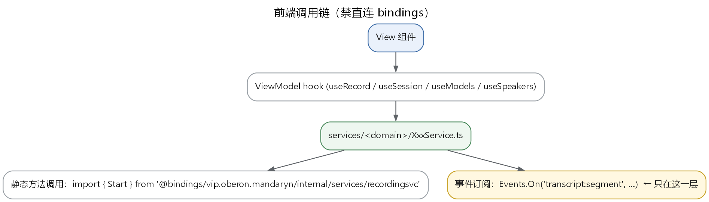

# Mandaryn 接口文档（API）

| 项 | 值 |
|----|----|
| 文档编号 | DOC-03 |
| 文档版本 | **v1.2.0** |
| 产品基线 | Mandaryn v0.1.0 |
| 状态 | 评审通过（Baseline） |
| 最后更新 | 2026-11-10 |
| 上游文档 | [ARCHITECTURE.md](./ARCHITECTURE.md)、[DATA-MODEL.md](./DATA-MODEL.md) |
| 下游文档 | [DEPLOYMENT.md](./DEPLOYMENT.md) |

> 本文是**前后端唯一契约**。方法签名变更必须同时改本文 + 重新生成 bindings（`wails3 generate bindings -ts`）。
> 术语见 DOC-00 §3；状态见 DOC-02 §6；表的字段见 DOC-04 §2。

---

## 1. 接口约定

### 1.1 通信方式

| 方向 | 机制 |
|------|------|
| 前端 → 后端 | Wails v3 Service 方法调用（生成 `frontend/bindings/vip.oberon.mandaryn/...`） |
| 后端 → 前端 | `app.Event.Emit(事件名, payload)`，前端 `Events.On` 订阅 |

### 1.2 类型映射（Wails 生成规则）

| Go | TypeScript | 备注 |
|----|-----------|------|
| `string` / `int` / `bool` | 同名 | |
| `int64`（毫秒时间戳） | `number` | 全部用毫秒；超过 2^53 的时间戳不存在 |
| `time.Time` | `string`（RFC3339Nano） | 生成参数 `-time-type=string`（默认） |
| `[]byte` | `string`（base64） | 仅用于声纹等二进制，禁止用于音频主体 |
| `struct` | `interface` | 字段名首字母大写 → camelCase |
| `error` | `Promise` reject | 统一 reject 为 `ApiError`（§1.4） |

### 1.3 命名规范

- 方法名 PascalCase，动词开头：`Start` / `Get*` / `List*` / `Set*` / `Rename*` / `Migrate*`。
- 返回值一律「数据 + 可选 `*Status`」；**不返回裸 bool**（bool 无法携带失败原因）。
- 所有会阻塞 > 200ms 的方法必须支持 `context` 取消（生成到前端后表现为 Promise，可忽略）。
- 事件名 `domain:event`，常量集中声明在 `internal/events/events.go`。

### 1.4 错误结构

```ts
interface ApiError {
  code: string;      // ERR_*，全表见 §5
  message: string;   // 面向开发者的英文短句
  action?: string;   // 面向用户的下一步动作键（前端映射 i18n + 按钮）
  detail?: string;   // 诊断信息（可脱敏后的原文）
  retryable: boolean;
}
```

### 1.5 通用 DTO

```go
type Source struct {
    ID          string `json:"id"`          // app:kook.exe|<pid> / dev:<deviceId>
    Kind        string `json:"kind"`        // application | device
    DisplayName string `json:"displayName"` // KOOK / 全部应用声音
    ExeName     string `json:"exeName"`
    PIDs        []int  `json:"pids"`
    DeviceID    string `json:"deviceId"`
    Present     bool   `json:"present"`
    Producing   bool   `json:"producing"`
    ChildCount  int    `json:"childCount"`  // 进程级捕获覆盖的子进程数（ARCH §4.1.3）
    IsDefault   bool   `json:"isDefault"`   // 当前系统默认输出设备（仅设备源有意义；文案由前端 i18n 渲染）
    Warn        string `json:"warn"`        // 如 "exclusive-mode"
}

type RecordingState struct {
    State       string `json:"state"`      // ST-01..ST-09 的枚举值，见 DOC-02 §6
    SessionID   string `json:"sessionId"`
    Degraded    bool   `json:"degraded"`   // ST-07 正交标记（模型来源回退）
    DegradeNote string `json:"degradeNote"`
    Throttled   bool   `json:"throttled"`     // NFR-08 正交标记：正在降档
    ThrottleLevel string `json:"throttleLevel"` // L0|L1|L2|L3|P（DOC-02 §4.7.3）
    Suspended   bool   `json:"suspended"`     // NFR-08 正交标记：预算耗尽已暂停推理
    Lagging     bool   `json:"lagging"`       // 转写落后于音频（暂停期或降档期）
    StartedAt   string `json:"startedAt"`  // RFC3339Nano
    ElapsedMs   int64  `json:"elapsedMs"`  // 逻辑时长（帧计数，ARCH §4.5.1）
    SourceID    string `json:"sourceId"`
    ModelSource string `json:"modelSource"` // local | online
    EngineID    string `json:"engineId"`
    LastError   *ApiError `json:"lastError"`
}

// PerfUsage 是 NFR-08 的三个分量读数（UI 实时反馈与诊断共用）
type PerfUsage struct {
    CapPct      int   `json:"capPct"`      // N（用户设定）
    TotalCpuPct int   `json:"totalCpuPct"` // 整机
    SelfCpuPct  int   `json:"selfCpuPct"`  // 本应用（含引擎子进程）
    OtherPct    int   `json:"otherPct"`    // total − self
    HeadroomPct int   `json:"headroomPct"` // N − other
    Level       string `json:"level"`      // L0|L1|L2|L3|P
    Suspended   bool  `json:"suspended"`
    WindowMs    int64 `json:"windowMs"`    // 判据窗口（固定 5000）
    SampledAt   string `json:"sampledAt"`  // RFC3339Nano
}

type Segment struct {
    ID        int64   `json:"id"`
    SessionID string  `json:"sessionId"`
    Seq       int     `json:"seq"`
    StartMs   int64   `json:"startMs"`
    EndMs     int64   `json:"endMs"`
    Text      string  `json:"text"`
    SpeakerID string  `json:"speakerId"`   // 空 = 未识别
    RoleID    string  `json:"roleId"`
    RoleName  string  `json:"roleName"`    // 由 roles join 得到，非冗余存储
    EngineID  string  `json:"engineId"`
    Finalized bool    `json:"finalized"`
    Confidence float32 `json:"confidence"`
}

type Session struct {
    ID           string `json:"id"`
    Title        string `json:"title"`
    SourceID     string `json:"sourceId"`
    SourceName   string `json:"sourceName"`
    ModelSource  string `json:"modelSource"`  // local | online（导出保留，FR-08-3）
    EngineID     string `json:"engineId"`
    Status       string `json:"status"`       // completed | interrupted | failed | degraded
    Degraded     bool   `json:"degraded"`
    StartedAt    string `json:"startedAt"`
    EndedAt      string `json:"endedAt"`
    DurationMs   int64  `json:"durationMs"`
    SegmentCount int    `json:"segmentCount"`
    SpeakerCount int    `json:"speakerCount"`
    AudioPath    string `json:"audioPath"`
    SizeBytes    int64  `json:"sizeBytes"`
}
```

---

## 2. 服务方法

### 2.1 `capturesvc` — 音频源（FR-02）

| ID | 方法 | 签名 | 说明 | 可能错误 |
|----|------|------|------|----------|
| API-1.1 | `ListSources` | `() ([]Source, error)` | 枚举应用源 + 设备源；`Present`/`Producing` 实时 | `ERR_CAPTURE_PERMISSION` |
| API-1.2 | `RefreshSources` | `() ([]Source, error)` | 强制重新枚举（UI「刷新」） | 同上 |
| API-1.3 | `ProbeSource` | `(sourceID string) (Source, error)` | 探测单个源当前是否可用/有声 | `ERR_SOURCE_NOT_FOUND` |
| API-1.4 | `SetPreferredSource` | `(sourceID string) error` | 记住上次选择（FR-02-5） | `ERR_SOURCE_NOT_FOUND` |
| API-1.5 | `GetPreferredSource` | `() (string, error)` | 返回上次源 ID | — |
| API-1.6 | `GetCapabilities` | `() (CaptureCaps, error)` | 平台能力矩阵（是否支持进程级/设备回环 + 最低系统是否满足） | — |

```go
type CaptureCaps struct {
    Platform          string `json:"platform"`          // windows | darwin | linux
    ProcessLoopback   bool   `json:"processLoopback"`   // 是否支持进程级
    DeviceLoopback    bool   `json:"deviceLoopback"`
    Reason            string `json:"reason"`            // 不支持时的人类可读原因（含系统版本要求）
    RequiresPermission bool  `json:"requiresPermission"`// macOS 需授权
}
```

### 2.2 `recordingsvc` — 录制与录音实例（FR-03）

> **职责边界**：本 service 只做采集、状态机与**录音实例封存**，**不跑转写**（默认延后转写）。
> 转写任务见 §2.4 `transcriptsvc`。

| ID | 方法 | 签名 | 说明 | 可能错误 |
|----|------|------|------|----------|
| API-2.1 | `Start` | `(req StartRequest) (RecordingState, error)` | 进入 `ST-02 → ST-03` | `ERR_STATE_FORBIDDEN`、`ERR_CAPTURE_UNAVAILABLE`、`ERR_ENGINE_NOT_READY`、`ERR_ENGINE_LOAD`、`ERR_DISK_FULL` |
| API-2.2 | `Pause` | `() (RecordingState, error)` | `ST-03 → ST-04` | `ERR_STATE_FORBIDDEN` |
| API-2.3 | `Resume` | `() (RecordingState, error)` | `ST-04 → ST-03` | `ERR_STATE_FORBIDDEN`、`ERR_CAPTURE_UNAVAILABLE` |
| API-2.4 | `Stop` | `() (RecordingState, error)` | `→ ST-05 → ST-06/ST-08`；封存录音实例（不转写） | `ERR_STATE_FORBIDDEN`、`ERR_DB_WRITE` |
| API-2.5 | `GetState` | `() (RecordingState, error)` | 幂等查询（窗口重新打开时用） | — |
| API-2.6 | `RecoverSession` | `(sessionID string) (Session, error)` | 把 `interrupted` 会话修补为可回放（UC-07） | `ERR_MODEL_NOT_FOUND`、`ERR_DB_WRITE` |
| API-2.7 | `ExportAudio` | `(sessionID, targetPath string) (string, error)` | 另存录音实例为单个音频文件（`wav`/`flac`）；`targetPath` 空则弹原生「另存为」。**不改库**（`FR-03-11`） | `ERR_NOT_FOUND`、`ERR_DISK_FULL` |

```go
type StartRequest struct {
    SourceID    string `json:"sourceId"`
    ModelSource string `json:"modelSource"` // 空则用 app_settings 当前值
    Title       string `json:"title"`       // 空则自动命名（日期+来源应用）
}
```

> **契约约束**：`Start` 期间若 `modelSource` 与已预热引擎不一致，后端必须自动 `Warm` 目标引擎
> （≤8s，期间 `EV: engine:status=loading`），不得要求前端先调 `SetSource`。

### 2.3 `sessionsvc` — 会话库（FR-04）

| ID | 方法 | 签名 | 说明 | 可能错误 |
|----|------|------|------|----------|
| API-3.1 | `List` | `(q ListQuery) (ListResult, error)` | 分页 + 搜索 + 筛选 | `ERR_INVALID_ARGUMENT` |
| API-3.2 | `Get` | `(sessionID string) (Session, error)` | 详情 | `ERR_NOT_FOUND` |
| API-3.3 | `Rename` | `(sessionID, title string) error` | 改标题 | `ERR_NOT_FOUND` |
| API-3.4 | `Delete` | `(sessionIDs []string, deleteAudio bool) error` | 批量删除（默认连音频） | `ERR_NOT_FOUND` |
| API-3.5 | `Export` | `(req ExportRequest) (string, error)` | 导出 `txt`/`srt`/`csv`/`xlsx`，返回保存路径 | `ERR_INVALID_ARGUMENT`、`ERR_DISK_FULL` |

```go
type ListQuery struct {
    Keyword     string `json:"keyword"`     // 标题 + 片段全文
    SourceIDLike string `json:"sourceIdLike"`
    Status      string `json:"status"`      // 空=全部
    ModelSource string `json:"modelSource"` // local|online|""（FR-08-3 筛选在线会话）
    From, To    string `json:"from"`        // RFC3339，含
    Offset, Limit int  `json:"offset"`
}
type ExportRequest struct {
    SessionIDs []string `json:"sessionIds"`
    Format     string   `json:"format"` // txt | srt | csv | xlsx
    IncludeTimestamps bool `json:"includeTimestamps"`
    IncludeSpeakers   bool `json:"includeSpeakers"`
    TargetPath string   `json:"targetPath"` // 空则弹原生「另存为」
}
```

### 2.4 `transcriptsvc` — 时间轴（FR-04）

| ID | 方法 | 签名 | 说明 | 可能错误 |
|----|------|------|------|----------|
| API-4.1 | `GetTimeline` | `(sessionID string) (Timeline, error)` | 一次性取整段（≤2 万条）；含 marker | `ERR_NOT_FOUND` |
| API-4.2 | `GetTimelinePage` | `(sessionID string, offset, limit int) (TimelinePage, error)` | 超大通话分页 | 同上 |
| API-4.3 | `SearchSegments` | `(q SegmentQuery) ([]Segment, error)` | 片段级检索（带跳转时间） | — |
| API-4.5 | `StartTranscription` | `(sessionID string) (TranscriptionState, error)` | 对已存录音实例发起转写（手动触发）：`none/failed/done → queued → running`。已 `done` 时等价「重转」（旧任务取消后重新入队） | `ERR_NOT_FOUND`、`ERR_ENGINE_NOT_READY`、`ERR_MODEL_NOT_FOUND`、`ERR_PERF_SUSPENDED` |
| API-4.6 | `CancelTranscription` | `(sessionID string) (TranscriptionState, error)` | 取消排队/运行中的任务，已转句子保留，状态回 `none` | `ERR_NOT_FOUND`、`ERR_STATE_FORBIDDEN` |
| API-4.7 | `GetTranscription` | `(sessionID string) (TranscriptionState, error)` | 幂等查询进度（窗口重开、断线重连时用） | `ERR_NOT_FOUND` |
| API-4.8 | `LiveAvailability` | `() (LiveAvailability, error)` | 边录边转当前是否可用（开关状态 + 是否有流式引擎） | — |
| API-4.4 | `UpdateSegmentText` | `(segmentID int64, text string) error` | 人工修正（P1），置 `edited=true` | `ERR_NOT_FOUND` |

```go
type Timeline struct {
    SessionID  string    `json:"sessionId"`
    DurationMs int64     `json:"durationMs"`
    Segments   []Segment `json:"segments"`
    Markers    []Marker  `json:"markers"`  // 降级打点等
}
// API-4.2 的一页。DurationMs 每页都给；Markers 只在 offset==0（首屏页）下发
// —— 标记数量少，每页重复下发没有意义，前端首屏拿到后自行保留。
type TimelinePage struct {
    SessionID  string    `json:"sessionId"`
    Total      int       `json:"total"`       // 整段句数（不是本页条数）
    Offset     int       `json:"offset"`
    Limit      int       `json:"limit"`
    Segments   []Segment `json:"segments"`
    DurationMs int64     `json:"durationMs"`
    Markers    []Marker  `json:"markers"`     // 仅 offset==0
}
// 转写任务状态（独立于 recording:state，见 DOC-02 §6.4）
type TranscriptionState struct {
    SessionID   string `json:"sessionId"`
    Status      string `json:"status"`      // none | queued | running | done | failed
    ProgressMs  int64  `json:"progressMs"`  // 已转写的音频位置（断点续跑）
    AudioMs     int64  `json:"audioMs"`     // 音频总时长
    Segments    int    `json:"segments"`    // 已落库句数
    EngineID    string `json:"engineId"`
    Trigger     string `json:"trigger"`     // manual | idle
    ErrorCode   string `json:"errorCode,omitempty"`
    StartedAt   int64  `json:"startedAt,omitempty"`
    FinishedAt  int64  `json:"finishedAt,omitempty"`
}
type Marker struct {
    AtMs int64  `json:"atMs"`
    Kind string `json:"kind"` // degrade | source-lost | device-switch
    Note string `json:"note"`
}
```

> **对齐契约**：`Segments` 必按 `seq` 升序且 `startMs` 单调不减（后端断言，见 DOC-02 §4.5.2）。
> 前端二分定位直接依赖该不变量。

### 2.5 `enginesvc` — 模型来源与降级（FR-01）

| ID | 方法 | 签名 | 说明 | 可能错误 |
|----|------|------|------|----------|
| API-5.1 | `GetStatus` | `() (EngineStatus, error)` | ready/loading/failed/degraded + 详情 | — |
| API-5.2 | `SetSource` | `(source string) (EngineStatus, error)` | `local`/`online`；**录制中拒绝** | `ERR_STATE_FORBIDDEN`、`ERR_SETTINGS_CONSENT_REQUIRED`、`ERR_ENGINE_LOAD` |
| API-5.3 | `Reload` | `() (EngineStatus, error)` | 强制重载当前引擎（换模型后） | `ERR_ENGINE_LOAD` |
| API-5.4 | `TestOnline` | `(cfg OnlineConfig) (TestResult, error)` | 连通性 + 延迟 + 错误分类 | `ERR_ENGINE_ONLINE_*` |
| API-5.5 | `SetOnlineConfig` | `(cfg OnlineConfig) error` | 保存端点（需已同意隐私确认） | `ERR_SETTINGS_CONSENT_REQUIRED` |
| API-5.6 | `GetOnlineConfig` | `() (OnlineConfig, error)` | 返回密钥时**掩码** | — |
| API-5.7 | `SetFallbackPolicy` | `(p FallbackPolicy) error` | `fallbackToLocal` 等 | `ERR_INVALID_ARGUMENT` |

```go
type EngineStatus struct {
    Source      string `json:"source"`    // local | online
    State       string `json:"state"`     // loading|ready|failed|degraded|paused
    EngineID    string `json:"engineId"`  // bundleId@version / online:<model>
    LoadMs      int64  `json:"loadMs"`
    Degraded    bool   `json:"degraded"`
    DegradeNote string `json:"degradeNote"`
    LastError   *ApiError `json:"lastError"`
}
type OnlineConfig struct {
    Endpoint string `json:"endpoint"` // https://... （必须 https）
    Model    string `json:"model"`
    Language string `json:"language"` // auto | zh | en | ...
    APIKey   string `json:"apiKey"`   // 读取时掩码为 "sk-***last4"
    TimeoutMs int64 `json:"timeoutMs"`
}
type FallbackPolicy struct {
    FallbackToLocal bool `json:"fallbackToLocal"` // 默认 true
    AutoSwitchBack  bool `json:"autoSwitchBack"`  // 默认 false（ARCH §4.2.4）
    MaxRetries      int  `json:"maxRetries"`      // 默认 2
}
```

### 2.6 `modelssvc` — 模型仓库与迁移（FR-05 / FR-07）

| ID | 方法 | 签名 | 说明 | 可能错误 |
|----|------|------|------|----------|
| API-6.1 | `ListAvailable` | `() ([]BundleInfo, error)` | 清单（远程缓存 + 内置兜底） | `ERR_DOWNLOAD_NETWORK`（仅远程刷新失败时返回缓存） |
| API-6.2 | `ListInstalled` | `() ([]InstalledBundle, error)` | 已装（含校验状态、占用） | — |
| API-6.3 | `Download` | `(bundleID string) (DownloadState, error)` | 开始/继续下载 | `ERR_MODEL_BUSY`、`ERR_DOWNLOAD_DISK_FULL`、`ERR_DOWNLOAD_PROXY` |
| API-6.4 | `PauseDownload` | `(bundleID string) error` | 暂停（保留分片） | `ERR_NOT_FOUND` |
| API-6.5 | `CancelDownload` | `(bundleID string, removeParts bool) error` | 取消 | `ERR_NOT_FOUND` |
| API-6.6 | `Verify` | `(bundleID string) (VerifyResult, error)` | 重新哈希校验 | `ERR_MODEL_NOT_FOUND` |
| API-6.7 | `Remove` | `(bundleID string) error` | 删除已装包 | `ERR_MODEL_BUSY` |
| API-6.8 | `GetStoreStats` | `() (StoreStats, error)` | 目录 + 占用 | — |
| API-6.9 | `SetModelRoot` | `(path string) (MigratePlan, error)` | 预检并给出迁移计划（**不执行**） | `ERR_MIGRATE_PRECHECK` |
| API-6.10 | `MigrateModelRoot` | `(req MigrateRequest) (MigrateState, error)` | 执行迁移（校验→复制→切换→清理） | `ERR_MODEL_BUSY`、`ERR_MIGRATE_*` |
| API-6.11 | `CancelMigration` | `() error` | 取消并回滚 | — |
| API-6.12 | `GetMigrationState` | `() (MigrateState, error)` | 轮询兜底（事件丢失时） | — |
| API-6.13 | `ImportOffline` | `(archivePath string) (InstalledBundle, error)` | 导入离线包（UC-08 内网部署） | `ERR_MODEL_CORRUPT` |

```go
type BundleInfo struct {
    BundleID string   `json:"bundleId"`
    Name     string   `json:"name"`
    Version  string   `json:"version"`
    SizeBytes int64   `json:"sizeBytes"`
    RAMHintMB int     `json:"ramHintMb"`
    Languages []string `json:"languages"`
    License  string   `json:"license"`
    Roles    []string `json:"roles"`   // streaming | offline | vad | speaker
    SHA256   string   `json:"sha256"`
}
type DownloadState struct {
    BundleID  string `json:"bundleId"`
    State     string `json:"state"` // queued|downloading|verifying|paused|done|failed
    BytesDone int64  `json:"bytesDone"`
    BytesTotal int64 `json:"bytesTotal"`
    SpeedBps  int64  `json:"speedBps"`
    EtaMs     int64  `json:"etaMs"`
    Retries   int    `json:"retries"`
    Mirror    string `json:"mirror"`
    LastError *ApiError `json:"lastError"`
}
type MigratePlan struct {
    From        string `json:"from"`
    To          string `json:"to"`
    TotalBytes  int64  `json:"totalBytes"`
    FreeBytes   int64  `json:"freeBytes"`
    BundleCount int    `json:"bundleCount"`
    Warnings    []string `json:"warnings"` // 如 "network-path"
    Feasible    bool   `json:"feasible"`
}
type MigrateState struct {
    Phase     string `json:"phase"` // idle|preflight|copying|verifying|switching|cleaning|done|rollback|failed
    BytesDone int64  `json:"bytesDone"`
    BytesTotal int64 `json:"bytesTotal"`
    Current   string `json:"current"` // 当前文件
    LastError *ApiError `json:"lastError"`
}
```

### 2.7 `speakersvc` — 说话人与角色（FR-06）

| ID | 方法 | 签名 | 说明 | 可能错误 |
|----|------|------|------|----------|
| API-7.1 | `ListRoles` | `() ([]Role, error)` | 全局角色列表（含颜色、命中会话数） | — |
| API-7.2 | `RenameRole` | `(roleID, name string) error` | **改名即全局生效**（单行 UPDATE） | `ERR_INVALID_ARGUMENT` |
| API-7.3 | `ListSessionSpeakers` | `(sessionID string) ([]SessionSpeaker, error)` | 会话内说话人 → 角色映射 | `ERR_NOT_FOUND` |
| API-7.4 | `MergeSpeakers` | `(fromSpeakerID, toSpeakerID string) error` | 合并（FR-06-5） | — |
| API-7.5 | `SplitSpeaker` | `(sessionID, speakerID string, segmentIDs []int64) (Role, error)` | 从误并中拆出 | — |
| API-7.6 | `SetMaxSpeakers` | `(n int) error` | 0=自动，2–8 | `ERR_INVALID_ARGUMENT` |
| API-7.7 | `SetRoleColor` | `(roleID, colorToken string) error` | 稳定配色 | — |

```go
type Role struct {
    ID          string `json:"id"`
    Name        string `json:"name"`       // 默认 "说话人 N"
    ColorToken  string `json:"colorToken"` // 主题令牌，不硬编码十六进制
    SpeakerIDs  []string `json:"speakerIds"` // 该角色覆盖的声纹身份
    SessionCount int   `json:"sessionCount"`
}
```

> **同步语义**：`RenameRole` 成功后必须 emit `EV-07 roles:changed`，
> 所有已打开会话页据此重取 `RoleName`（ARCH §4.4）。禁止前端本地改名后自行广播。

### 2.8 `hotkeysvc` — 快捷键（FR-09）

| ID | 方法 | 签名 | 说明 | 可能错误 |
|----|------|------|------|----------|
| API-8.1 | `List` | `() ([]Binding, error)` | 全部动作 + 当前绑定 + 是否默认 | — |
| API-8.2 | `Set` | `(action, accelerator string) (ConflictReport, error)` | 设置并**预注册探测**冲突 | `ERR_HOTKEY_CONFLICT`、`ERR_HOTKEY_REGISTER` |
| API-8.3 | `Reset` | `(action string) error` | 恢复默认 | `ERR_NOT_FOUND` |
| API-8.4 | `Disable` | `(action string) error` | 禁用单个动作 | — |
| API-8.5 | `DetectConflicts` | `(accelerator string) (ConflictReport, error)` | 单独探测 | — |
| API-8.6 | `ResetAll` | `() error` | 全部恢复默认 | — |
| API-8.7 | `Available` | `() (bool, error)` | 当前平台能否注册系统级热键（false 时 UI 应禁用相关控件） | — |
| API-8.8 | `ListActions` | `() ([]ActionInfo, error)` | 动作元数据（ID / 分组 / 作用域 / 默认键 / 是否已接线），供设置页分组渲染 | — |
| API-8.9 | `Trigger` | `(action string) error` | 统一动作入口（托盘菜单 / 前端按钮 / 热键三处共用，避免动作逻辑重复） | `ERR_NOT_FOUND`、`ERR_STATE_FORBIDDEN` |
| API-8.10 | `GetLeanState` | `() (LeanState, error)` | 精简模式开关 + 后端取舍清单（保留区 / 隐去区 / 隐去控件） | — |
| API-8.11 | `SetLeanMode` | `(enabled bool) (LeanState, error)` | 切换精简模式并持久化，返回新状态 | `ERR_DB_WRITE` |

**动作实现分工（重要）**：`record.toggle` / `record.pause` / `window.show` 在后端有权威实现；
其余界面型动作（`playback.*` / `nav.*` / `search.focus` / `role.rename` / `session.delete` /
`model.switchSource` / `ux.leanMode`）由后端经 **EV-17 `hotkey:trigger`** 广播，前端各接自己那部分
—— 不在后端硬造第二套导航/播放器状态。

```go
type Binding struct {
    Action      string `json:"action"`      // record.toggle / record.pause / window.show / playback.play ...
    Accelerator string `json:"accelerator"` // "Ctrl+Alt+R" / "⌘⌥R"
    Scope       string `json:"scope"`       // global | app
    Default     string `json:"default"`
    Enabled     bool   `json:"enabled"`
    RegisterErr string `json:"registerErr"` // 注册失败原因（被系统/他程序占用）
}
type ConflictReport struct {
    Conflicts []struct{ Action, Accelerator, Reason string } `json:"conflicts"`
    Preview   string `json:"preview"` // 规范化后的显示形式
    Ok        bool   `json:"ok"`
}
```

### 2.9 `appsettings` — 应用设置（扩展，FR-08/09）

在既有 `appsettings` Service 上新增字段与方法（原有 `ThemeChoice` / `CustomTheme` / `LocaleChoice` 保留）：

| ID | 方法 | 签名 | 说明 |
|----|------|------|------|
| API-9.1 | `Get` | `() (Settings, error)` | 全量设置（密钥掩码） |
| API-9.2 | `SetModelSource` | `(source string) error` | 与 `enginesvc.SetSource` 等价，供设置页调用 |
| API-9.3 | `SetProxy` | `(p ProxyConfig) error` | 代理（§2.9.1） |
| API-9.4 | `TestProxy` | `(p ProxyConfig) (TestResult, error)` | 测试代理连通 |
| API-9.5 | `SetConsentOnline` | `(endpoint string) error` | 记录 `onlineConsentAt`（FR-08-2） |
| API-9.6 | `SetAudio` | `(a AudioSettings) error` | 音频格式/灵敏度等精简项 |
| API-9.7 | `SetPrivacy` | `(p PrivacySettings) error` | 音频不落盘、日志级别（写 `log_level` 后同步调试模式运行时） |
| API-9.8 | `GetOutboundLog` | `() ([]OutboundEntry, error)` | 最近 24h 出站记录（域名 + 是否含音频） |
| API-9.16 | `SetDebugMode` | `(enabled bool) (DebugModeState, error)` | 切换调试模式（§2.10.1）：写 `log_level`（开 = `debug`，关 = `info`），**立即生效、无需重启**；被 `MANDARYN_LOG_LEVEL` 接管时仍保存用户层，返回值以环境变量为准；广播 `EV-14 appsettings:changed`（`"debugMode"`）。可能错误：`ERR_DB_WRITE`、`ERR_PATH_UNWRITABLE`（调试日志文件打不开，开关回落为关） |

```go
type ProxyConfig struct {
    Type     string `json:"type"`     // none | http | https | socks5
    Host     string `json:"host"`
    Port     int    `json:"port"`
    Username string `json:"username"`
    Password string `json:"password"` // 读取掩码；写入加密
    UseForDownload bool `json:"useForDownload"` // 默认 true
    UseForOnline   bool `json:"useForOnline"`   // 默认 true
    NoProxy        string `json:"noProxy"`
}
type AudioSettings struct {
    SaveFormat   string `json:"saveFormat"`   // wav | flac
    Sensitivity  string `json:"sensitivity"`  // standard | noisy（替代旧 VAD 阈值滑块，DOC-05 §4）
    MaxSpeakers  int    `json:"maxSpeakers"`  // 0=auto
    DefaultSourceID string `json:"defaultSourceId"`
    AutoName     bool   `json:"autoName"`
}
type PrivacySettings struct {
    NoAudioPersist bool   `json:"noAudioPersist"` // 在线模式内存直传（P1）
    LogLevel       string `json:"logLevel"`       // info | debug | off；debug = 调试模式开（off 视同关，不关闭 app.log）
}
```

#### 2.9.1 代理的契约约束

- `Type=none` 时其余字段必须为空，后端忽略；
- `https` 表示「以 TLS 连接代理」（CONNECT over TLS），与「目标是否 https」无关；
- 凭据仅用于 `Proxy-Authorization`，**禁止**写入 URL query 或日志；
- `UseForDownload` / `UseForOnline` 分别控制两条出站链路（ARCH §4.6.2）。

#### 2.9.2 性能预算（NFR-08）

| ID | 方法 | 签名 | 说明 | 可能错误 |
|----|------|------|------|----------|
| API-9.9 | `SetResourceCap` | `(capPct int) (PerfUsage, error)` | 设置整机性能预算 `N`；校验 10–100 且为 5 的倍数；**即时生效**（调度器订阅内部变更，不等下次会话） | `ERR_PERF_CAP_RANGE` |
| API-9.10 | `GetPerfUsage` | `() (PerfUsage, error)` | 读取三分量 + 档位 + 是否暂停（界面读数与事件丢失时的兜底） | — |

**契约要点**

- `capPct` 语义是**整机预算**，不是「本应用上限」；接口注释与 i18n 文案必须写清（DOC-01 `NFR-08` 注 2）。
- 校验不通过返回 `ERR_PERF_CAP_RANGE`（不是通用 `ERR_INVALID_ARGUMENT`），便于 UI 直接给出「10–100，步进 5」提示。
- 配置写入后沿用既有广播：`EV-14 appsettings:changed`，payload 为字段名 `"resourceCapPct"`；
  后端调度器**不等前端**，自己订阅变更并立即重新计算档位（前端重取设置仅用于刷新 UI）。
- 暂停期间前端**不需要**轮询：`EV-15` 每秒推送状态，档位与暂停变化还会额外触发一次 `EV-01 recording:state`。

#### 2.9.3 路径解析与来源（FR-07-7/8，ADR-02）

| ID | 方法 | 签名 | 说明 | 可能错误 |
|----|------|------|------|----------|
| API-9.11 | `GetResolvedPaths` | `() ([]ResolvedPath, error)` | 返回 `dataRoot` / `modelRoot` 的生效值、来源层、用户值、接管变量名、失效回退状态 | — |
| API-9.12 | `SetModelRoot` | `(path string) (ResolvedPath, error)` | 设置模型目录；若当前受 `env`/`cli` 接管则写入暂存 `pending` 并原样返回（`source` 不变、`pendingValue` 非空） | `ERR_PATH_UNWRITABLE`、`ERR_INVALID_ARGUMENT` |
| API-9.13 | `ClearModelRoot` | `() (ResolvedPath, error)` | 清除用户值与暂存值，回落到 `default`（受管时同样只清暂存） | — |
| API-9.14 | `RevealPath` | `(key string) error` | 在系统文件管理器中打开该路径（不存在则先创建）；`key` 为 `dataRoot`/`modelRoot`/`logs`（`logs` = `<dataRoot>/logs`，跟随 dataRoot，不是独立根目录） | `ERR_INVALID_ARGUMENT` |
| API-9.15 | `RestartForPaths` | `() error` | 请求重启以应用 `dataRoot` 变更（`dataRoot` 只允许重启生效，DOC-02 §4.8） | — |

**`ResolvedPath` DTO**

| 字段 | 类型 | 说明 |
|------|------|------|
| `key` | `string` | `dataRoot` \| `modelRoot` |
| `effective` | `string` | 当前生效绝对路径 |
| `source` | `string` | `default` \| `user` \| `env` \| `cli` |
| `userValue` | `string` | 用户设置里保存的值（可能因被接管而未生效，空表示未设） |
| `pendingValue` | `string` | 受管期间暂存的值，解除接管并重启后自动应用 |
| `envName` | `string` | 接管它的变量名（`source` 为 `env`/`cli` 时非空） |
| `overrideHint` | `string` | 可复制的解除提示（如 `MANDARYN_MODEL_ROOT=`），由后端按平台生成 |
| `writable` | `bool` | 生效路径当前是否可写 |
| `fallbackFrom` | `string` | 若非空，表示该层因不可用而降级，值为被跳过的原路径 |

**契约要点**

- `source` 是**唯一判定依据**：前端不得自行推断优先级，只按 `source` 决定 UI 状态（DOC-05 §5.10）。
- 受管时 `SetModelRoot` **不报错**：写入 `pendingValue` 并返回 `source=env|cli`，让 UI 能同时展示两层（PRD `FR-07-7`）。
- `ERR_PATH_UNWRITABLE` 只在**用户层自身**不可写（未被接管、目标路径校验失败）时返回；被接管时不触碰用户值校验。
- `dataRoot` 变更只登记意图，实际切换在下次启动完成，因此 `SetModelRoot` 之外不提供 `SetDataRoot`（数据根仅由 CLI/ENV/`storage.json` 决定，见 DOC-06 §4.1）。
- `RevealPath` 走平台原生调用，禁止前端使用 `file://` 或浏览器能力。

---

### 2.10 `privacysvc` — 隐私边界（FR-08）

| ID | 方法 | 签名 | 说明 | 可能错误 |
|----|------|------|------|----------|
| API-10.1 | `GetStatus` | `() (PrivacyStatus, error)` | 离线是否生效 + **来源**（`env` / `user` / `env+user`）+ 变量名 + 最近 24h 出站汇总 | — |
| API-10.2 | `SetOffline` | `(enabled bool) (PrivacyStatus, error)` | 切用户层离线开关；env 层仍生效时返回的 `offline` 仍为 true | `ERR_DB_WRITE` |
| API-10.3 | `ListOutbound` | `(limit, offset int) (OutboundPage, error)` | 分页读取出站留痕（新的在前） | `ERR_DB_READ` |
| API-10.4 | `ClearOutbound` | `() (ClearResult, error)` | 清空留痕（用户主动） | `ERR_DB_WRITE` |
| API-10.5 | `RunAudit` | `(filter AuditFilter) (AuditReport, error)` | 零出站自检：给出可判定结论 + 违例明细 | `ERR_INVALID_ARGUMENT` |
| API-10.6 | `ExportDiagnostics` | `() (DiagnosticsArtifact, error)` | 生成脱敏诊断包，字节回给前端 | `ERR_STATE_FORBIDDEN`（脱敏自检不过则**扣留**产物） |
| API-10.7 | `WriteDiagnostics` | `(targetPath string) (string, error)` | 生成同一份脱敏诊断包并**原子落盘**到用户选定的路径，返回实际路径 | `ERR_INVALID_ARGUMENT`、`ERR_DB_WRITE`、`ERR_STATE_FORBIDDEN` |
| API-10.8 | `GetDebugLogStatus` | `() (DebugLogStatus, error)` | 调试模式生效状态（含来源 `env`/`user`）+ 日志目录、文件、占用、保留策略 | `ERR_PATH_UNWRITABLE` |
| API-10.9 | `ReadDebugLog` | `(q DebugLogQuery) (DebugLogPage, error)` | 查看器读取：新的在前，按 `minLevel` / `origin` / `component` 过滤，`limit` 默认 200、上限 500，最多读 2 MB 尾部；**调试模式关闭时同样可读** | `ERR_INVALID_ARGUMENT` |
| API-10.10 | `ClearDebugLog` | `() (DebugLogStatus, error)` | 删除全部调试日志文件（不碰 `app.log`）；开启状态下删完继续写新文件 | `ERR_PATH_UNWRITABLE` |
| API-10.11 | `ReportFrontendLog` | `(e FrontendLogEntry) error` | 前端 error / warn / 未捕获异常上报；调试模式关闭时直接忽略；后端每秒限 20 条；只写调试日志 | — |

**契约要点**

- **离线闸门在发请求之前**：离线时任何出站直接返回 `ERR_OFFLINE_ENFORCED`（`action=disable-offline`），
  不允许「先发出去再报错」。环境变量 `MANDARYN_OFFLINE=1` 与用户开关**取或**，来源如实上报。
- **留痕先登记再执行**：出站先写入 `pending` 行，执行完补结果；请求失败或 panic 同样留痕，
  因此「有记录且无失败」才可作零出站自证。
- **脱敏是硬门槛**：URL 的 userinfo、敏感 query 值、疑似密钥路径段一律替换；诊断包产物内部还有一层
  自检（`Residuals`），自检不过就**不产出**，宁可没有诊断包也不泄漏。
- **不含**：音频、转写正文、声纹向量、凭据、请求头 `Authorization` 的值。
- 诊断包附带 `app.log` 与调试日志的尾部（各至多 512 KB），进包前统一脱敏（字段 `logs` / `debugLogs`）。

#### 2.10.1 调试模式与调试日志

- **存储**：`<dataRoot>/logs/debug.log`，滚动文件 `debug.log.1` … `debug.log.4`；JSON Lines，固定字段
  `time`（RFC3339 毫秒）/ `level` / `source`（仅后端，仓库相对 `file:line`）/ `msg` / `component` / `origin`（`backend`|`frontend`），
  其余为上下文字段；与固定字段同名的上下文字段改名为 `ctx_<key>`。
- **保留**：单文件 10 MB 滚动、最多 5 个文件（约 50 MB）；启动与每次滚动时删除修改时间超过 7 天的文件；`ClearDebugLog` 手动清空。
- **开关**：用户层 `app_settings.log_level`（API-9.16），环境变量 `MANDARYN_LOG_LEVEL=debug|info|off` 覆盖（非法值忽略）；
  开启时所有级别（DEBUG 起）额外写入调试日志，`app.log` 维持 Info 不变；关闭即停写并释放文件句柄。
- **脱敏**（`privacy.SanitizeDebugAttr`，写入前执行；未注入则拒绝开启）：敏感键整值 `***`；普通字符串含 ≥4 个中文 / 换行 / 二进制整段替换、密钥模式与用户目录名替换、超 160 字符截断；`err`/`error` 只做密钥与路径脱敏（截断 300）；数值数组 ≥8 视为向量替换；`msg` 只做密钥与路径脱敏。

```go
type DebugModeState struct {
    Enabled     bool   `json:"enabled"`     // 生效值（调试日志是否在写）
    UserEnabled bool   `json:"userEnabled"` // 用户层（log_level == debug）
    Source      string `json:"source"`      // env | user
    EnvVar      string `json:"envVar"`      // 接管时为 MANDARYN_LOG_LEVEL
}
type DebugLogStatus struct {
    Mode          DebugModeState `json:"mode"`
    Dir           string         `json:"dir"`    // <dataRoot>/logs
    Format        string         `json:"format"` // jsonl
    Files         []DebugLogFile `json:"files"`  // {name, sizeBytes, modifiedAt}
    TotalBytes    int64          `json:"totalBytes"`
    MaxFileBytes  int64          `json:"maxFileBytes"`  // 10 MB
    MaxFiles      int            `json:"maxFiles"`      // 5
    RetentionDays int            `json:"retentionDays"` // 7
}
type DebugLogQuery struct { Limit int; MinLevel, Origin, Component string }
type DebugLogEntry struct { Time, Level, Origin, Component, Source, Msg string; Fields string /* JSON 文本 */ }
type DebugLogPage struct { Entries []DebugLogEntry; Components []string; Scanned, Malformed int; Truncated bool }
type FrontendLogEntry struct { Level, Message, Stack, Route, Window, Kind string } // kind: error | rejection | console
```

---

## 3. 事件（后端 → 前端）

| ID | 事件名 | Payload | 频率 | 触发 |
|----|--------|---------|------|------|
| EV-01 | `recording:state` | `RecordingState` | 状态变化时 | 状态机每次转换（DOC-02 §6.2） |
| EV-02 | `recording:level` | `{sessionId, rms, peak, silentMs}` | 10Hz（节流） | 采集期间 |
| EV-03 | `recording:tick` | `{sessionId, elapsedMs, bytesWritten, charCount}` | 1Hz | 采集期间（UI 计时；`charCount` 仅在边录边转时有意义） |
| EV-04 | `transcript:partial` | `Segment`（`finalized=false`） | ≤10Hz | 流式引擎出字（**仅边录边转开启时**，`FR-03-10`） |
| EV-05 | `transcript:segment` | `Segment`（`finalized=true`） | 每句 1 次 | 逐句定稿（延后转写与边录边转两条路径都会发） |
| EV-16 | `transcription:state` | `TranscriptionState` | 状态变化 + 1Hz | 转写任务入队/开跑/完成/失败/被抢占（ARCH §6.4） |
| EV-06 | `transcript:speaker` | `{sessionId, segmentId, speakerId, roleId, roleName}` | 定稿后 | 声纹归并完成 |
| EV-07 | `roles:changed` | `{roleId, name, colorToken}` | 变更时 | 改名/合并/拆分（FR-06-3） |
| EV-08 | `engine:status` | `EngineStatus` | 变化时 | 预热/降级/恢复/失败（FR-01-4） |
| EV-09 | `models:download` | `DownloadState` | 4Hz（节流） | 下载/校验 |
| EV-10 | `models:changed` | `{bundleId, installed, verified}` | 安装/删除/校验完成 | 仓库变化 |
| EV-11 | `models:migrate` | `MigrateState` | 阶段变化 + 4Hz | 迁移（FR-07-3） |
| EV-12 | `capture:sources` | `{sources: []Source}` | 变化时 | 应用启动/退出、设备变化（FR-02-4） |
| EV-13 | `capture:invalid` | `{sourceId, reason, recovering}` | 异常时 | 源失效/重连中（UC-03） |
| EV-14 | `appsettings:changed` | `string`（字段名） | 变更时 | **既有事件**，新增字段同样走它（含 `resourceCapPct`） |
| EV-15 | `perf:usage` | `PerfUsage` | 1Hz | 性能预算采样（NFR-08）；档位或暂停状态变化时额外触发一次 `EV-01` |
| EV-17 | `hotkey:trigger` | `HotkeyTrigger` | 触发时 | 热键命中了「实现位于前端」的动作（`playback.*` / `nav.*` / `search.focus` / `role.rename` / `session.delete` / `model.switchSource` / `ux.leanMode`）；前端据此执行界面动作，`record.toggle` / `record.pause` / `window.show` 在后端直接执行、不发此事件 |
| EV-18 | `hotkeys:changed` | `Binding` | 绑定变化时 | 单个动作的绑定被设置 / 重置 / 禁用（含注册失败原因），供设置页与其它窗口同步 |

**payload 示例**

```json
// EV-05 transcript:segment
{
  "id": 9183, "sessionId": "s_2f9c", "seq": 42,
  "startMs": 183450, "endMs": 187900,
  "text": "那我们把这一版先冻结，下周再看数据。",
  "speakerId": "sp_7d1", "roleId": "rl_2", "roleName": "张三",
  "engineId": "sensevoice-small@1.2.0",
  "finalized": true, "confidence": 0.94
}
```

```json
// EV-08 engine:status（降级）
{
  "source": "online", "state": "degraded", "engineId": "sensevoice-small@1.2.0",
  "loadMs": 2140, "degraded": true,
  "degradeNote": "online endpoint unreachable after 2 retries; fell back to local",
  "lastError": { "code": "ERR_ENGINE_ONLINE_NETWORK", "message": "dial tcp: timeout",
                 "action": "switch-online", "retryable": true }
}
```

---

## 4. 前端调用边界（强制）



*DOT 源码：[diagrams/COM-02-frontend-chain.dot](./diagrams/COM-02-frontend-chain.dot)*

| 约束 | 校验方式 |
|------|----------|
| View 不得 import `@bindings/*` | code review + ESLint 规则（`no-restricted-imports`） |
| ViewModel 不得直接 import `@bindings/*` | 同上 |
| 事件订阅只能在 `services/` | 同上 |
| 前端不得用 `localStorage` / `sessionStorage` | code review（脚手架铁律） |

---

## 5. 错误码全表

| 码 | 类别 | 可重试 | 含义 | 用户可执行动作（`action`） |
|----|------|--------|------|---------------------------|
| `ERR_INVALID_ARGUMENT` | 参数 | ❌ | 入参非法 | 修正输入 |
| `ERR_NOT_FOUND` | 参数 | ❌ | 资源不存在（会话/角色/包） | 刷新列表 |
| `ERR_STATE_FORBIDDEN` | 状态 | ❌ | 当前状态不允许该操作（如录制中切模型） | 停止录制后重试 |
| `ERR_CAPTURE_UNAVAILABLE` | 捕获 | ✅ | 源不可用（应用未运行/设备缺失） | 刷新源、改用设备源 |
| `ERR_CAPTURE_PERMISSION` | 捕获 | ❌ | 缺少系统音频权限 | 打开系统设置授权 |
| `ERR_CAPTURE_DEVICE_LOST` | 捕获 | ✅ | 设备拔出/切换 | 插入设备或重选 |
| `ERR_SOURCE_NOT_FOUND` | 捕获 | ❌ | 源 ID 失效 | 刷新源 |
| `ERR_ENGINE_NOT_READY` | 引擎 | ✅ | 引擎未预热完成 | 等待加载 / 重载 |
| `ERR_ENGINE_LOAD` | 引擎 | ✅ | 模型加载失败 | 换小档模型 / 重新下载 |
| `ERR_ENGINE_ONLINE_NETWORK` | 在线 | ✅ | DNS/TCP 不可达 | 检查网络/代理、切本地 |
| `ERR_ENGINE_ONLINE_TIMEOUT` | 在线 | ✅ | 首字节超时 | 重试 / 切本地 |
| `ERR_ENGINE_ONLINE_AUTH` | 在线 | ❌ | 401/403 密钥无效 | 更新密钥 |
| `ERR_ENGINE_ONLINE_RATE_LIMIT` | 在线 | ✅ | 429 限流 | 等待后重试 / 切本地 |
| `ERR_ENGINE_ONLINE_REJECTED` | 在线 | ❌ | 端点拒绝该格式/语种 | 调整语种或换端点 |
| `ERR_ENGINE_ONLINE_SERVER` | 在线 | ✅ | 端点 5xx（对方服务端出错） | 重试 / 切本地（无需查本机网络） |
| `ERR_MODEL_NOT_FOUND` | 模型 | ❌ | 包未安装 | 去下载 |
| `ERR_MODEL_CORRUPT` | 模型 | ✅ | 哈希校验失败 | 重新下载 |
| `ERR_MODEL_BUSY` | 模型 | ✅ | 迁移/下载互斥占用 | 等待完成后重试 |
| `ERR_DOWNLOAD_NETWORK` | 下载 | ✅ | 网络错误 | 重试 / 配代理 |
| `ERR_DOWNLOAD_CHECKSUM` | 下载 | ✅ | 校验不一致（已自动重下一次） | 手动重试 / 换镜像 |
| `ERR_DOWNLOAD_DISK_FULL` | 下载 | ❌ | 磁盘不足 | 清理空间 / 换目录 |
| `ERR_DOWNLOAD_PROXY` | 下载 | ✅ | 代理不可用/认证失败 | 检查代理配置 |
| `ERR_MIGRATE_PRECHECK` | 迁移 | ❌ | 目标不可写/空间不足/被占用 | 换目标目录 |
| `ERR_MIGRATE_VERIFY` | 迁移 | ✅ | 复制后哈希不一致 | 重试（已回滚） |
| `ERR_MIGRATE_SWITCH` | 迁移 | ✅ | 切换配置/rename 失败 | 重试（已回滚） |
| `ERR_SETTINGS_CONSENT_REQUIRED` | 隐私 | ❌ | 未确认在线风险 | 完成隐私确认 |
| `ERR_HOTKEY_CONFLICT` | 快捷键 | ❌ | 组合冲突 | 换组合 |
| `ERR_HOTKEY_REGISTER` | 快捷键 | ✅ | 系统注册失败（被占用） | 换组合 / 改为应用内 |
| `ERR_DISK_FULL` | 存储 | ❌ | 录制/写库时磁盘满 | 清理空间 |
| `ERR_DB_WRITE` | 存储 | ✅ | 数据库写入失败 | 重试 / 查看诊断 |
| `ERR_LOCAL_UNAVAILABLE` | 构建 | ❌ | `nollm` 产物不含本地引擎，却请求了本地模式（与 CGO 无关，见 ADR-01） | 使用在线模式 / 换标准包 |
| `ERR_PERF_CAP_RANGE` | 性能 | ❌ | 预算值越界或非 5 的倍数（`NFR-08`） | 调整为 10–100、步进 5 |
| `ERR_PERF_SUSPENDED` | 性能 | ✅ | 其他应用占用 ≥ `N`，推理已暂停 | 稍后重试 / 提高上限 / 关闭其他应用 |
| `ERR_PATH_UNWRITABLE` | 路径 | ❌ | 用户层路径不可写或无法创建（`FR-07-7`）；**被 env/cli 接管时不返回此错**，改为写入暂存值 | 换一个目录 / 查看解除接管提示 |
| `ERR_OFFLINE_ENFORCED` | 隐私 | ❌ | 离线模式生效（`MANDARYN_OFFLINE=1` 或用户开关）时仍尝试出站；在**发请求前**拒绝（`FR-08`） | 关闭离线开关 / 完成后再试 |

---

## 6. 内部接口（L2，供实现与单测参考）

> 非前后端契约，但必须稳定，因为 DOC-02 的状态机与迁移逻辑依赖它们。

```go
// internal/asr —— 引擎统一接口（ARCH §4.2.1）
type Engine interface {
    ID() string
    Warm(ctx context.Context) error
    Feed(frame []float32) (<-chan Partial, error)
    Finalize(seg AudioSegment) (FinalResult, error)
    Health(ctx context.Context) HealthStatus
    Close() error
}

// internal/capture —— 捕获抽象（ARCH §4.1.1）
type Channel interface {
    ReadPCM(dst []float32) (int, error)
    Format() AudioFormat
    Err() <-chan error
    Close() error
}

// internal/models —— 迁移阶段（ARCH §4.6.3）
type MigratePhase string // idle|preflight|copying|verifying|switching|cleaning|done|rollback|failed
```

---

## 7. 版本与兼容

| 规则 | 说明 |
|------|------|
| 契约版本 | 与 DOC-03 文档版本一致（当前 v1.2.0） |
| 破坏性变更 | 方法签名/事件 payload 删字段 → 升次版本号，并在本表登记 |
| 兼容性变更 | 新增可选字段 → 修订号；前端必须容忍未知字段 |
| bindings | 变更后执行 `wails3 generate bindings -ts -clean=true`（DOC-06 §2.3），否则前端类型漂移 |
| 事件 payload | 一律结构体（禁止裸 string，`appsettings:changed` 为历史例外，不扩散） |

---

## 8. 变更记录

| 日期 | 版本 | 变更 | 作者 |
|------|------|------|------|
| 2026-11-10 | v1.0.0 | 首版：9 个服务域 63 个方法、14 个事件、30 个错误码、通用 DTO、L2 内部接口、兼容规则 | Kether |
| 2026-11-10 | v1.1.0 | 新增性能预算接口 `API-9.9 SetResourceCap` / `API-9.10 GetPerfUsage` 与 `PerfUsage` DTO；`RecordingState` 增加 `throttled`/`throttleLevel`/`suspended`/`lagging`；新增 `EV-15 perf:usage`（1Hz）；新增 `ERR_PERF_CAP_RANGE`、`ERR_PERF_SUSPENDED`。现为 65 个方法、15 个事件、32 个错误码 | Kether |
| 2026-11-10 | v1.2.0 | 新增 §2.9.3 路径解析与来源：`API-9.11 GetResolvedPaths` / `API-9.12 SetModelRoot` / `API-9.13 ClearModelRoot` / `API-9.14 RevealPath` / `API-9.15 RestartForPaths` 与 `ResolvedPath` DTO（含 `source` / `pendingValue` / `fallbackFrom`）；新增 `ERR_PATH_UNWRITABLE`；`ERR_NO_CGO_BUILD` 更名为 `ERR_LOCAL_UNAVAILABLE`（ADR-01 之后「无 CGO」是误导性表述，`nollm` 不是 CGO 兜底）。现为 **70 个方法、15 个事件、33 个错误码** | Kether |
| 2026-11-11 | v1.3.0 | **录制与转写解耦**：`recordingsvc` 退回「录制与录音实例」（`API-2.4 Stop` 明确只封存不转写，`API-2.7` 由 `Retranscribe` 改为 `ExportAudio` 另存录音文件）；`transcriptsvc` 新增转写任务 `API-4.5 StartTranscription` / `API-4.6 CancelTranscription` / `API-4.7 GetTranscription` 与 `TranscriptionState` 类型；新增事件 `EV-16 transcription:state`；`EV-03 recording:tick` 改为 `bytesWritten`，`EV-04 transcript:partial` 标注仅边录边转开启时、`EV-05` 改为两条路径共用 | Kether |
| 2026-11-11 | v1.4.0 | **Wave D 四域**：新增 §2.10 `privacysvc`（`API-10.1 GetStatus` / `API-10.2 SetOffline` / `API-10.3 ListOutbound` / `API-10.4 ClearOutbound` / `API-10.5 RunAudit` / `API-10.6 ExportDiagnostics` / `API-10.7 WriteDiagnostics`）；`hotkeysvc` 增 `API-8.7 Available` / `API-8.8 ListActions` / `API-8.9 Trigger` / `API-8.10 GetLeanState` / `API-8.11 SetLeanMode`；新增事件 `EV-17 hotkey:trigger`、`EV-18 hotkeys:changed`；新增错误码 `ERR_OFFLINE_ENFORCED`；`appsettings.SetResourceCap` 改为返回真实三分量读数。现为 18 个服务、134 个方法、19 个事件 | Kether |
| 2026-11-14 | v1.5.0 | **调试模式**：`appsettings` 增 `API-9.16 SetDebugMode`；`privacysvc` 增 `API-10.8 GetDebugLogStatus` / `API-10.9 ReadDebugLog` / `API-10.10 ClearDebugLog` / `API-10.11 ReportFrontendLog`（§2.10.1）；`RevealPath` 接受 `logs` 键；诊断包附带调试日志尾部。复用 `EV-14`（字段 `debugMode`），无新事件、无新错误码 | Kether |
