# Mandaryn 架构设计文档（SAD）

| 项 | 值 |
|----|----|
| 文档编号 | DOC-02 |
| 文档版本 | **v1.2.0** |
| 产品基线 | Mandaryn v0.1.0 |
| 状态 | 评审通过（Baseline） |
| 最后更新 | 2026-11-10 |
| 上游文档 | [DOC-INDEX.md](./DOC-INDEX.md)、[PRD.md](./PRD.md) |
| 下游文档 | [API.md](./API.md)、[DATA-MODEL.md](./DATA-MODEL.md)、[DEPLOYMENT.md](./DEPLOYMENT.md) |

> 本文回答「**怎么实现**」。需求编号（FR/NFR）与术语严禁自造，一律引用 DOC-00/DOC-01。
> 服务方法签名与事件 payload 归 DOC-03；表结构归 DOC-04；本文只定义**组件边界与内部机制**。

---

## 1. 架构总览

### 1.1 分层

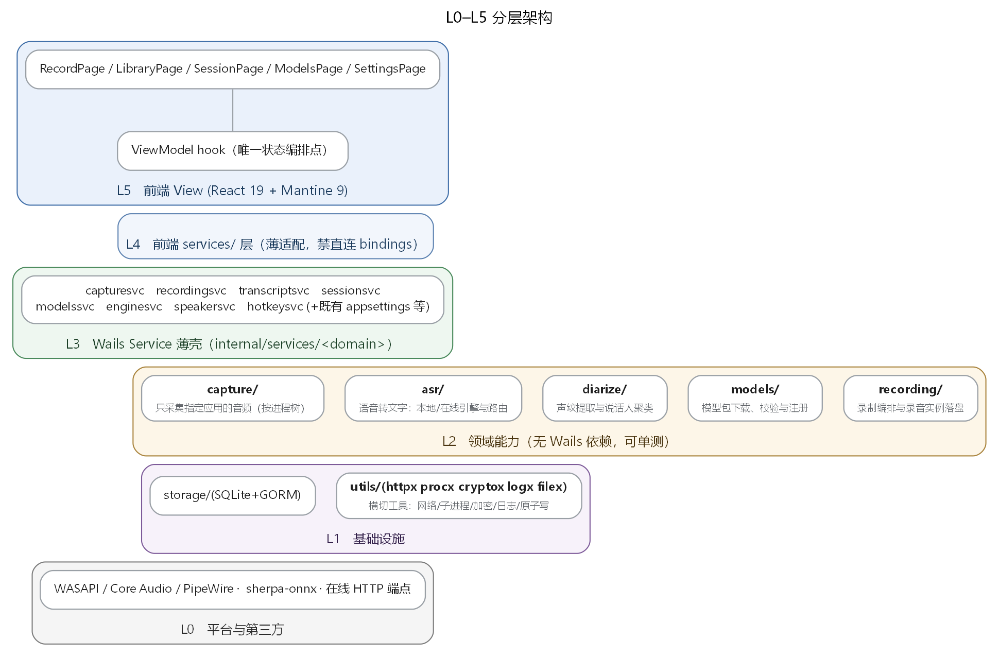

*DOT 源码：[diagrams/ARCH-01-layers.dot](./diagrams/ARCH-01-layers.dot)*

**铁律**（沿用脚手架约定并强化）：

1. `main.go` 只做 `embed.FS` + `app.Run`；装配在 `internal/app/`。
2. L3 是**薄壳**：参数校验 + 调 L2 + 发事件；不得写业务逻辑。
3. L2 **不 import Wails**，因此可被单测直接驱动（状态机、迁移、时间轴都靠这条）。
4. 平台差异走 build tag 文件（`capture_windows.go` / `capture_darwin.go` / `capture_linux.go`），不在业务里写 `runtime.GOOS` 分支。
5. 前端组件**不得**直接 import `@bindings/*`，必须经 `services/` 层。

### 1.2 运行时数据流（录制阶段 / 转写阶段）

**录制与转写是两条独立管线**：录制只做采集与落盘，转写是对已存音频的后续任务。
两者通过**录音实例**（音频文件 + `sessions` 元数据）交接，互不阻塞。

**阶段一：录制（默认不跑推理，`FR-03-3`/`FR-03-6`）**

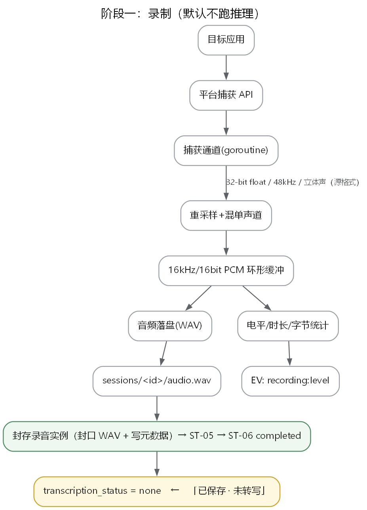

*DOT 源码：[diagrams/ARCH-02a-recording-phase.dot](./diagrams/ARCH-02a-recording-phase.dot)*

**阶段一（可选支路）：边录边转（`FR-03-10`，默认关）**

开启后在上面的环形缓冲之后**额外**挂推理支路，走 §2.3 的两遍转写：

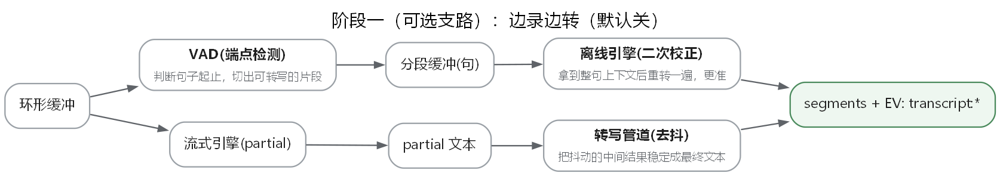

*DOT 源码：[diagrams/ARCH-02b-live-transcribe.dot](./diagrams/ARCH-02b-live-transcribe.dot)*

**阶段二：转写（录制结束后，独立任务，`FR-03-4`）**

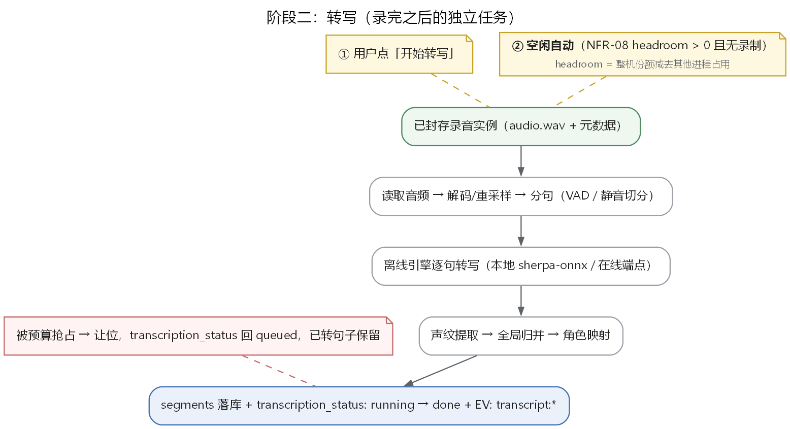

*DOT 源码：[diagrams/ARCH-02c-transcription-phase.dot](./diagrams/ARCH-02c-transcription-phase.dot)*

**关键点**：
- 音频落盘在**最上游**且与任何推理解耦 —— 这是 `FR-03-5/8` 与 `NFR-04-1` 的结构性保证：转写全线崩溃也不会丢音频。
- 录制不依赖引擎：模型没下载、引擎加载失败都**不影响**录制（`FR-03-6`）。
- 转写任务可中断可续跑，中断只影响 `transcription_status`，不改变录音实例本身。

---

### 1.3 通信链路

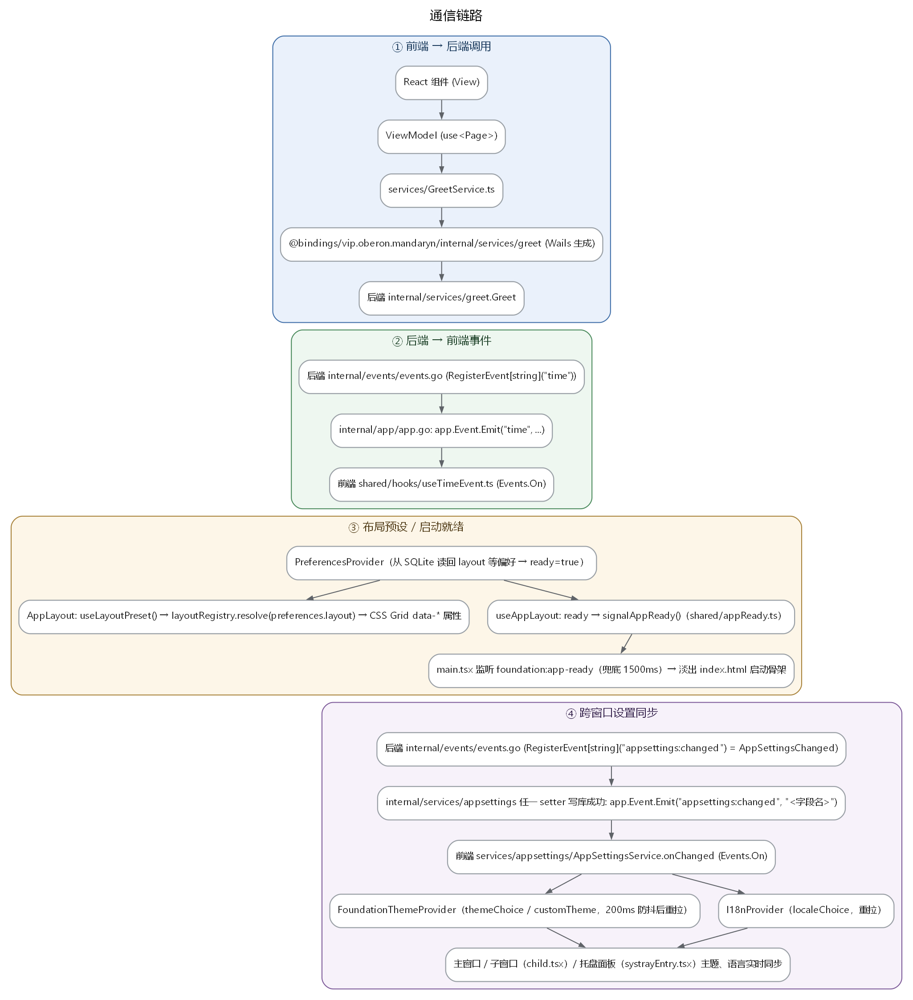

*DOT 源码：[diagrams/COM-01-callchain.dot](./diagrams/COM-01-callchain.dot)*

---
## 2. 技术选型

### 2.1 选型总表

| 层 | 选型 | 备选 | 结论与理由 |
|----|------|------|------------|
| 桌面壳 | Wails v3.1.0 | Electron / Tauri | 已由脚手架确定；Go 后端天然适合音频/推理；内存占用远低于 Electron |
| 前端 | React 19 + Mantine 9 + Vite 8 | — | 脚手架既定；Mantine 提供长列表/虚拟滚动所需 primitives 且主题可令牌化 |
| 本地 ASR 运行时 | **sherpa-onnx**（Go 绑定，CGO） | whisper.cpp / ONNX Runtime Go / 子进程调 Python | 唯一同时提供「流式识别 + 离线识别 + 声纹 + 说话人分离 + VAD」的单一 Go 可用栈；免去自研余弦检索层 |
| 流式模型 | streaming Zipformer（中英） | Paraformer 流式 | 低延迟出 partial，满足 `FFD-engine` P50 ≤ 1000ms |
| 定稿模型 | SenseVoice-Small / FunASR-Nano（中文强） | Whisper-large（慢、中文弱于前者） | 二次校正把 partial 的错字纠回，保 SLD |
| VAD | Silero VAD（经 sherpa-onnx） | WebRTC VAD | 端点检测更稳，抗噪 |
| 声纹 | sherpa-onnx `SpeakerEmbeddingExtractor` + `SpeakerEmbeddingManager` | 自研 embedding + 余弦 | 内置注册表 API（Add/Search/Verify），跨会话归并零自研 |
| 离线聚类 | sherpa-onnx `OfflineSpeakerDiarization` | 自研层次聚类 | 同上 |
| 在线 ASR | OpenAI 兼容 `POST /v1/audio/transcriptions`（流式优先，退化到分段） | 各家专有 SDK | 端点可配置即插即用；不绑定单一厂商 |
| 数据库 | SQLite（modernc，纯 Go）+ GORM | PostgreSQL / BoltDB | 脚手架既定；单机单用户足够；AutoMigrate 零迁移文件 |
| 音频落盘 | WAV（默认）/ FLAC | Opus | 落盘用于回放与重转，必须无损；FLAC 省一半空间 |
| 捕获（Win） | WASAPI **Process Loopback**（`AUDIOCLIENT_ACTIVATION_TYPE_PROCESS_LOOPBACK`） | 虚拟声卡驱动 / 设备回环 | 官方 API，免驱动免提权；设备回环作降级 |
| 捕获（macOS） | Core Audio **process tap**（14.2+） | BlackHole 等虚拟声卡 | 免装驱动；旧系统降级设备回环 |
| 捕获（Linux） | PipeWire（`pw-record` 子进程 / libpipewire） | PulseAudio 监视源 | PipeWire 为现代默认；用 `procx` 管子进程 |

### 2.2 CGO 决策（**已决策：接受**，ADR-01）

本地引擎与 macOS/Linux 捕获都依赖 CGO，因此本项目**基线为 `CGO_ENABLED=1`**，与脚手架原本的纯 Go 构建不同。
**该依赖已被正式接受**（不再作为待确认取舍）：不提供纯 Go 等价路径，构建机必须具备 C 工具链。

| 影响 | 处理 |
|------|------|
| 构建机需要 C 工具链 | Windows: MSYS2 mingw-w64；macOS: Xcode CLT；Linux: gcc |
| 交叉编译变难 | 发布走**各平台原生构建**（CI matrix），不做单机交叉编译 |
| 单文件静态分发 | 允许；sherpa-onnx 提供静态库 |
| 体积与启动成本 | 本地库随包分发；首次加载模型有一次性开销（NFR-01 已覆盖） |
| `nollm` 变体 | **可选产物**（仅在线引擎），用于体积敏感场景，**不是** CGO 兜底 |

> **落地现状**（`-tags nollm` 已实现，构建入口 `task build:nollm`）：
> 本地推理实现文件统一加 `//go:build windows && cgo && !nollm` —— 即
> `internal/asr/local/local_windows.go`、`internal/asr/local/streaming_windows.go`、
> `internal/speaker/sherpa/sherpa_windows.go`；对应的 `_stub.go` 用
> `//go:build nollm || !windows || !cgo`，于是「非 Windows / 无 CGO / nollm」三种情形
> 走**同一份桩**：恒返回 `ERR_LOCAL_UNAVAILABLE`，**不**静默降级去调在线引擎。
>
> `internal/capture/` 目前**没有** `!nollm` 标签：Windows 捕获走 `go-wca`（纯 Go，无需 CGO），
> macOS/Linux 捕获是诚实桩（同样无 CGO 依赖）。将来这两端的 CGO 捕获实现落地时，
> 才需要给它们补 `!nollm`。
>
> `nollm` 的目的是**裁剪体积与依赖**，不是绕过 CGO。默认构建仍是 `CGO_ENABLED=1`；
> Windows 上 `nollm` 产物实测可用 `CGO_ENABLED=0` 构建（只导入 `kernel32.dll`），
> 但**不承诺**该组合在其它平台成立 —— 是否可用取决于该平台设备回环捕获层是否需要 CGO。
> 默认与 `nollm` 的产物体积对比见 [DEPLOYMENT.md](./DEPLOYMENT.md) §2.2。

### 2.3 两遍转写（streaming + offline 二次校正）—— 仅「边录边转」开启时

> **默认路径不走本节**：延后转写（`FR-03-4`）对已存音频分句后逐句跑**离线一遍**，追求准确率，
> 不要求 `FFD-engine`。两遍法只在用户开启「边录边转」（`FR-03-10`，默认关）时启用。

单用流式模型：延迟低但错字多；单用离线模型：准确但每句等待整句结束，`SLD` 不可控。
两遍法把两者解耦：

- **第一遍（流式）**：100ms 帧喂 streaming Zipformer，产出可覆盖的 partial → 保证 `FFD-engine`。
- **第二遍（离线）**：VAD 判定一句结束后，对该句音频（含 200ms 前置缓冲）用 SenseVoice 重算 →
  用结果**替换**该句的 partial，并作为 finalized 落库 → 保证准确率与稳定时间戳。

代价：CPU 峰值上升（两模型常驻）。缓解：离线模型懒加载 + 空闲 10 分钟卸载（可配）。

---

## 3. 模块划分

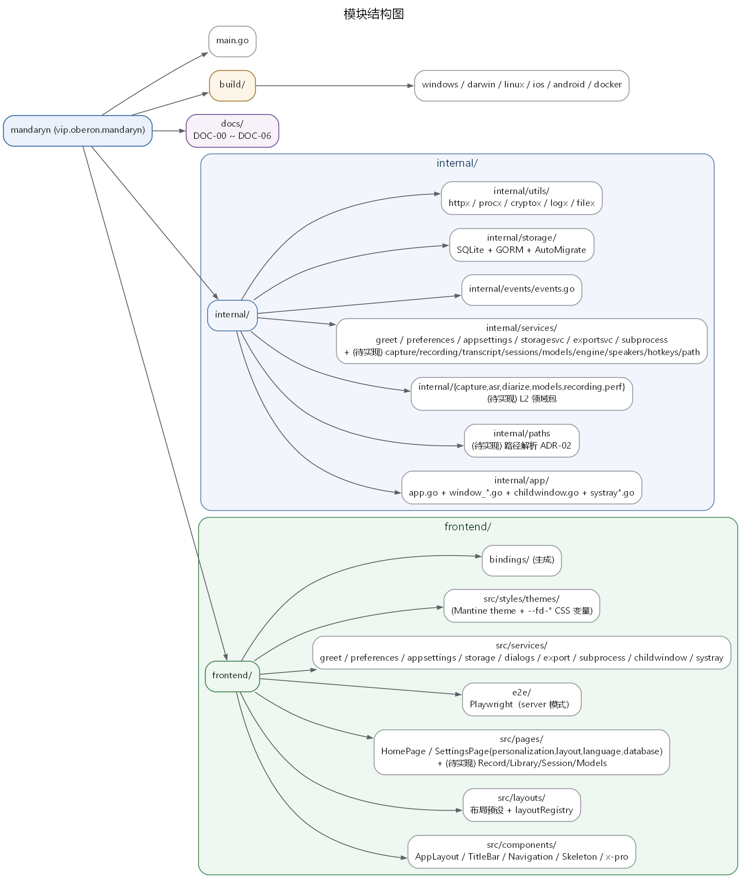

*DOT 源码：[diagrams/MOD-01-modules.dot](./diagrams/MOD-01-modules.dot)*

**当前仓库已落地的模块清单与实现状态**（哪些包尚未存在）见 [DEVELOPMENT.md](./DEVELOPMENT.md) §3；
本节描述的是**目标**分层，不要据此假设包已存在。
### 3.1 Go 包（`internal/`）

| 包 | 职责 | 关键类型 | 依赖 |
|----|------|----------|------|
| `internal/capture` | 音频源枚举、平台捕获、设备变化监听 | `Source`, `Channel`, `Enumerator`, `DeviceMonitor` | 平台 API |
| `internal/asr` | 引擎抽象与路由（本地/在线/降级） | `Engine`, `Router`, `Partial`, `FinalResult` | `asr/local`, `asr/online` |
| `internal/asr/local` | sherpa-onnx 封装（流式 + 离线 + VAD） | `Recognizer`, `VAD` | sherpa-onnx |
| `internal/asr/online` | OpenAI 兼容客户端（流式/分段） | `Client`, `StreamDecoder` | `utils/httpx` |
| `internal/diarize` | 声纹提取、会话内聚类、全局归并、角色映射 | `Extractor`, `Clusterer`, `SpeakerRegistry`, `RoleMapper` | `asr/local` |
| `internal/models` | 模型清单、下载器、哈希校验、根目录与迁移 | `Catalog`, `Downloader`, `Store`, `Migrator` | `utils/httpx,filex` |
| `internal/recording` | 状态机、会话编排、音频落盘、时间轴 | `Session`, `Machine`, `Recorder`, `Timeline` | 上述所有 |
| `internal/services/*` | Wails 薄壳（见 §3.3） | `Service` | L2 |
| `internal/events` | 事件名与强类型注册 | 常量 + `Register()` | Wails |
| `internal/storage` | GORM 模型、AutoMigrate、Holder | `Holder`, `AllModels` | GORM |
| `internal/utils/*` | `httpx`(代理感知) `procx` `cryptox` `logx` `filex` | — | — |

### 3.2 前端目录（`frontend/src/`）

```
pages/
  RecordPage/        Record.tsx · useRecord.ts · Record.module.css · lang/
  LibraryPage/       Library.tsx · useLibrary.ts · ...
  SessionPage/       Session.tsx · useSession.ts · components/{PlayerBar,TranscriptList,RolePanel}
  ModelsPage/        Models.tsx · useModels.ts · components/{BundleCard,DownloadRow,ProxyForm}
settings/ 并入 SettingsPage/ 子目录：
  audio/(音频源)  asr/(转写模型)  privacy/(隐私)  hotkeys/(快捷键)
  (既有) personalization/ language/ database/
components/
  Transcript/        VirtualTranscript.tsx（虚拟滚动 + 高亮）
  StatusPill/        录制状态胶囊（全局状态反馈）
services/            capture/ recording/ transcript/ sessions/ models/ engine/ speakers/ hotkeys/
shared/hooks/
```

### 3.3 Wails Service 划分（薄壳边界）

| Service | 承载 FR | 说明 |
|---------|---------|------|
| `capturesvc` | FR-02 | 枚举源、探测可用性、订阅设备/进程变化 |
| `recordingsvc` | FR-03 | 启停/暂停/恢复、状态查询、崩溃恢复、**录音实例封存与另存**（不跑转写） |
| `transcriptsvc` | FR-03/04 | **转写任务**（发起/取消/进度/重转）+ 取时间轴片段、搜索、导出 |
| `sessionsvc` | FR-04 | 会话列表/详情/重命名/删除 |
| `modelssvc` | FR-05/07 | 清单、下载、校验、根目录、迁移 |
| `enginesvc` | FR-01 | 来源切换、健康检查、热切换、降级状态 |
| `speakersvc` | FR-06 | 角色列表、重命名、合并/拆分 |
| `hotkeysvc` | FR-09 | 快捷键注册、冲突检测、持久化 |
| `appsettings`(既有) | FR-08/09 | 应用级单行设置（含代理、在线端点、隐私确认） |
| `preferences`(既有) | — | 开放 KV（布局、主题等） |
| `storagesvc`(既有) | FR-07 | 数据目录切换（与模型目录迁移互不复用） |
| `exportsvc`(既有) | FR-04 | CSV/XLSX 导出（新增 TXT/SRT 见 DOC-03） |

---

## 4. 关键设计

### 4.1 音频捕获层（FR-02）

#### 4.1.1 抽象

```go
// 一个可捕获目标（应用或设备）
type Source struct {
    ID         string   // 稳定标识：app:<exe>|<pid> 或 dev:<deviceId>
    Kind       SourceKind // kindApplication | kindDevice
    DisplayName string  // KOOK / QQ / 全部应用声音
    ExeName    string   // kook.exe（应用源）
    PIDs       []int    // 进程树根（应用源）
    DeviceID   string   // 设备源
    Present    bool     // 当前是否可用（进程存活 / 设备在线）
    Producing  bool     // 最近是否检测到音频
}

type Channel interface {
    ReadPCM(dst []float32) (n int, err error) // 源采样率/声道，未重采样
    Format() AudioFormat
    Err() <-chan error                        // EOF / 设备失效
    Close() error
}
```

**为什么 `Source.ID` 用「可执行名 + PID」而不是只 PID**：目标应用重启后 PID 变化，但用户意图是「继续抓 KOOK」。
重连时按 `ExeName` 重新解析 PID 树（UC-03）。纯 PID 匹配会导致重启后静默失联。

#### 4.1.2 平台实现与能力矩阵

| 能力 | Windows | macOS | Linux |
|------|---------|-------|-------|
| 进程级（准确分路） | `AUDIOCLIENT_ACTIVATION_TYPE_PROCESS_LOOPBACK`，**含子进程树** | Core Audio process tap（14.2+） | PipeWire node 级捕获 |
| 最低系统 | 官方标注 **Windows 10 Build 20348** / Win11；低版本运行时探测失败即降级 | **macOS 14.2** | PipeWire 0.3.60+ |
| 设备回环（降级） | WASAPI Loopback（整机混音 / 指定设备） | 需虚拟声卡或安装聚合设备（降级路径标注「会含全部应用声音」） | PulseAudio/PipeWire monitor 源 |
| 设备变化通知 | `IMMNotificationClient` | `AudioObjectAddPropertyListener` | PipeWire registry 事件 |
| 实现方式 | 纯 Go COM（`syscall` + 手写 vtable）**或** CGO 薄封装 | CGO + Objective-C | `procx` 起 `pw-record` / cgo libpipewire |

**决策**：三个平台统一要求 `CGO_ENABLED=1`（§2.2 已定），因此：
- Windows 优先写**纯 Go COM**（免 MSYS2 依赖链，且能精确控制 `ActivateAudioInterfaceAsync` 的异步语义）；
- macOS/Linux 走 CGO 薄封装；
- 若 Windows 纯 Go COM 在 20348 之前的系统上探测异常，直接走设备回环，不尝试私有 API。

#### 4.1.3 进程级捕获的技术限制（必须写进 UI 提示）

| 限制 | 影响 | 应对 |
|------|------|------|
| 只能抓**同一进程树**的输出 | 某些应用音频由独立子进程（如微信的 `WeChatAppEx.exe`）产生 | 枚举时把「可执行名同前缀」的子进程加入捕获集合；UI 显示「包含 N 个子进程」 |
| 系统音效/独占模式音频可能抓不到 | WASAPI exclusive 模式流不在混音器里 | 检测到长时间无数据 → 提示「该应用可能使用独占音频模式，请改用设备源」 |
| 静音应用仍在 Capture | 会持续收到静音帧 | 用 `Producing` 标记（电平 > 阈值）区分「在抓但无声」与「抓不到」 |
| 需要用户授予屏幕/系统音频权限 | macOS 首次须授权 | 首次使用引导授权，拒绝则只能设备源 |
| 受采样率/格式影响 | 源 48kHz 立体声 | 统一重采样到 16kHz 单声道（§4.3） |

#### 4.1.4 异常检测与恢复（FR-02-4，对应 UC-03）

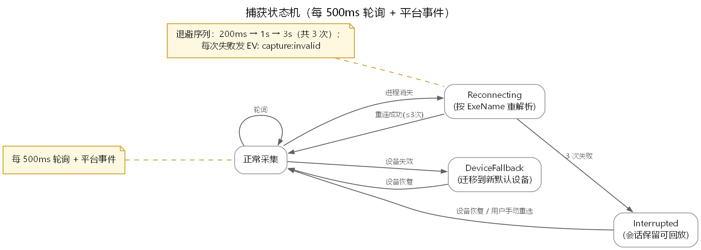

*DOT 源码：[diagrams/ARCH-03-capture-state.dot](./diagrams/ARCH-03-capture-state.dot)*

| 场景 | 检测手段 | 动作 | 用户提示 |
|------|----------|------|----------|
| 目标应用未运行 | 枚举时 `Present=false` | 源置灰，不阻止选择其他源 | 「KOOK 未运行，点击刷新」 |
| 录制中应用退出 | `Channel.Err()` 收到 EOF | 进入 Reconnecting，按 `ExeName` 重解析进程树 | 重连中：静默（≤3.2s）；失败：「已保存本次会话」 |
| 默认输出设备变更 | `DeviceMonitor` 事件 | 若源为设备源 → 迁移到新默认设备；应用源不受影响 | 「输出设备已切换为 X」 |
| 设备拔出 | 事件 + `ReadPCM` 报错 | 若无可迁移设备 → 停止采集但**不结束会话**（计时继续，状态 `paused`） | 「未检测到设备，插入后自动恢复」 |
| 长时间无音频 | 电平 < 阈值持续 10s | 不改状态，仅提示（避免误停） | 「未检测到音频」 |

### 4.2 引擎抽象与模型来源切换（FR-01）

#### 4.2.1 统一接口

```go
type Engine interface {
    ID() string                                    // bundleId@version 或 online:<model>
    Warm(ctx context.Context) error                // 加载/握手；幂等
    Feed(frame []float32) (<-chan Partial, error)  // 流式送帧，返回部分结果流
    Finalize(seg AudioSegment) (FinalResult, error) // 一句结束：离线校正
    Health(ctx context.Context) HealthStatus       // ready|loading|failed|degraded + 详情
    Close() error
}
```

`Router` 对上层暴露与 `Engine` 相同的接口，内部持有 `local` 与 `online` 两个实现，负责选择与降级：

```go
type Router struct {
    source ModelSource      // local | online（用户选择）
    local  Engine           // 懒加载
    online Engine           // 可选
    policy DegradePolicy    // fallbackToLocal, retry, 是否允许自动回升
}
```

#### 4.2.2 切换方式与**生效时机**（FR-01-2）

| 触发入口 | 行为 | 生效时机 |
|----------|------|----------|
| 设置页「转写模型」 | 写 `app_settings.modelSource` | **下一个会话**；当前无会话则立即预热 |
| 录制页模型选择器 | 同上 | 同上 |
| 快捷键（可选绑定） | 同上 | 同上 |
| 录制进行中尝试切换 | **拒绝**（`ERR_STATE_FORBIDDEN`），UI 选择器禁用并提示「录制中不可切换」 | — |

**热切换机制**（不需要重启应用）：

```
SetSource(next):
  1. 校验：无活跃会话（否则拒绝）
  2. 标记 engine:status=loading（EV: engine:status）
  3. 目标引擎 Warm()（local: 加载模型 + 自检一次空跑；online: 握手 + 1 次健康探测）
  4. 成功 → 卸旧引擎（延迟 2s，容错在途请求）→ status=ready
  5. 失败 → 回滚到旧引擎 → status=failed + 原因 → 提示用户
```

- 目标 NFR：`local→local` 热切换 ≤ 8s（medium 档，NVMe，见 NFR-01）。
- 启动时不阻塞 UI：引擎在后台 `Warm`，录制按钮在 `ready` 前置灰但显示「正在加载模型 42%」。

#### 4.2.3 适用场景引导（FR-01-3）

在 UI 中以「并排卡片」呈现，两侧各有「推荐」条件：

| 维度 | `local` 本地离线 | `online` 在线 |
|------|------------------|---------------|
| 隐私 | 数据不出机（FR-08-1） | 音频出机（FR-08-2） |
| 网络 | 不需要 | 必须 |
| 首字延迟 | 更稳定（无网络抖动） | 受 RTT 影响 |
| 准确率 | 中文强；方言/噪声弱 | 可换更强模型；支持多语种、口音 |
| 语种覆盖 | 取决于所下模型包 | 取决于端点模型 |
| 成本 | 一次性下载 + 本机算力 | 端点计费 |
| 推荐 | 隐私敏感、离线、长时间会议 | 追求准确率、多语种、机器算力不足 |

#### 4.2.4 降级策略（FR-01-4）

**在线失败分类 → 处置矩阵**：

| 错误类别 | 判定 | 重试 | 降级到本地 | 说明 |
|----------|------|------|------------|------|
| 网络不可达（DNS/TCP） | 连接层错误 | 2 次（1s/3s） | ✅ 若本地就绪 | 最常见（UC-04） |
| 超时 | 请求超 8s 无首字节 | 2 次 | ✅ | — |
| 鉴权失败 401/403 | HTTP 4xx | ❌ | ✅ | 不重试（重试无意义），提示检查密钥 |
| 限流 429 | HTTP 429 | 2 次（尊重 `Retry-After`，上限 30s） | ✅ | — |
| 端点 5xx | HTTP 5xx | 2 次（1s/3s） | ✅ | — |
| 内容被拒（4xx 语义错误） | 4xx 非 401/403/429 | ❌ | ✅ | 提示端点不支持该格式/语种 |
| 本地不可用（模型缺失/加载失败） | 预热阶段 | — | 不降级到在线（隐私默认） | 提示下载（§4.2.5） |

**降级一旦触发**：

1. 会话置 `degraded`（ST 见 §6），音频继续落盘（不受影响）；
2. 时间轴在该时刻打一个 `degrade_marker`（DOC-04 `session_events`）；
3. 发 `EV: engine:status(state=degraded, reason)` → 顶部非阻塞提示；
4. **不自动切回在线**（避免网络抖动造成反复切换），提供「切回在线」按钮；
5. 降级后的 partial/final 由本地引擎产出，片段带 `engineId` 以便追溯。

#### 4.2.5 本地不可用

| 情况 | 行为 |
|------|------|
| 无任何已装 bundle | 录制按钮禁用，引导「下载模型」（跳 ModelsPage） |
| bundle 已装但校验失败 | 标记 `corrupt`，提示「重新下载」（`ERR_MODEL_CORRUPT`） |
| 加载失败（内存不足/库缺失） | `ERR_ENGINE_LOAD` + 建议（换小档模型 / 关闭其他程序 / 用精简版） |

### 4.3 音频管线细节

| 阶段 | 参数 | 说明 |
|------|------|------|
| 源格式 | 设备/进程默认（常见 48kHz/32f/2ch） | 不做假设，按 `Format()` 协商 |
| 重采样 | → **16kHz / 16bit / 单声道** | 内部唯一格式；重采样用带窗 sinc（避免混叠影响识别） |
| 环形缓冲 | 3s 容量 | 吸收 GC/调度抖动；溢出时丢**最旧**并计数告警 |
| 落盘 | WAV（默认）/ FLAC，200ms 刷盘 | 每 200ms `fsync` 一次；崩溃最多丢 200ms（UC-07 修补 WAV 头） |
| 帧喂给引擎 | 100ms/帧（1600 samples） | 与流式模型训练帧长对齐 |
| VAD | Silero，帧 32ms，语音起点前置 200ms 缓冲 | 前置缓冲避免吞掉句首辅音 |
| 句切分 | VAD 终点 + 最短句 300ms / 最长句 20s 强制切 | 最长句约束防止「不换气」导致 SLD 失控 |

### 4.4 说话人分离与角色映射（FR-06）

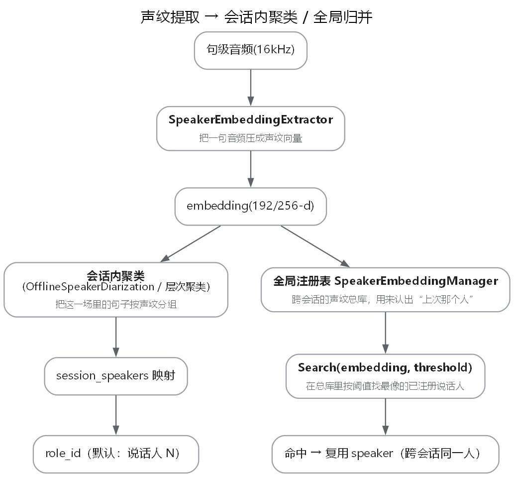

*DOT 源码：[diagrams/ARCH-04-diarize-flow.dot](./diagrams/ARCH-04-diarize-flow.dot)*

| 机制 | 规则 |
|------|------|
| 声纹提取时机 | 每个 finalized 片段提取一次（不逐帧，避免抖动） |
| 会话内聚类 | 片段级 embedding 做层次聚类；`maxSpeakers` 默认自动（受 FR-06-6 上限 2–8 约束） |
| 全局归并 | `Search(emb, threshold=0.72)`；命中即复用既有 `speaker`，否则新建 |
| 角色映射 | `role` 是**用户可见标签**，`session_speakers` 把 `(session, speaker) → role_id`；默认每个新 `speaker` 建一个 `说话人 N` 角色 |
| 改名同步 | 改名只 `UPDATE roles SET name`；片段不存名字，展示时 join → **天然全局同步**（FR-06-3） |
| 重叠语音 | 不做强行拆分；标 `speaker_id = NULL`，UI 显示「未识别」 |
| 过短片段 | < 1.2s 不提取声纹（embedding 不可靠），归「未识别」或继承相邻同段 |
| 手动纠正 | merge：把 B 的 `session_speakers` 指向 A 的 role；split：为选中片段新建 speaker+role（FR-06-5） |

> **为什么名字不冗余存进 segments**：这是 FR-06-3「改名必须全局同步、不能新旧名并存」的
> 唯一可靠实现方式。冗余存名会带来批量 UPDATE 与并发不一致风险。

### 4.5 时间轴与时基（FR-04-1）

#### 4.5.1 时基

**唯一时基 = 音频帧计数**（`frameCount / 16000 * 1000` ms），**不用 wall clock**：

| 原因 | 说明 |
|------|------|
| 系统休眠/挂起 | wall clock 继续走，音频帧不走 → 用 wall clock 会造成漂移 |
| 设备时钟漂移 | 48kHz 实际 47999Hz 时，按名义速率换算会累积误差 |
| 可重放 | 帧计数与落盘文件严格对应，回放 seek 精确 |

会话有两个基准：
- `session.audioStartMs`：会话起点（`wallClock`，仅用于显示真实时间）；
- `session.audioDurationMs`：帧计数换算的逻辑时长（**时间轴原点**）。

#### 4.5.2 时间戳生成与对齐

```
时间戳来源（优先级）：
1. VAD 端点：speechStartFrame / speechEndFrame  → 主时间戳（±32ms 精度）
2. 流式引擎 partial：返回 chunk 相对偏移       → 仅用于 partial 展示
3. 定稿时二次校正：离线引擎对整句重算，句界沿用 VAD 端点（不采信引擎自报时长）

最终：segment.startMs = round(speechStartFrame / 16)   // 16000Hz → ms
      segment.endMs   = round(speechEndFrame   / 16)
```

- **最小片段 300ms、最大 20s**；相邻片段允许 **≤ 120ms 重叠**（受前置缓冲影响），展示层按 `seq` 排序优先。
- 插入顺序严格单调：`seq` 单调递增，`startMs` 单调不减（断言校验，违反则修正并告警）。

#### 4.5.3 存储与索引

- 存 `INTEGER` 毫秒（DOC-04 `segments.start_ms/end_ms`）；
- 复合索引 `(session_id, start_ms)`：回放定位用二分（O(log n)），不线性扫描；
- 前端一次性取整段会话时间轴（5000 条 × ~120B ≈ 600KB，可接受）；超过 2 万条分页预取（P1）。

#### 4.5.4 回放同步算法（前端）

```
每 requestAnimationFrame：
  t = audio.currentTime * 1000
  idx = binarySearchLast(segments, s => s.startMs <= t)   // 命中即当前片段
  if idx != current: 高亮切换 + （若自动滚动启用）居中滚动
  // 边界：t 落在片段间隙 → 保持上一个片段为「当前」，不闪烁
```

**为什么用 rAF 而不是 `timeupdate` 事件**：`timeupdate` 频率约 4–66Hz 且不均匀，会造成高亮抖动；
rAF 与渲染同帧，实测可稳定在 60fps 并满足 ≤80ms 误差（NFR-01）。

### 4.6 模型仓库、下载与迁移（FR-05/07）

#### 4.6.1 目录布局

```
<modelRoot>/                       默认 ~/.mandaryn
  manifest.cache.json              上次拉取的模型清单（带签名摘要）
  models/
    sensevoice-small@1.2.0/
      manifest.json                bundleId, version, files[{path,sha256,size}], license, langs
      model.onnx
      tokens.txt
    zipformer-zh-streaming@1.0.3/
  .staging-<uuid>/                 迁移/下载中的临时区（启动时清理残留）
  .downloads/
    <bundleId>.part.<n>            分片临时文件
    <bundleId>.state.json          断点状态（bytesDone, etag, urlsIdx, retries）
```

#### 4.6.2 下载流程

```
Catalog.Fetch()  ──► 清单（HTTPS + 可选镜像）
   │
Downloader.Start(bundleId):
  1. 预检：磁盘空间 ≥ size*1.15，目标可写
  2. 分片：默认 4 并发，每片 8MB，Range 请求
  3. 续传：读 .state.json；ETag 不变 → If-Range 续；ETag 变 → 整包重下（避免拼接脏数据）
  4. 单文件完成 → sha256 比对（流式，边下边算）
  5. 整包完成 → 逐文件复核 + 写 manifest → 原子 rename 到 models/<id>@<ver>/
  6. 失败 → 退避（1s/4s/16s）→ 换镜像（最多 3 个）→ 收敛为错误
```

| 机制 | 细节 |
|------|------|
| 代理 | `httpx` 客户端按 `app_settings.proxy*` 构造 `http.Transport`（支持 http/https/socks5 + 认证）；下载与在线转写分别开关 |
| 校验 | 单文件 sha256（流式）+ 整包 manifest 摘要；不一致 → 删除该文件重下（最多 1 次） |
| 进度 | 汇总所有分片 bytesDone；事件 4Hz 节流 |
| 并发限制 | 同时最多 2 个 bundle 下载（避免占满带宽影响转写） |

#### 4.6.3 根目录迁移状态机（FR-07-3/4/5）

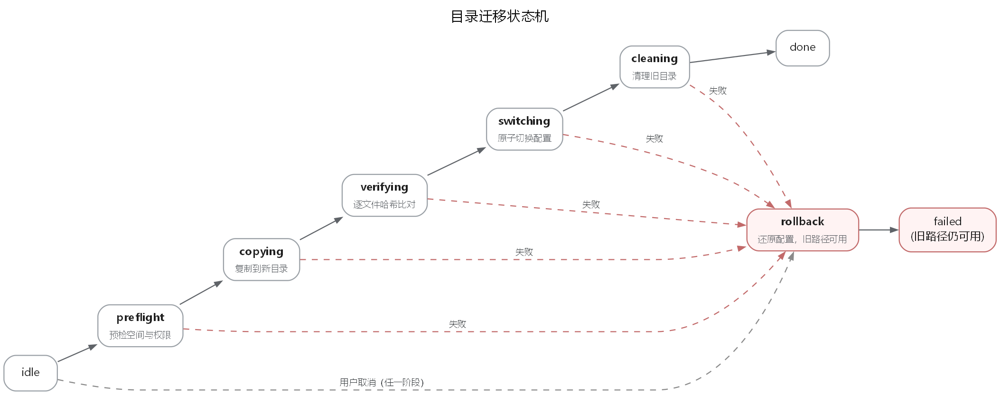

*DOT 源码：[diagrams/ARCH-05-migrate-state.dot](./diagrams/ARCH-05-migrate-state.dot)*

| 阶段 | 动作 | 失败处理 |
|------|------|----------|
| `preflight` | 目标可写（`.mandaryn-write-test`）、空间 ≥ 源×1.15、**取得全局互斥锁**（禁下载/禁引擎加载）、请求引擎 `Close()` | 直接失败，无副作用 |
| `copying` | 流复制到 `<target>/.staging-<uuid>/`，保留相对结构；进度事件 | 删 `.staging`，旧路径不变 |
| `verifying` | 逐文件 sha256 与 manifest 比对 | 同上 |
| `switching` | **单事务**写 `app_settings.modelRoot` + 原子 rename `.staging` → `models/` | rename 失败 → 回写旧值 |
| `cleaning` | 旧目录改名 `.trash-<ts>`，异步删除（失败保留） | 不影响可用性（仅占空间） |
| `rollback` | 恢复 `modelRoot` 旧值；`Close()` 的引擎重新 `Warm` | — |

**一致性保障**（FR-07-5）：

1. **全局互斥**：`modelsvc` 持有 `sync.Mutex` + 状态，迁移期间所有下载/加载请求返回 `ERR_MODEL_BUSY`；
2. **原子切换**：DB 值 + 目录 rename 配对；启动时校验 `modelRoot` 存在且可写，否则回退默认路径并提示；
3. **不删源直到目标校验通过**（copy→verify→switch→clean 的顺序不可换）；
4. **网络盘检测**：目标为 UNC/网络挂载时警告「跨设备迁移不保证原子性」，允许但降级为「复制模式」（不删除源，双份共存）。

### 4.7 整机性能预算与推理调度（NFR-08）

#### 4.7.1 预算模型

**不是**「限制本应用不超过 N%」，而是「整机总占用不超过 N%，本应用只吃剩余额度」：

```
totalCpuPct  整机所有进程 CPU（按核数归一化）
selfCpuPct   本应用进程树 CPU（含推理库线程；若引擎走子进程则含子进程）
otherPct  =  totalCpuPct − selfCpuPct
headroom  =  N − otherPct              ← 本应用当前可用额度
```

`otherPct ≥ N` ⇒ `headroom ≤ 0` ⇒ 额度耗尽，暂停推理。

#### 4.7.2 采样与判据

| 项 | 实现 |
|----|------|
| 采样源 | Windows `GetSystemTimes` + `GetProcessTimes`；macOS `host_processor_info` + `proc_pidinfo`；Linux `/proc/stat` + `/proc/<pid>/stat`。放在 `internal/perf/`，build tag 分平台，**不用第三方依赖** |
| 采样周期 | 500ms（独立 goroutine，最低优先级；本身开销 < 0.3% CPU） |
| 控制判据 | 5s 滑动平均（10 点），与 NFR-08 一致；**不用瞬时值**，避免编译/杀毒软件突发拉高造成误暂停 |
| 暂停判据 | `avg(otherPct) ≥ N` 连续 3s |
| 恢复判据 | `avg(otherPct) ≤ N − 5` 连续 3s（5 点滞回，防抖） |
| 读数发布 | 1Hz 经 `EV-15 perf:usage` 推给前端（含三分量 + 档位 + 状态） |

#### 4.7.3 调度阶梯（先降档，后暂停）

`headroom` 收窄时按阶梯下行，**每一级都可逆**，且**永不中断录制**（音频采集与落盘在管线最上游，与推理解耦，见 §1.2）：

| 档位 | 触发（`headroom` 相对 N 的比例） | 动作 | 影响 |
|------|--------------------------------|------|------|
| `L0` 正常 | > 60% | 边录边转：两遍转写全开（流式 + 离线校正）；延后转写：全速跑转写任务 + 声纹逐句提取 | 基准质量 |
| `L1` 关二次校正 | ≤ 60% | 仅边录边转有意义：关闭第二遍离线校正，只保留流式结果（延后转写不受影响） | SLD 下降，错字略升（ARCH §2.3 的可降级点） |
| `L2` 单线程推理 | ≤ 40% | 引擎 `num_threads` 降到 1；暂停声纹提取（延后批处理） | FFD 上升；说话人标注延迟到会话结束批量补 |
| `L3` 隔句跳过 | ≤ 20% | 仅边录边转有意义：流式引擎每 2 帧处理 1 帧（丢帧而非丢音频） | 转写明显滞后/丢词，**仍继续出字** |
| `P` 暂停 | ≤ 0（`otherPct ≥ N`） | 停止所有推理；**音频继续采集与落盘** | 会话标 `lagging`；恢复后追赶 |

**回升**：`headroom` 回到上一档阈值 +10% 的比例并稳定 15s 才升档（比降档更保守），避免档位抖动。

#### 4.7.4 与两遍转写、降级策略的关系

| 关系 | 说明 |
|------|------|
| 与两遍转写（§2.3） | 两遍架构只在「边录边转」下存在；默认延后转写本来就只有一遍离线，预算不足时降低转写任务的并发/线程数或排队，不改准确率 |
| 与模型来源降级（§4.2.4） | 两者**互不替代**：`degraded` 是「在线失败→本地」，`throttled`/`suspended` 是「本地算力不足→降档/暂停」。一个会话可同时处于 `degraded` 与 `L2` |
| 与 `NFR-01` 性能预算 | 当 `N` 很小导致 FFD/SLD 无法达标时，**优先保证「录制不中断」**，允许 SLD 超预算并在会话上标 `lagging`；FFD 目标退化为「首个 partial ≤ 3s」 |
| 与暂停/恢复状态机（§6） | 不新增 ST 编号：`throttled`（档位 > L0）与 `suspended`（档位 P）是**正交标记**，与 `degraded` 并列，`state` 主状态不变；转写任务的 `transcription_status` 是**另一条轴**（§6.4），同样不塞进 `state` |
| 暂停期间的写入 | 已完成句子正常落库；转写任务让位并保留进度（`transcription_status=queued`），恢复后从断点续跑（同样受预算约束，`headroom` 不足则继续排队） |
| 用户操作冲突 | 暂停期间调用需要推理的方法（如「重新转写」）→ 返回 `ERR_PERF_SUSPENDED`（可重试），不静默排队失败 |

#### 4.7.5 边界与已知限制

- **估算而非精确配额**：CPU 占用是观测值，调度是反馈控制，存在一个控制周期（≈3s）的滞后；因此判据用滑动平均 + 滞回，宁可慢一拍也不抖动。
- **进程树边界**：若推理以子进程运行，`selfCpuPct` 必须包含子进程（`procx` 已托管进程组，可枚举）。
- **不受控的外部占用**：其他应用瞬间拉满（如编译）会直接触发暂停；这是设计意图（让位于用户的前台工作），但 UI 必须说明原因，否则会被误读为「软件卡死」。

### 4.8 路径解析（FR-07-7/8，ADR-02）

`dataRoot` / `modelRoot` 由**单一解析器**裁决，禁止各模块自行读环境变量：

```go
// internal/paths —— 启动早期构造，全进程只读
type Resolver struct { /* 四个来源层的原始值 + 解析结果缓存 */ }

func (r *Resolver) Resolve(key string) (ResolvedPath, error) // key: dataRoot | modelRoot
func (r *Resolver) ApplyPending() (applied []string, err error) // 启动时消费 *_pending
```

**为什么必须集中**：`cryptox` 要往 `dataRoot` 放主密钥、`logx` 要往 `dataRoot/logs` 写日志、
`storage` 要打开 `dataRoot/mandaryn.db`。三者若各自解析，一旦某层不可用而回退时机不同，
就会出现「数据库在 A、密钥在 B、日志在 C」——数据看似丢失且无法自愈。因此**一次解析、三处复用**。

| 约束 | 说明 |
|------|------|
| 解析时机 | 必须在 `cryptox.Init` 与 `storage.Open` **之前**完成；`Resolver` 是二者的构造参数，不是全局变量 |
| 优先级 | `cli` > `env` > `user` > `default`，单向覆盖，不做「合并」 |
| 不可变性 | 进程生命周期内解析结果不变；唯一例外是被接管时写入 `pending`（不影响生效值） |
| 副作用隔离 | `dataRoot` 变更等价于换掉整套数据，**只允许重启生效**；`modelRoot` 也统一走重启，避免「一半即时一半重启」的认知负担 |
| 失败处理 | 高层不可用 → 降级到下一层并留可见痕迹，绝不静默失败；`dataRoot` 降级必须提示数据归属 |

**下游分工**（本节只定架构，不重复细节）：

- 四级链的**具体行为**（来源徽章文案、暂存提示、解除命令、失效回退话术）→ DOC-06 §4.1–4.6；
- `ResolvedPath` **字段与接口签名** → DOC-03 §2.9.3；
- 持久化列（`model_root` / `model_root_pending`）→ DOC-04 TBL-02；
- 界面四态与只读态规范 → DOC-05 §5.10。

> 与脚手架的差异：现有 `storage.LoadConfig()` 只做「env 或 storage.json」二选一且不暴露来源，
> 落地时替换为上述 `Resolver`（DOC-02 §10 第 9 项）。

---

## 5. 前端关键设计

| 主题 | 设计 |
|------|------|
| 长列表 | `VirtualTranscript`：固定行高估算 + 二分定位可视区；5000 片段下滚动不丢帧 |
| 状态编排 | 全部在 ViewModel hook（`useRecord` / `useSession` / `useModels`）；View 无副作用 |
| 事件订阅 | `services/` 层订阅 `Events.On`，转成 hook 可消费的 store；组件不直接订阅 |
| 高亮 | 单例 `HighlightController`：rAF 驱动，只切换 `data-active`，避免 React 重渲染整列表 |
| 自动滚动 | `scrollToIndex(center)`，禁用 `scroll-behavior:smooth`（与 rAF 抢帧），用 CSS transform 动画 |
| 手动滚动检测 | `wheel`/`pointerdown` 立即置 `userScrolled=true`，1.5s 无操作或点击「回到当前句」复位 |
| 降级/错误 | 全局 `StatusPill` + toast；不阻塞录制 |

---

## 6. 录制状态机（ST）

### 6.1 状态定义

| ID | 状态 | 含义 | 可进录制按钮 |
|----|------|------|--------------|
| `ST-01` | `idle` | 空闲，无会话 | 「开始」可用（引擎 ready 时） |
| `ST-02` | `preparing` | 解析源、预热引擎、创建落盘文件 | 禁用（显示进度） |
| `ST-03` | `recording` | 采集中（默认只采集与落盘；开启边录边转时并行出字） | 「暂停」「停止」 |
| `ST-04` | `paused` | 采集暂停（用户主动或设备失效），会话未结束 | 「继续」「停止」 |
| `ST-05` | `finalizing` | 停止采集、**封口音频、封存录音实例（写元数据）**；不跑转写（边录边转时额外定稿末句） | 禁用 |
| `ST-06` | `completed` | 录音实例已保存，可回放；文字待转写（`transcription_status=none`） | 「开始」 |
| `ST-07` | `degraded` | **录制中**在线→本地降级的附加状态（不独立存在，与 `recording` 并存） | 取决于父状态 |
| `ST-08` | `interrupted` | 异常中断（崩溃/断电/源永久失效），音频保留 | 「开始」+「恢复」 |
| `ST-09` | `failed` | 终止性失败（无法继续也无法恢复，如磁盘满且无音频） | 「开始」 |

> 说明：`degraded`（ST-07）是**正交标记**而非独立状态 —— 录制仍在 `ST-03`。
> 实现上：`state` 字段存主状态，`degraded` 是布尔 + `degradeReason`。这样避免状态爆炸。
>
> 同理，`NFR-08` 引入的两个标记也**不新增 ST 编号**：`throttled`（降档，含 `throttleLevel` L1–L3）与
> `suspended`（预算暂停，档位 P）与 `degraded` 并列，主状态仍为 `ST-03`。三者可同时为真，
> 分别回答「模型来源是否回退」「是否降档」「是否暂停推理」。**禁止**把它们塞进 `state` 枚举。

### 6.2 状态转换

| 从 | 事件/触发 | 到 | 副作用 |
|----|-----------|----|--------|
| `idle` | 用户开始（快捷键/按钮） | `preparing` | 解析源、分配 `sessionId`、建目录、引擎 `Warm` |
| `preparing` | 就绪 | `recording` | 打开落盘文件、启动捕获通道、开始计时 |
| `preparing` | 源不可用 / 引擎失败 | `failed` | `ERR_CAPTURE_UNAVAILABLE` / `ERR_ENGINE_LOAD` |
| `recording` | 用户暂停 | `paused` | 停止采集，转写侧 flush 半句 |
| `paused` | 用户继续 | `recording` | 重开通道（同一文件，时间轴连续） |
| `recording` | 用户停止 | `finalizing` | 停采集、封口音频、写元数据（不跑转写；边录边转时定稿末句） |
| `paused` | 用户停止 | `finalizing` | 同上（不重复处理已 flush 的） |
| `recording` | 设备失效且不可迁移 | `paused` | 保留会话，提示插入设备 |
| `recording` | 在线失败且本地不可用 | `recording` + `degraded=false` | 转写暂停但**继续录音**，`EV: engine:status(paused)` |
| `recording` | 在线失败且本地就绪 | `recording` + `degraded=true` | 切本地引擎、打点、提示 |
| `finalizing` | 完成 | `completed` | 写 `endedAt`、`durationMs`、`sizeBytes`；`transcription_status` 置 `none`（边录边转已完成则 `done`） |
| `finalizing` | 失败（写库失败） | `interrupted` | 音频在，已转写片段尽力保留；可修后重新封存 |
| 任意（进程崩溃） | 启动自检发现残留 | `interrupted` | 修补 WAV 头、标记，可「重新转写」 |
| `paused` | 目标应用退出且重连 3 次失败 | `interrupted` | 结束会话（用户可续录新会话） |

**非法转换**（一律拒绝并返回 `ERR_STATE_FORBIDDEN`）：
`recording → recording`（重复开始）、`completed → paused`、`idle → paused`、`finalizing → recording`、录制中切换模型来源（§4.2.2）。

### 6.3 状态机图

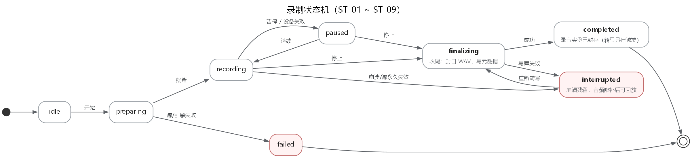

*DOT 源码：[diagrams/ARCH-06-recording-state.dot](./diagrams/ARCH-06-recording-state.dot)*

---

### 6.4 转写任务状态（`transcription_status`）

录制状态机（`ST-01`~`ST-09`）只描述**采集侧**；转写是录制结束后的独立任务，用**另一条轴**表达，
两者正交 —— 同一会话可以「早已 `completed`，但转写还在 `running`」。

| 值 | 含义 | 进入条件 |
|----|------|----------|
| `none` | 未转写（刚封存的录音实例默认值） | 录制结束且未开启边录边转 |
| `queued` | 已排队，等待执行 | 用户手动发起 / 空闲自动命中；或被预算抢占后回收 |
| `running` | 正在转写 | 调度器取得执行权 |
| `done` | 转写完成 | 全部句子落库（含声纹归并）；边录边转正常结束时也置此值 |
| `failed` | 转写失败 | 引擎不可用 / 在线端点错误 / 音频损坏；带 `ERR` 与重试入口 |

**约束**：
- **禁止**把 `transcription_status` 的值写进 `sessions.state`，也**禁止**为它新增 `ST` 编号（与 §6.1 三标记同规矩）。
- 录音实例与转写结果**互不影响**：转写失败不得删除或改动音频；删除会话时二者一起删。
- 同一会话同时只允许一个转写任务；重转 = 旧任务取消 → 新任务入队，按 `(session_id, seq)` 幂等覆盖片段。

---
## 7. 性能预算与打点

### 7.1 预算分解（本地模式，FFD-engine ≤ 1000ms P50）

> **适用范围**：本节指标只在**开启「边录边转」**（`FR-03-10`）时有意义。默认的延后转写不要求交互时延，
> 其目标是「空载下转写速度 ≥ 3× 音频时长」（1 小时录音 ≤ 20 分钟转完），受 `NFR-08` 预算调度。
>
> 前提：本节预算成立的条件是 `NFR-08` 的 `headroom` 充足（等效 `L0` 档、`otherPct < 10%`）。
> 当预算被压缩到 `L1` 及以下时，表中「流式引擎首批解码」会变长，FFD 目标按 §4.7.4 退化处理。

| 环节 | 预算 | 说明 |
|------|------|------|
| 捕获启动 + 首帧到达 | ≤ 120ms | 含 `ActivateAudioInterfaceAsync` |
| 重采样 + 首帧入环形缓冲 | ≤ 20ms | |
| VAD 判定语音起点（需 ≥32ms 帧） | ≤ 80ms | 含 200ms 前置缓冲的滚动判定 |
| 流式引擎首批解码 | ≤ 500ms | 模型常驻时 |
| partial 去抖 + 事件下发 | ≤ 50ms | 10Hz 节流下的首推 |
| 前端渲染 | ≤ 130ms | 含 React 提交 |

### 7.2 打点（NFR-05-3）

关键路径埋点（`logx` structured + 内存环形时间线，诊断面板可导出）：

| 打点 | 字段 |
|------|------|
| `rec.start` | `sessionId`, `sourceId`, `modelSource`, `engineId` |
| `rec.firstPartial` | `sessionId`, `ffdMs` |
| `seg.finalized` | `sessionId`, `seq`, `sldMs`, `audioMs`, `engineId` |
| `transcribe.start` | `sessionId`, `trigger`(manual/idle), `engineId`, `audioMs` |
| `transcribe.done` | `sessionId`, `audioMs`, `elapsedMs`, `segments`, `rtf` |
| `transcribe.preempt` | `sessionId`, `reason`(budget/cancel), `processedMs` |
| `engine.degrade` | `sessionId`, `reason`, `from`, `to` |
| `engine.switch` | `from`, `to`, `loadMs`, `result` |
| `model.download` | `bundleId`, `bytes`, `durationMs`, `retries`, `result` |
| `model.migrate` | `from`, `to`, `bytes`, `phase`, `result` |

### 7.3 FFD / SLD 的**测量定义**（与 PRD 对齐）

首字延迟拆成**双指标**（`NFR-01`）：一项约束引擎能力，一项如实呈现用户感知。两者必须同时报告，
**不可只报其一**，也不可用任一指标替代另一指标。

> **拆分不等于变快**：`FFD-engine` 落在阈值内，不代表用户感知改善 —— 从点开始到看见字仍是
> `FFD-e2e`（实测约 1.6s，其中 700ms 是源音频前导静音）。拆分只是把「源静音」与「引擎出字」
> 两种责任分开计量；若按旧单指标口径衡量，实测值与拆分前相同，仍不达标。对外表述时
> **禁止**用 `FFD-engine` 的数值暗示端到端首字已达 1 秒。

- `FFD-engine` = `t(引擎返回首个非空增量)` − `t(首个非静音帧)`。
  - **起点**：源音频中首个满足「能量超过底噪 +N dB 且连续 ≥ M 帧」的帧。底噪取音频前段中位数。
    必须带持续时长约束 —— 否则会被起始瞬态尖峰（单帧高能量、随即回落）误判到 30ms 级。
  - **终点**：引擎层首个非空增量（不含 IPC 与前端渲染），因此是**下界**。
  - **阈值**：P50 ≤ 1000ms，P95 ≤ 1500ms。依据是该模型 chunk 结构决定的约 912–922ms 实测下限 + 余量，
    不是「跑到多快就把线画多快」。
- `FFD-e2e` = `t(first partial 渲染到前端)` − `t(用户触发开始)`，**必须包含前端渲染**，且**含源音频前导静音**。
  - **不设阈值，仅观测**。它随源音频前导静音自然变化（同一引擎在不同音频上可差出数百毫秒），
    因此不适合作为验收判据；它的用途是回答「用户实际等了多久」。
  - 正式测量需在有前端与落库的整机上用 `metrics.json` 采样。
- `SLD` = `t(segment 落库且 state=finalized)` − `t(VAD 判定句末帧)`。
- 采样：每次录制记录全部片段的 `SLD`，取 P50/P95；FFD 每会话一条。验收取 20 次会话统计（PRD §7）。

> 历史说明（勿混用）：v1.3.0 之前 `FFD` 是单指标，起点为「用户触发开始」、阈值 P50 ≤ 900ms。
> 该口径把源音频前导静音计入引擎责任，实测样本静音 690–700ms 约占测量值 43%，导致指标
> 「测出来的是样本静音长度」而非引擎能力。2026-11-12 起按上表拆分。

---

## 8. 隐私架构（FR-08）

### 8.1 数据边界

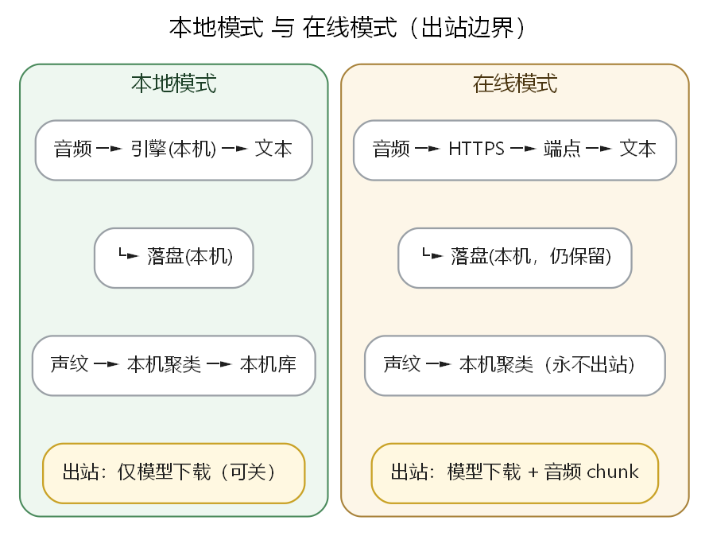

*DOT 源码：[diagrams/ARCH-07-local-vs-online.dot](./diagrams/ARCH-07-local-vs-online.dot)*

### 8.2 强制实现约束

| 约束 | 落地位置 |
|------|----------|
| 在线模式必须用户显式确认（不可预设） | `appsettings` 校验：`onlineConsentAt == 0` 时禁止保存在线配置 |
| 证书校验不可关闭 | `online.Client` 无 `InsecureSkipVerify` 通路（代码层面不提供选项） |
| 密钥/密码加密 | `cryptox.EncryptString` 后入库；导出/日志永不解密 |
| 日志脱敏 | `logx` 包装层：`segments.text`、`audio` 字段一律不写；`logx.For("asr")` 只写元数据 |
| 出站可见 | 录制页常驻「→ 域名」；设置页列「最近出站点」 |
| 在线会话可识别 | `sessions.model_source='online'` → UI 徽章 + 导出保留 |

### 8.3 风险提示的呈现（与 PRD §6.2 一一对应）

设置在线端点时弹出**不可跳过**的确认页，逐条列出 4 项风险 + 6 项缓解措施，
需勾选「我已了解音频将被发送到该端点」并点击「确认启用」；`onlineConsentAt` 落库（含端点域名），
端点域名变更后需重新确认。

---

## 9. 错误处理与可观测性

| 层 | 策略 |
|----|------|
| L2 | 返回 typed error（带 `ERR_*` 码 + 上下文）；不 panic（除不可恢复的初始化） |
| L3 | 转成 `{code, message, action}` 结构返回前端；同时 `logx` 记录 |
| 前端 | 按 `code` 映射 i18n 文案 + 「下一步动作」按钮（下载/切换/重试/查看诊断） |
| 全局 | 崩溃 → 写本地 crash 日志（不含正文）→ 下次启动提示「上次异常退出」 |

---

## 10. 与脚手架的落地差异（实施清单）

| # | 事项 | 位置 |
|---|------|------|
| 1 | 改名：`AppDirName`/`DBFileName`/`APP_NAME`/`DataDirEnv` → Mandaryn | `internal/storage/paths.go`、`internal/utils/{cryptox,logx}`、`Taskfile.yml`、`build/config.yml` |
| 2 | 新增 L2 包 7 个（§3.1：`capture`/`asr`/`asr/local`/`asr/online`/`diarize`/`models`/`recording`）与 L3 服务 8 个（§3.3） | `internal/`、`internal/app/app.go` 注册 |
| 3 | 事件注册集中化 | `internal/events/events.go` |
| 4 | 新增 10 张表并入 `AllModels` | `internal/storage/models.go`（见 DOC-04） |
| 5 | 构建改 `CGO_ENABLED=1` + 平台库 | Taskfile / CI（见 DOC-06） |
| 6 | 前端路由新增 4 个页面 + 4 个设置子页 | `frontend/src/App.tsx`、`pages/` |
| 7 | 全局快捷键注册 | `hotkeysvc` + Wails `GlobalShortcut`（见 DOC-03） |
| 8 | 新增 `internal/perf/`（分平台 CPU 采样）+ `asr` 资源调度器（档位 L0–L3/P），并在 `recordingsvc` 暴露 `throttled`/`suspended` | `internal/perf/`、`internal/asr/`、`internal/events/` |
| 9 | 把 `storage.LoadConfig()` 的「env 或 storage.json」二选一扩展为 `paths.Resolver`（§4.8），输出 `ResolvedPath` 并由 `pathsvc` 暴露；`cryptox`/`logx`/storage 改为消费同一解析结果 | `internal/storage/`、`internal/paths/`、`internal/services/pathsvc/`、`internal/utils/{cryptox,logx}` |

---

### 10.1 应用标识收尾（已完成）

module 已是 `vip.oberon.mandaryn`，应用标识已全链路切换为 `Mandaryn` / `mandaryn.db` / `MANDARYN_*` / `bin/mandaryn`。
**唯一来源**是 `internal/paths/names.go`（`AppDirName` / `DBFileName` / `DataDirEnv` 等常量），
`internal/storage/paths.go`、`cryptox`、`logx` 都从那里取，不再各留一份。

若要再改应用标识，改动面是：

| 位置 | 现值 |
|------|------|
| `internal/paths/names.go` | `AppDirName="Mandaryn"`、`DBFileName="mandaryn.db"`、`DataDirEnv="MANDARYN_DATA_DIR"` |
| `Taskfile.yml` `APP_NAME` | `"mandaryn"` |
| `internal/app/app.go` `Name` / `Description` | `"Mandaryn"` / 产品描述 |
| `internal/app/window_*.go` `Title`、`internal/app/systray_*.go` `Title` | `"Mandaryn"` |
| `frontend/index.html` / `child.html` / `systray.html` `<title>`、`frontend/package.json` `name` | `"Mandaryn"` |
| `build/config.yml` `info.*`（companyName / productName / productIdentifier / copyright） | Oberon / Mandaryn / `vip.oberon.mandaryn` |
| `frontend/playwright.config.ts` E2E 数据目录变量 | `MANDARYN_DATA_DIR` |

> `AppDirName` 决定数据、密钥、日志三个根目录，**三处消费方共用同一常量**，
> 不要再在 storage / cryptox / logx 里各写一份字面量。
>
> 运行期标识：前端启动就绪事件 `mandaryn:app-ready`（`main.tsx` 与 `index.html` 骨架）、
> 主题预设 ID `mandaryn-light` / `mandaryn-dark` / `mandaryn-obsidian` / `mandaryn-custom`、
> Mantine 主色键 `mandaryn`（`styles/themes/`、`MANDARYN_CSS_VARS`）。
> CSS 变量前缀 `--fd-*` 保持不变（历史前缀，样式层统一约定，不做二次迁移）。

改完跑：`go mod tidy` → `wails3 generate bindings -ts` → `wails3 task common:update:build-assets`。


---
## 11. 变更记录

| 日期 | 版本 | 变更 | 作者 |
|------|------|------|------|
| 2026-11-10 | v1.0.0 | 首版：分层与铁律、技术选型（含 CGO 决策与两遍转写）、捕获层抽象与恢复状态机、引擎路由与降级矩阵、时间轴时基、模型仓库迁移状态机、录制状态机 9 态、性能预算与 FFD/SLD 测量定义、隐私数据边界 | Kether |
| 2026-11-10 | v1.1.0 | 新增 §4.7 整机性能预算与推理调度（`headroom = N − otherPct`、500ms 采样/5s 滑动平均、L0–L3 降档阶梯与 P 暂停、回升滞回、与两遍转写及 `degraded` 的关系、`ERR_PERF_SUSPENDED`）；§6.1 明确 `throttled`/`suspended` 为正交标记、不新增 ST 编号；§7.1 标注预算前提；§10 增加 `internal/perf/` 落地项 | Kether |
| 2026-11-10 | v1.2.0 | §2.2 CGO 决策由「待确认取舍」改为**已决策（ADR-01）**，明确不提供纯 Go 等价路径、`nollm` 仅为可选产物；新增 §4.8 路径解析与来源可见性（`ResolvedPath`、四级单向覆盖、暂存 `pending`、失效回退），对应 `FR-07-7`/`FR-07-8` 与 ADR-02，并指出需把脚手架 `storage.LoadConfig()` 扩展为 `paths.Resolver` 以避免 `cryptox`/`logx`/storage 三处各自解析分叉 | Kether |
| 2026-11-11 | v1.3.0 | **录制与转写解耦（默认延后转写）**：§1.2 拆为录制阶段与转写阶段两条独立管线（录音实例=音频+元数据交接）；§2.3 两遍转写降为「仅边录边转开启时」适用，默认路径只跑离线一遍；§3.3 `recordingsvc` 去掉转写职责、`transcriptsvc` 增加转写任务；§4.7.3/§4.7.4 降档阶梯与预算关系按新口径修正；§6.1 `ST-03`/`ST-05`/`ST-06` 语义改为「采集与封存」不再含转写；**新增 §6.4 转写任务状态（`transcription_status`），与录制状态机正交、不新增 ST 编号**；§7.1 标注 FFD/SLD 仅边录边转适用并给出延后转写吞吐目标，§7.2 新增 `transcribe.*` 打点 | Kether |
| 2026-11-12 | v1.3.1 | §2.2 `nollm` 段落**由「设计意图」改为「落地现状」**（此前表述暗示 `internal/asr/local/` 与 `capture_darwin.go` 已加 `!nollm`，实际代码里一次都没出现）：列明真正带 `//go:build windows && cgo && !nollm` 的三个文件、桩的标签 `nollm \|\| !windows \|\| !cgo` 与恒返回 `ERR_LOCAL_UNAVAILABLE` 的语义，说明 `internal/capture/` 当前**不需要** `nollm` 标签（Windows 走纯 Go 的 `go-wca`，macOS/Linux 捕获仍是诚实桩），并纠正「主发布物与 `nollm` 均按 `CGO_ENABLED=1` 构建」为「Windows 上 `nollm` 实测可用 `CGO_ENABLED=0`、其它平台不承诺」 | NarraFork |
