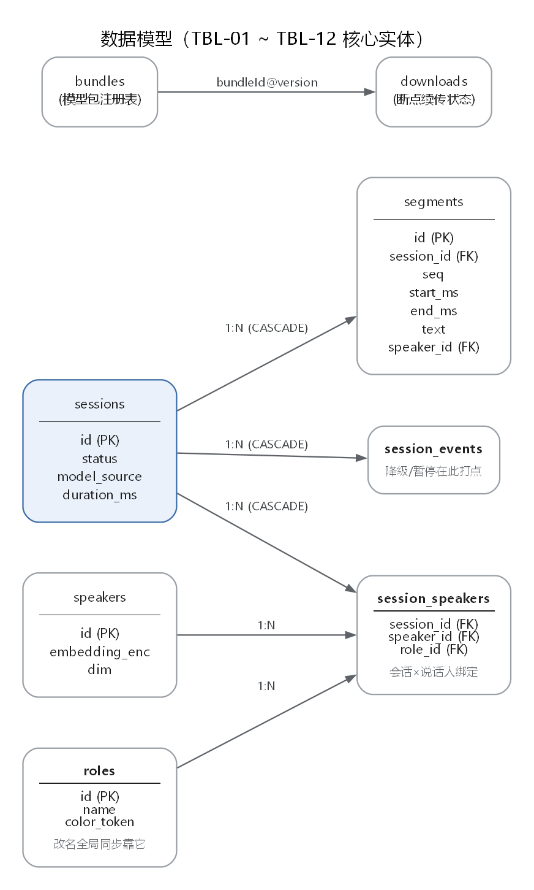

# Mandaryn 数据模型设计（DATA-MODEL）

| 项 | 值 |
|----|----|
| 文档编号 | DOC-04 |
| 文档版本 | **v1.2.0** |
| 产品基线 | Mandaryn v0.1.0 |
| 状态 | 评审通过（Baseline） |
| 最后更新 | 2026-11-10 |
| 上游文档 | [ARCHITECTURE.md](./ARCHITECTURE.md) |
| 下游文档 | [API.md](./API.md)、[DEPLOYMENT.md](./DEPLOYMENT.md) |

> 本文定义**持久化形态**：SQLite 表结构、索引、文件布局、迁移与清理规则。
> DTO 归 DOC-03；术语归 DOC-00；表如何在 `AllModels` 注册与业务 service 如何接入见 [PERSISTENCE.md](./PERSISTENCE.md)。

---

## 1. 存储总览

| 存储 | 引擎 | 用途 | 位置 |
|------|------|------|------|
| 结构化数据 | SQLite（WAL，modernc 纯 Go）+ GORM AutoMigrate | 会话/片段/角色/模型注册/设置 | `<dataRoot>/mandaryn.db` |
| 全文索引 | SQLite **FTS5** 虚拟表（手工建，见 §5） | 片段全文检索 | 同库 |
| 音频 | 文件（WAV/FLAC） | 回放与重转 | `<dataRoot>/sessions/<id>/audio.wav` |
| 模型包 | 文件目录 | 推理 | `<modelRoot>/models/<bundleId>@<version>/` |
| 密钥 | 文件 + 加密列 | cryptox 主密钥、凭据密文 | `<dataRoot>/.master.key` |
| 日志 | 文件（rotate） | 诊断（**不含正文**） | `<dataRoot>/logs/` |

### 1.1 两个根目录（**不可混淆**）

| 根 | 默认值 | 内容 | 谁可以改 |
|----|--------|------|----------|
| `dataRoot` | Windows `%AppData%\Mandaryn`；macOS `~/Library/Application Support/Mandaryn`；Linux `${XDG_DATA_HOME:-~/.local/share}/Mandaryn` | 数据库、日志、密钥、**会话音频** | `storagesvc`（既有「数据存储」页） |
| `modelRoot` | **`~/.mandaryn`**（FR-07-1） | 模型包、下载临时区 | `modelssvc`（FR-07-2，可迁移） |

> 为什么分开：模型是可再生的**大体积可迁移资产**，用户常放到外置盘；数据库与会话音频是**不可再生的业务数据**，
> 迁移策略与回滚语义完全不同（ARCH §4.6.3 vs `storagesvc`）。两者的「迁移」实现**不得复用**。

---

## 2. 表结构

> 所有表由 `internal/storage/models.go` 的 `AllModels` 注册；新增表遵循现有 `ModelDescriptor` 规范
> （`TableName` / `LabelKey` / `Clearable`）。

### TBL-01 `preferences`（既有，不改）

| 列 | 类型 | 约束 | 说明 |
|----|------|------|------|
| `key` | TEXT | PK, size 128 | 偏好键 |
| `value` | TEXT | NOT NULL | JSON |
| `updated_at` | INTEGER | autoUpdateTime:milli | |

用途：布局（`layout`）、`navCollapsed`、`floatDockSide`、`floatDockY`、以及快捷键覆盖表（JSON，见 TBL-01.1）。

**TBL-01.1 快捷键的存储形态**（不新建表，理由是条目固定且量小）

```json
// preferences.key = "hotkeys.override"
{ "record.toggle": "Ctrl+Alt+R", "playback.play": "Space", "window.show": null }
```
`null` 表示该动作被禁用；缺键表示使用默认（默认表在代码常量，DOC-05 §2）。

### TBL-02 `app_settings`（既有，扩展字段）

| 列 | 类型 | 约束 | 默认 | 说明 |
|----|------|------|------|------|
| `id` | INTEGER | PK, CHECK(id=1) | 1 | 单行表 |
| `theme_choice` | TEXT | size 64, NOT NULL | `system` | 既有 |
| `custom_theme` | TEXT | | | 既有（JSON） |
| `locale_choice` | TEXT | size 32, NOT NULL | `auto` | 既有 |
| `model_source` | TEXT | size 16, NOT NULL | `local` | `local` / `online`（FR-01-1） |
| `online_endpoint` | TEXT | size 512 | | 在线端点（HTTPS） |
| `online_model` | TEXT | size 128 | | 端点模型名 |
| `online_language` | TEXT | size 16 | `auto` | |
| `online_api_key_enc` | TEXT | | | **AES-GCM 密文**（cryptox） |
| `online_consent_at` | INTEGER | NOT NULL | 0 | 0 = 未确认；>0 = 已确认时间（ms）（FR-08-2） |
| `online_consent_host` | TEXT | size 255 | | 确认时绑定的域名，变更需重新确认 |
| `fallback_to_local` | INTEGER | NOT NULL | 1 | bool |
| `auto_switch_back` | INTEGER | NOT NULL | 0 | bool，默认关（ARCH §4.2.4） |
| `max_retries` | INTEGER | NOT NULL | 2 | 在线失败重试次数（0–10，`FallbackPolicy.MaxRetries` 持久化） |
| `proxy_type` | TEXT | size 16 | `none` | `none`/`http`/`https`/`socks5` |
| `proxy_host` | TEXT | size 255 | | |
| `proxy_port` | INTEGER | | 0 | |
| `proxy_username` | TEXT | size 128 | | |
| `proxy_password_enc` | TEXT | | | AES-GCM 密文 |
| `proxy_for_download` | INTEGER | NOT NULL | 1 | bool |
| `proxy_for_online` | INTEGER | NOT NULL | 1 | bool |
| `proxy_no_proxy` | TEXT | size 512 | | 逗号分隔 |
| `model_root` | TEXT | size 1024 | `""` | 空=默认 `~/.mandaryn`（FR-07-2）。**语义为用户层的值**：即使被 `env`/`cli` 接管也原样保留，供 UI 展示「你的设置（未生效）」（DOC-02 §4.8） |
| `model_root_pending` | TEXT | size 1024 | `""` | 非空表示「受管期间用户改过的目录」，解除接管并重启后自动写入 `model_root` 并清空此列（`FR-07-8`） |
| `save_format` | TEXT | size 8 | `wav` | `wav`/`flac` |
| `sensitivity` | TEXT | size 16 | `standard` | `standard`/`noisy`（替代 VAD 阈值，DOC-05 §4） |
| `max_speakers` | INTEGER | NOT NULL | 0 | 0=自动，2–8 |
| `default_source_id` | TEXT | size 255 | | 上次源（FR-02-5） |
| `auto_name` | INTEGER | NOT NULL | 1 | 会话自动命名 |
| `no_audio_persist` | INTEGER | NOT NULL | 0 | 在线模式不落盘（P1） |
| `log_level` | TEXT | size 8 | `info` | `info`/`debug`/`off`；即「调试模式」开关的用户层：`debug` = 开（额外写 `logs/debug.log`），`info`/`off` = 关（`off` 不关闭 `app.log`）；环境变量 `MANDARYN_LOG_LEVEL` 覆盖（DEPLOYMENT §5.1） |
| `resource_cap_pct` | INTEGER | NOT NULL, CHECK(`resource_cap_pct` BETWEEN 10 AND 100) | 80 | **整机性能预算 `N`**（`NFR-08`）；步进 5 由应用层校验（SQLite 无法表达步进），越界返回 `ERR_PERF_CAP_RANGE` |
| `updated_at` | INTEGER | autoUpdateTime:milli | | |

> 既有字段保持不动（`theme_choice` / `custom_theme` / `locale_choice`），保证主题与 i18n 不回退。

### TBL-03 `sessions`

| 列 | 类型 | 约束 | 说明 |
|----|------|------|------|
| `id` | TEXT | PK, size 32 | `s_<26 位 ULID>` |
| `title` | TEXT | size 255, NOT NULL | 默认「YYYY-MM-DD HH:mm · KOOK」 |
| `source_id` | TEXT | size 255 | 源稳定 ID（`app:kook.exe`） |
| `source_name` | TEXT | size 128 | 冗余展示名（源消失后仍可读） |
| `source_kind` | TEXT | size 16 | `application`/`device` |
| `model_source` | TEXT | size 16, NOT NULL | `local`/`online`（**FR-08-3 导出保留**） |
| `engine_id` | TEXT | size 128 | 主引擎 `bundleId@version` 或 `online:<model>` |
| `status` | TEXT | size 16, NOT NULL | **录制状态**（与 `ST` 对齐）：`completed`/`interrupted`/`failed`/`degraded`。**不包含转写进度**（见 `transcription_status`） |
| `degraded` | INTEGER | NOT NULL, 0 | 是否发生过降级（ST-07 标记） |
| `degrade_reason` | TEXT | size 255 | |
| `started_at` | INTEGER | NOT NULL | 毫秒时间戳（wall clock，仅显示用） |
| `ended_at` | INTEGER | | |
| `duration_ms` | INTEGER | NOT NULL, 0 | **逻辑时长**（帧计数换算，ARCH §4.5.1） |
| `audio_path` | TEXT | size 512 | **相对 `dataRoot`**（数据目录迁移不需改库） |
| `audio_format` | TEXT | size 8 | `wav`/`flac` |
| `vad_preset` | TEXT | NOT NULL, `standard-v1` | 开录时固定 `standard-v1` 或 `noisy-v1`，历史会话沿用标准；录中与延期转写及断点续跑统一读取 |
| `size_bytes` | INTEGER | NOT NULL, 0 | 音频文件大小 |
| `segment_count` | INTEGER | NOT NULL, 0 | 冗余计数（列表页免 count） |
| `speaker_count` | INTEGER | NOT NULL, 0 | 同上 |
| `char_count` | INTEGER | NOT NULL, 0 | 冗余字符数（未转写时为 0，转写完成后回填） |
| `transcription_status` | TEXT | size 16, NOT NULL, default `none` | **转写任务状态**（独立于 `status`，见 ARCH §6.4）：`none`/`queued`/`running`/`done`/`failed` |
| `transcribed_at` | INTEGER | | 转写完成时间（ms） |
| `transcribe_engine_id` | TEXT | size 128 | 实际用于转写的引擎 `bundleId@version` / `online:<model>`（重转与审计用） |
| `live_transcribed` | INTEGER | NOT NULL, 0 | 是否在录制中开了「边录边转」（`FR-03-10`） |
| `transcribe_progress_ms` | INTEGER | NOT NULL, 0 | 已转写的音频位置，断点续跑用 |
| `created_at` | INTEGER | autoCreateTime:milli | |
| `updated_at` | INTEGER | autoUpdateTime:milli | |

**索引**

| 索引 | 列 | 用途 |
|------|----|------|
| `idx_sessions_started` | `(started_at DESC)` | 列表默认排序 |
| `idx_sessions_status` | `(status)` | 筛选 interrupted |
| `idx_sessions_model_source` | `(model_source)` | 筛选在线会话（FR-08-3） |
| `idx_sessions_transcription` | `(transcription_status, started_at DESC)` | 列表筛选「待转写」与空闲转写队列扫描 |
| `idx_sessions_source` | `(source_id)` | 按应用筛选 |

### TBL-04 `segments`

| 列 | 类型 | 约束 | 说明 |
|----|------|------|------|
| `id` | INTEGER | PK AUTOINCREMENT | |
| `session_id` | TEXT | NOT NULL, FK→sessions.id ON DELETE CASCADE | |
| `seq` | INTEGER | NOT NULL | 会话内单调递增（从 0） |
| `start_ms` | INTEGER | NOT NULL | 时间轴起点（VAD 端点，ARCH §4.5.2） |
| `end_ms` | INTEGER | NOT NULL | 时间轴终点 |
| `text` | TEXT | NOT NULL | 定稿文本 |
| `speaker_id` | TEXT | size 32, FK→speakers.id | 空 = 未识别 |
| `confidence` | REAL | | 0–1 |
| `engine_id` | TEXT | size 128 | 产出该片段的引擎（降级前后可不同） |
| `is_final` | INTEGER | NOT NULL, 1 | 0=partial 残留（崩溃时可能存在） |
| `edited` | INTEGER | NOT NULL, 0 | 用户人工修正过（API-4.4） |
| `created_at` | INTEGER | autoCreateTime:milli | |

**约束与索引**

| 项 | 定义 | 理由 |
|----|------|------|
| `uq_segments_session_seq` | UNIQUE `(session_id, seq)` | 幂等写入，重转不产生重复句 |
| `idx_segments_timeline` | `(session_id, start_ms)` | 回放二分定位（ARCH §4.5.3） |
| `idx_segments_speaker` | `(speaker_id)` | 按说话人聚合 |
| 断言 | 写入时校验 `start_ms <= end_ms` 且 `start_ms >= 上一句.start_ms` | 保证前端二分的单调性前提 |

> **不存角色名**：只存 `speaker_id`，角色名通过 `speakers → session_speakers → roles` join 得到。
> 这是 FR-06-3「改名全局同步、禁止新旧名并存」的唯一正确实现（ARCH §4.4）。

### TBL-05 `speakers`（声纹身份，**全局**）

| 列 | 类型 | 约束 | 说明 |
|----|------|------|------|
| `id` | TEXT | PK, size 32 | `sp_<ULID>` |
| `embedding_enc` | TEXT | | **AES-GCM 密文**（cryptox），base64；禁止明文落库 |
| `dim` | INTEGER | NOT NULL | 向量维度（随模型，192/256） |
| `model_id` | TEXT | size 128 | 产出该向量的声纹模型（换模型需重建库 → §4.3） |
| `first_seen_at` | INTEGER | NOT NULL | 首次出现（ms） |
| `last_seen_at` | INTEGER | NOT NULL | 最近出现 |
| `session_count` | INTEGER | NOT NULL, 0 | 冗余计数 |
| `total_speech_ms` | INTEGER | NOT NULL, 0 | 累计语音时长（排序用：可信度参考） |

> 声纹表**加密**意味着不能做 SQL 向量检索 —— 启动时解密并注入 `SpeakerEmbeddingManager` 内存注册表
> （ARCH §4.4）。规模假设：单用户 ≤ 5000 个说话人，全量加载内存开销 ≈ 5000×256×4B ≈ 5MB，可接受。

### TBL-06 `session_speakers`（会话 × 说话人 → 角色）

| 列 | 类型 | 约束 | 说明 |
|----|------|------|------|
| `id` | INTEGER | PK AUTOINCREMENT | |
| `session_id` | TEXT | NOT NULL, FK→sessions.id ON DELETE CASCADE | |
| `speaker_id` | TEXT | NOT NULL, FK→speakers.id ON DELETE CASCADE | |
| `role_id` | TEXT | NOT NULL, FK→roles.id ON DELETE SET DEFAULT→`rl_unknown` | 角色映射点 |
| `utterance_count` | INTEGER | NOT NULL, 0 | 该会话内句数 |
| `speech_ms` | INTEGER | NOT NULL, 0 | 该会话内语音总时长 |

**约束**：UNIQUE `(session_id, speaker_id)`；索引 `(role_id)`（改名后统计/列表用）。

### TBL-07 `roles`（用户可见标签，**全局**）

| 列 | 类型 | 约束 | 说明 |
|----|------|------|------|
| `id` | TEXT | PK, size 32 | `rl_<ULID>`；内置 `rl_unknown` |
| `name` | TEXT | size 64, NOT NULL | 默认 `说话人 N`；可改 |
| `color_token` | TEXT | size 32, NOT NULL | 主题令牌（如 `accent` / `role-3`），**不存十六进制** |
| `is_system` | INTEGER | NOT NULL, 0 | 1 = 「未识别」内置角色，不可删 |
| `created_at` | INTEGER | autoCreateTime:milli | |
| `updated_at` | INTEGER | autoUpdateTime:milli | |

**改名语义**：`UPDATE roles SET name=? WHERE id=?` 一行即全局生效 → emit `EV-07`（DOC-03 §2.7）。
**删除语义**：不允许物理删除被引用的角色；「删除角色」= 把 `session_speakers.role_id` 指回 `rl_unknown`（保留声纹与片段）。

### TBL-08 `bundles`（模型包注册表）

| 列 | 类型 | 约束 | 说明 |
|----|------|------|------|
| `id` | TEXT | PK, size 128 | `bundleId@version` |
| `bundle_id` | TEXT | NOT NULL, size 64 | |
| `version` | TEXT | NOT NULL, size 32 | |
| `name` | TEXT | size 128 | |
| `path` | TEXT | size 1024 | 相对 `modelRoot` 的路径 |
| `size_bytes` | INTEGER | NOT NULL | |
| `sha256` | TEXT | size 64 | 整包摘要 |
| `verified_at` | INTEGER | | 最近一次校验通过时间 |
| `state` | TEXT | size 16 | `installed`/`corrupt`/`missing` |
| `roles` | TEXT | | JSON 数组：`["streaming","offline","vad","speaker"]` |
| `languages` | TEXT | | JSON 数组 |
| `license` | TEXT | size 64 | |
| `ram_hint_mb` | INTEGER | | |
| `installed_at` | INTEGER | autoCreateTime:milli | |

**索引**：UNIQUE `(bundle_id, version)`；`(state)`。

### TBL-09 `downloads`（断点续传状态）

| 列 | 类型 | 约束 | 说明 |
|----|------|------|------|
| `id` | TEXT | PK, size 128 | = `bundleId@version` |
| `url_idx` | INTEGER | NOT NULL, 0 | 当前镜像索引（失败切镜像） |
| `etag` | TEXT | size 128 | 续传判据（ETag 变则整包重下，ARCH §4.6.2） |
| `bytes_done` | INTEGER | NOT NULL, 0 | |
| `bytes_total` | INTEGER | NOT NULL, 0 | |
| `parts_done` | TEXT | | JSON：已完成分片序号数组 |
| `retries` | INTEGER | NOT NULL, 0 | |
| `state` | TEXT | size 16 | `queued`/`downloading`/`verifying`/`paused`/`failed` |
| `last_error` | TEXT | size 255 | 错误码 + 摘要 |
| `updated_at` | INTEGER | autoUpdateTime:milli | |

> 分片文件本身在 `<modelRoot>/.downloads/`，表只存**状态**；两者不一致时以表为准并清理孤儿分片（§4.4）。

### TBL-10 `session_events`（时间轴标记）

| 列 | 类型 | 约束 | 说明 |
|----|------|------|------|
| `id` | INTEGER | PK AUTOINCREMENT | |
| `session_id` | TEXT | NOT NULL, FK→sessions.id ON DELETE CASCADE | |
| `at_ms` | INTEGER | NOT NULL | 时间轴位置 |
| `kind` | TEXT | size 32, NOT NULL | `degrade`/`source-lost`/`device-switch`/`paused`/`resumed`/`perf-throttle`/`perf-suspend`/`perf-resume` |
| `note` | TEXT | size 255 | |

**索引** `(session_id, at_ms)`；供 DOC-03 `Timeline.markers` 展示（录制中的异常在回放时可见）。

### TBL-11 `data_migrations`（一次性迁移钩子）

| 列 | 类型 | 约束 | 说明 |
|----|------|------|------|
| `name` | TEXT | PK, size 128 | 如 `20261110_add_roles_unknown` |
| `applied_at` | INTEGER | NOT NULL | |
| `note` | TEXT | size 255 | |

> GORM AutoMigrate 不做「删列/改名/数据搬迁」，这类变更在 `internal/storage/migrations.go` 里以具名钩子执行，
> 执行前查 `data_migrations` 保证幂等（NFR-04-5）。

### TBL-12 `outbound_log`（出站记录，FR-08/NFR-03）

| 列 | 类型 | 约束 | 说明 |
|----|------|------|------|
| `id` | INTEGER | PK AUTOINCREMENT | |
| `at` | INTEGER | NOT NULL | ms |
| `host` | TEXT | size 255 | 目标域名（**不存完整 URL**，避免 query 泄露） |
| `kind` | TEXT | size 16 | `model-download`/`online-asr` |
| `audio` | INTEGER | NOT NULL, 0 | 是否包含音频（1=是） |
| `bytes` | INTEGER | | |
| `result` | TEXT | size 32 | `ok`/错误码 |

保留策略：仅保留最近 24h（启动时清理），供设置页「最近出站点」展示（DOC-03 API-9.8）。

---

## 3. 关系图



*DOT 源码：[diagrams/DATA-01-er.dot](./diagrams/DATA-01-er.dot)*

---

## 4. 一致性、迁移与清理

### 4.1 删除语义（级联矩阵）

| 操作 | sessions | segments | session_speakers | session_events | 音频文件 | speakers |
|------|----------|----------|------------------|----------------|----------|----------|
| 删除会话 | 删 | 级联删 | 级联删 | 级联删 | 删目录 | **保留**（跨会话身份） |
| 删除角色 | — | — | `role_id → rl_unknown` | — | — | 保留 |
| 合并说话人 | — | 改 `speaker_id` | 合并行 | — | — | 删被并者（或标 `merged_into`） |
| 删除模型包 | — | 片段保留 `engine_id` 字符串 | — | — | — | — |
| 清空声纹库 | — | `speaker_id → NULL` | 删全部 | — | — | 删全部（保留 `rl_unknown`） |

> 会话删除是**唯一会丢数据**的操作，UI 必须二次确认（DOC-05 §5.4）。

### 4.2 会话写入事务边界

```
Stop():
  BEGIN
    UPDATE sessions SET ended_at, duration_ms, segment_count, speaker_count, status
    UPDATE segments SET is_final=1 WHERE session_id=? AND is_final=0   -- 兜底定稿
    UPSERT session_speakers (...)
  COMMIT
  → 提交成功后才置 ST-06 completed；失败则 ST-08 interrupted（音频仍在）(ARCH §6.2)
```

### 4.3 声纹模型变更

`speakers.model_id` 与当前声纹模型不一致时：

| 策略 | 说明 |
|------|------|
| 检测 | 切换声纹模型 → 比较 `model_id` 集合 |
| 处置 | 保留旧向量（不删），新建的说话人用新模型；跨模型不比较相似度（维度/空间不同） |
| 提示 | 「声纹模型已更换，历史说话人不会自动归并到新会话」 |
| 重建 | 提供「重新分析会话」按钮（重转并重建该会话的 speaker 映射，P1） |

### 4.4 孤儿清理（启动自检）

| 检查 | 动作 |
|------|------|
| `.downloads/` 中的分片在 `downloads` 表无对应记录 | 删除分片 |
| `downloads` 记录的分片文件全部缺失 | 重置为 `queued`，`bytes_done=0` |
| `bundles` 记录的 `path` 不存在 | 置 `state=missing`，提示重新下载 |
| `sessions` 记录 `audio_path` 不存在 | 会话标 `failed`，片段保留（可读不可回放） |
| `.staging-*` / `.trash-*` 残留 | 删除（迁移已中断） |
| `sessions.status='recording'` 残留（非正常退出） | 修补 WAV 头 → 置 `interrupted`（UC-07） |

### 4.5 GORM 迁移边界

| 变更类型 | 手段 | 需要迁移钩子 |
|----------|------|--------------|
| 加表 / 加列 / 加索引 | `AllModels` + AutoMigrate | ❌ |
| 加外键 | AutoMigrate（`foreign_keys=ON`） | ❌ |
| 改列类型（兼容） | AutoMigrate | ❌ |
| 删列 / 改名 / 数据搬迁 / 回填 | `internal/storage/migrations.go` 具名钩子 + `data_migrations` | ✅ |
| 加 FTS5 虚表/触发器 | 手工 SQL（`CREATE VIRTUAL TABLE IF NOT EXISTS`） | ✅ |

---

## 5. 全文检索（FTS5）

AutoMigrate 无法创建虚表，故在 `internal/storage/fts.go` 以幂等 SQL 建立：

```sql
CREATE VIRTUAL TABLE IF NOT EXISTS segments_fts USING fts5(
  text, content='segments', content_rowid='id', tokenize='unicode61'
);
-- 触发器保持同步：segments INSERT / UPDATE / DELETE → segments_fts
```

| 项 | 取值 | 理由 |
|----|------|------|
| 分词器 | `unicode61` | 中文按字切分可用；不引入 ICU 依赖（纯 Go 构建） |
| 查询方式 | `MATCH` + `snippet()` | 命中高亮；NFR-01 要求 10 万片段 ≤ 500ms |
| 中文体验 | 字级 AND 查询（「冻结 数据」可行） | 若后续需要词级，可换 `simple` + 外部分词 |
| 重建 | `INSERT INTO segments_fts(segments_fts) VALUES('rebuild')` | 版本升级后按需触发 |

---

## 6. 文件布局

### 6.1 `dataRoot`

```
<dataRoot>/
  mandaryn.db  mandaryn.db-wal  mandaryn.db-shm
  storage.json            # 数据目录配置（既有；鸡生蛋，不能存库）
  .master.key             # cryptox 主密钥（POSIX 0600 / Windows 用户 ACL）
  logs/
    mandaryn-2026-11-10.log
  sessions/
    s_01JC8Z.../
      audio.wav           # 16kHz/16bit/mono（NFR-01）
      meta.json           # 冗余快照（源、时长、引擎），便于断库诊断
  exports/                # 导出临时区（写成功后 move 到用户目标）
```

### 6.2 `modelRoot`（默认 `~/.mandaryn`）

```
<modelRoot>/
  manifest.cache.json     # 远程清单缓存（含摘要）
  models/
    sensevoice-small@1.2.0/
      manifest.json       # bundleId/version/files[{path,sha256,size}]/license/langs
      model.onnx
      tokens.txt
    zipformer-zh-streaming@1.0.3/
    vad-silero@1.0.0/
    speakernet-zh@1.0.0/
  .downloads/
    sensevoice-small@1.2.0.part.0 ... .part.3
    sensevoice-small@1.2.0.state.json
  .staging-<uuid>/        # 迁移临时区
  .mandaryn-root.json     # 目录身份标记（防误删/防错挂载）
```

**`.mandaryn-root.json`** 用途：迁移切换与启动校验时确认「这个目录确实是 Mandaryn 的 modelRoot」，
避免把用户误选的目录（如桌面）当成模型目录清理。

---

## 7. 容量与保留策略

| 数据 | 单会话估算 | 1000 会话估算 | 保留 |
|------|-----------|---------------|------|
| 音频 WAV | ≈110MB/h | ≈ 110GB（1000h） | 默认永久；可配「30/90/180 天或按大小上限自动清理」（P1） |
| 音频 FLAC | ≈55MB/h | ≈ 55GB | 同上 |
| segments | 500 条/h × ~150B ≈ 75KB/h | ≈ 75MB | 随会话 |
| FTS 索引 | ≈ 正文 30% | ≈ 25MB | 随会话 |
| speakers | 每人 ~1KB（加密后 ~1.4KB） | ≤ 7MB | 永久（除非清空声纹库） |
| 模型包 | 见清单 | 每包 0.3–2GB | 用户手动删除 |

> 磁盘不足时：录制中返回 `ERR_DISK_FULL` 并**优雅结束会话**（已录部分可回放），不静默丢数据（NFR-04-1）。

---

## 8. 与 DOC-03 的对应

| API 方法 | 触及的表 |
|----------|----------|
| `recordingsvc.Start/Pause/Resume/Stop` | TBL-03（封存录音实例：`audio_path`/`duration_ms`/`size_bytes`/`transcription_status=none`）、TBL-10 |
| `transcriptsvc.StartTranscription/CancelTranscription/GetTranscription` | TBL-03（`transcription_status`/`transcribe_progress_ms`/`transcribed_at`/`transcribe_engine_id`）、TBL-04、TBL-06、TBL-07、TBL-10 |
| `transcriptsvc.GetTimeline` | TBL-04、TBL-07、TBL-10 |
| `sessionsvc.List/Get/Rename/Delete/Export` | TBL-03、TBL-04、TBL-06、TBL-07 |
| `modelssvc.*` | TBL-08、TBL-09、TBL-02(`model_root`、`model_root_pending`) |
| `enginesvc.*` | TBL-02 |
| `speakersvc.*` | TBL-05、TBL-06、TBL-07 |
| `hotkeysvc.*` | TBL-01(`hotkeys.override`) |
| `appsettings.*` | TBL-02、TBL-12 |
| `appsettings.SetResourceCap` / `GetPerfUsage`（`NFR-08`） | TBL-02（`resource_cap_pct`）；暂停/降档同时写 TBL-10（`perf-suspend`/`perf-throttle`）供回放时可见 |
| `pathsvc.GetResolvedPaths` / `SetModelRoot` / `ClearModelRoot`（ADR-02） | TBL-02（`model_root` / `model_root_pending`）；`dataRoot` 的用户层落在 `storage.json`（鸡生蛋问题，不能存库，见 §1.1），CLI/ENV 两层不持久化 |

---

## 9. 变更记录

| 日期 | 版本 | 变更 | 作者 |
|------|------|------|------|
| 2026-11-10 | v1.0.0 | 首版：12 张表（含 2 张扩展既有表）、索引与外键矩阵、FTS5 方案、两级根目录、级联/孤儿清理、容量估算 | Kether |
| 2026-11-10 | v1.1.0 | `app_settings` 新增 `resource_cap_pct`（`NFR-08` 整机性能预算，默认 80，CHECK 10–100，步进由应用层校验）；`session_events.kind` 增加 `perf-throttle`/`perf-suspend`/`perf-resume`；§8 补 `SetResourceCap`/`GetPerfUsage` 的落表说明 | Kether |
| 2026-11-10 | v1.2.0 | `app_settings` 新增 `model_root_pending`（受管期间暂存目录，`FR-07-8`）；`model_root` 明确为**用户层值**（被接管时仍保留，供 UI 展示未生效设置）；§8 补 `pathsvc.*` 落表说明并声明 `dataRoot` 不落库（ADR-02） | Kether |
| 2026-11-11 | v1.2.0 | **录制与转写解耦**：`sessions` 新增 `transcription_status`（`none`/`queued`/`running`/`done`/`failed`，不并入 `status`）、`transcribed_at`、`transcribe_engine_id`、`live_transcribed`、`transcribe_progress_ms`（断点续跑），新增索引 `idx_sessions_transcription`；`char_count` 说明改为「未转写时为 0、转写后回填」；§8 补 `transcriptsvc.StartTranscription/CancelTranscription/GetTranscription` 的落表映射，`recordingsvc` 不再触碰 TBL-04/TBL-06 | Kether |
