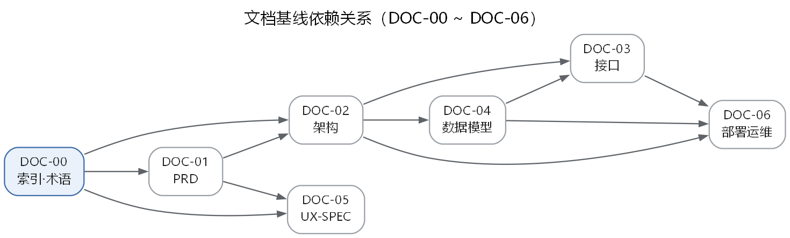

# Mandaryn 文档索引（DOC-INDEX）

| 项 | 值 |
|----|----|
| 文档版本 | **v1.2.0** |
| 产品基线 | Mandaryn v0.1.0（首个可交付版本） |
| 状态 | 评审通过（Baseline） |
| 最后更新 | 2026-11-10 |
| 维护人 | Kether |
| 文档责任人 | 产品 / 架构 / 前端 / 后端（按文档分工，见 §3） |

> 本文件是**整套文档的唯一入口**。所有文档的术语、编号、版本以本文件为准；
> 任何文档若与本文冲突，以本文为准并需提 issue 修正该文档。

---

## 1. 产品一句话

**Mandaryn** 是一款桌面端「按应用分路捕获音频 → 实时中文语音转写 → 声纹区分说话人 → 歌词式回放」的隐私优先工具：
默认全程本地推理，用户也可显式切换到在线模型以换取更强准确率与语种覆盖。

---

## 2. 文档地图

| 编号 | 文档 | 文件 | 版本 | 读者 | 依赖（前置） | 被谁引用 |
|------|------|------|------|------|--------------|----------|
| DOC-00 | 文档索引与术语表 | [DOC-INDEX.md](./DOC-INDEX.md) | v1.5.0 | 全体 | — | 全部 |
| DOC-01 | 产品需求文档（PRD） | [PRD.md](./PRD.md) | v1.3.0 | 产品 / 设计 / 测试 | DOC-00 | DOC-02、DOC-05 |
| DOC-02 | 架构设计文档（SAD） | [ARCHITECTURE.md](./ARCHITECTURE.md) | v1.3.0 | 后端 / 前端 / 架构 | DOC-00、DOC-01 | DOC-03、DOC-04、DOC-06 |
| DOC-03 | 接口文档（API） | [API.md](./API.md) | v1.3.0 | 后端 / 前端 | DOC-02、DOC-04 | DOC-06 |
| DOC-04 | 数据模型设计 | [DATA-MODEL.md](./DATA-MODEL.md) | v1.2.0 | 后端 / 数据 | DOC-02 | DOC-03、DOC-06 |
| DOC-05 | 交互与快捷键规范（UX-SPEC） | [UX-SPEC.md](./UX-SPEC.md) | v1.2.0 | 前端 / 设计 | DOC-00、DOC-01 | — |
| DOC-06 | 部署与运维说明 | [DEPLOYMENT.md](./DEPLOYMENT.md) | v1.2.0 | 构建 / 发布 / 运维 | DOC-02、DOC-04 | — |
| DOC-07 | 变更记录（Changelog） | [CHANGELOG.md](./CHANGELOG.md) | v1.0.0 | 全体 | DOC-00 | 全部（项目唯一的变更历史来源） |
| DOC-08 | 开发路线图（Roadmap） | [ROADMAP.md](./ROADMAP.md) | v1.0.0 | 全体 | DOC-00、DOC-01 | DOC-00、DOC-01（进度反馈） |
| DOC-09 | 持久化实现指南（Persistence） | [PERSISTENCE.md](./PERSISTENCE.md) | v1.0.0 | 后端 / 数据 | DOC-02、DOC-04 | DOC-04（加表步骤）、DOC-10 |
| DOC-10 | 开发指南（Development） | [DEVELOPMENT.md](./DEVELOPMENT.md) | v1.0.0 | 全体 | DOC-02、DOC-08 | DOC-09、DOC-06、DOC-02 |

### 2.1 引用与依赖关系

*DOT 源码：[diagrams/DOC-01-deps.dot](./diagrams/DOC-01-deps.dot)*

**依赖是单向的**：下游文档可以引用上游文档的编号与术语，上游文档**不得**定义下游的实现细节。
例如：PRD 只声明「首字延迟 ≤ 900ms（P50）」，具体如何测量、在哪层打点由架构文档（DOC-02 §7.3）定义。

### 2.2 版本联动规则

| 变更类型 | 需要升版 | 示例 |
|----------|----------|------|
| 术语、编号体系变更 | DOC-00 + 全部 | 把「角色」改名为「说话人标签」 |
| FR/NFR 增删或优先级变化 | DOC-01（次版本号）+ 引用处 | 新增「实时翻译」需求 |
| 模块边界、状态机、降级策略变化 | DOC-02（次版本号）+ DOC-03/04 | 引入子进程推理 |
| 服务方法签名、事件 payload 变化 | DOC-03（次版本号） | `Start` 增加 `SourceID` 参数 |
| 表结构 / 文件布局变化 | DOC-04（次版本号）+ 迁移说明 | 新增 `roles` 表 |
| 新增或改变 ADR 结论（决策状态变化） | DOC-00（次版本号）+ 全部引用处 | CGO 从「待确认」转为「已决策」 |
| 纯文字修正、补图、错别字 | 修订号（v1.0.0 → v1.0.1） | 修正 OCR 笔误 |

---

## 3. 术语表（强制统一）

> 下表是**唯一**术语来源。文档与代码标识符必须使用「术语 / 代码标识」两列，不得自造同义词。

| 术语 | 代码标识 | 定义 | 不要写成 |
|------|----------|------|----------|
| 会话 | `session` | 一次「采集 → 转写 → 可回放」的完整产物：1 条音频轨 + N 条转写片段 + 说话人映射 | 记录、录音文件 |
| 录制 | `recording` | 会话的**采集中间过程**（会话的一个阶段，不是产物） | 录音（歧义） |
| 转写片段 | `segment` | 带起止时间戳的一段文字，是时间轴对齐与高亮的最小单位 | 句子、字幕行 |
| 说话人 | `speaker` | 由声纹聚类得到的**声学身份**，全局唯一（跨会话复用一个 `speaker`） | 人、用户 |
| 角色 | `role` | 用户可见、可重命名的标签，通过 `role_id` 关联一个或多个说话人 | 昵称、备注 |
| 音频源 | `source` | 一路可被捕获的音频流，分「应用音频源」与「设备音频源」 | 输入、通道 |
| 捕获通道 | `channel` | 后端对某个音频源的一个活跃采集实例 | 流、管道 |
| 模型来源 | `modelSource` | 取值仅 `local`（本地离线）或 `online`（在线） | 引擎模式、提供商 |
| 推理引擎 | `engine` | 加载模型并产出转写结果的运行时封装，对上层暴露统一接口 | 模型、服务 |
| 模型包 | `bundle` | 可分发的离线模型目录（权重 + `manifest.json`），有 `bundleId` 与 `version` | 模型文件、权重 |
| 模型根目录 | `modelRoot` | 离线模型包的存储根，默认 `~/.mandaryn`，用户可改 | 下载目录、缓存目录 |
| 数据根目录 | `dataRoot` | 数据库 / 日志 / 密钥所在根，来自平台规范路径 | 用户目录 |
| 首字延迟 | `FFD` | 从**开始录制**到首条 partial 文本出现在界面上的时间 | 启动延迟 |
| 持续转写延迟 | `SLD` | 从**一句语音结束**到该片段被 finalized 的时间 | 转写延迟、延迟 |
| 时间轴 | `timeline` | 会话音频的时间轴，单位**毫秒**，原点为 `session.audioStartMs` | 进度条 |
| 降级 | `degraded` | 在线引擎不可用时自动回退本地引擎，并在会话上留痕的状态 | 兜底、容错 |
| 旁路（代理） | `proxy` | 仅作用于「模型下载」与「在线转写」的出站代理配置 | VPN、转发 |
| 性能预算上限 | `resourceCap` | 用户设定的**整机**性能预算 `N%`（默认 80%，范围 10–100，步进 5）。≠「本应用上限」，定义见 DOC-01 `NFR-08` | CPU 上限、性能模式 |
| 整机 CPU 占用 | `totalCpuPct` | 全机所有进程的 CPU 使用率，按核数归一化的百分比；口径与采样窗口见 DOC-01 `NFR-08` | CPU 占用 |
| 其他应用占用 | `otherPct` | `totalCpuPct − selfCpuPct`，即本软件之外的所有应用之和；限流判据的核心输入 | 别家占用、系统负载 |
| 可用额度 | `headroom` | `N − otherPct`。> 0 时按额度降档；≤ 0 时暂停推理 | 余量、余额 |
| 限流 | `throttled` | 因 `headroom` 收窄而**主动降低推理档位**的正交标记（不改变 ST 主状态，与 `degraded` 并列） | 降级（`degraded` 专指模型来源回退，勿混用） |
| 预算暂停 | `suspended` | `otherPct ≥ N` 时**暂停推理任务**（录制与落盘继续）的正交标记；回落自动解除 | 停止、中断（易与 ST-08 `interrupted` 混淆） |

### 3.1 统一书写约定

- 时间单位一律**毫秒**，字段名后缀 `Ms`（如 `startMs`、`durationMs`）；显示层再格式化。
- 状态值一律小写英文枚举（`idle` / `recording` / `degraded`），中文只出现在 UI 文案与文档叙述中。
- 事件名统一 `domain:event` 形式（如 `recording:state`），常量集中声明在 `internal/events/events.go`。
- 错误码统一 `E_<DOMAIN>_<REASON>`（如 `E_ENGINE_LOAD`），全表见 DOC-03 §5。
- 「用户」= 使用本软件的人；「说话人」= 被转写音频中的人。两者**不可混用**。

---

## 4. 需求编号体系

| 前缀 | 含义 | 定义位置 | 引用方式 |
|------|------|----------|----------|
| `FR-xx-y` | 功能需求（Feature Requirement） | DOC-01 §3 | 架构/接口文档必须能反查到 FR |
| `NFR-xx` | 非功能需求（Non-Functional Requirement） | DOC-01 §5 | 部署与测试文档引用 |
| `UC-xx` | 用户场景（Use Case） | DOC-01 §4 | 端到端流程 |
| `ST-xx` | 录制状态（State） | DOC-02 §6 | DOC-03 事件 payload |
| `API-x.y` | 服务方法 | DOC-03 §2 | 前后端契约 |
| `EV-x` | 事件 | DOC-03 §3 | 前后端契约 |
| `ERR-xx` | 错误码 | DOC-03 §5 | 全部 |
| `TBL-xx` | 数据表 | DOC-04 §2 | 全部 |
| `ADR-xx` | 架构决策记录 | DOC-00 §6 | 下游只引用编号，不重新表述决策 |

**NFR 编号现状**：`NFR-01` ~ `NFR-08`（`NFR-01`~`NFR-07` 见 DOC-01 §5；`NFR-08` 为「整机性能预算与自适应限流」，同为 DOC-01 §5，被 DOC-02 §4.7 / DOC-03 §2.9 / DOC-04 TBL-02 / DOC-05 §3.8、§5.9 引用）。
`ST` 编号保持 `ST-01`~`ST-09`：`degraded`（模型来源回退）、`throttled`（降档）、`suspended`（预算暂停）均为**正交标记**，不新增状态号（理由见 DOC-02 §6.1）。

**九大功能域**（与用户需求一一对应，后续所有 FR 均挂在其下）：

| 功能域 | 编号 | 名称 | 一句话 |
|--------|------|------|--------|
| D1 | `FR-01` | 模型来源与切换 | 本地 / 在线双来源，可切换、可降级 |
| D2 | `FR-02` | 应用级音频捕获 | 指定监听某个应用的输出 |
| D3 | `FR-03` | 录制与转写时机 | 快捷键启停、**录完先存录音实例**、空闲或手动再转写（边录边转为可选开关） |
| D4 | `FR-04` | 回放与歌词式同步 | 文字随进度高亮居中滚动 |
| D5 | `FR-05` | 离线模型下载与代理 | 断点续传、校验、代理 |
| D6 | `FR-06` | 说话人分离与角色命名 | 声纹区分 + 改名全局同步 |
| D7 | `FR-07` | 模型目录与迁移 | 默认 `~/.mandaryn`，可迁移可回滚 |
| D8 | `FR-08` | 隐私边界 | 两种模式的数据边界与风险提示 |
| D9 | `FR-09` | 快捷键与精简 UX | 快捷键体系、可自定义项、去冗余 |

---

## 5. 与当前仓库实现的基线差异

本文档描述**目标产品**（Mandaryn v0.1.0）。当前仓库是基于 `foundation` 脚手架（Wails v3 + React 19 + Mantine 9）改造而来，
Go 模块已重命名为 `vip.oberon.mandaryn`。落地前必须完成的基线对齐项：

| 项 | 现状 | 目标 | 影响文档 |
|----|------|------|----------|
| 应用标识 | `Name: "Foundation"`、`AppDirName = "Foundation"`、`foundation.db`、`APP_NAME: foundation` | `Mandaryn`、`mandaryn.db`、`APP_NAME: mandaryn` | DOC-04 §1.1、§6、DOC-06 §3 |
| 数据目录环境变量 | `FOUNDATION_DATA_DIR`，且 `storage.LoadConfig()` 只做「env 或 storage.json」二选一、不暴露来源 | `MANDARYN_DATA_DIR` + `MANDARYN_MODEL_ROOT`；扩展为 `paths.Resolver`，输出 `ResolvedPath`（含 `source` / `pendingValue` / `fallbackFrom`），供设置页四态展示（ADR-02） | DOC-02 §4.8、DOC-03 §2.9.3、DOC-04 TBL-02、DOC-05 §5.10、DOC-06 §4.1 |
| 业务服务包 | `greet`（示例）、`exportsvc`、`preferences`、`appsettings`、`storagesvc`、`subprocess` | 新增 L2 包 `capture`/`asr`/`diarize`/`models`/`recording` 与 L3 服务 `capturesvc`/`recordingsvc`/`transcriptsvc`/`sessionsvc`/`enginesvc`/`modelssvc`/`speakersvc`/`hotkeysvc`/`pathsvc` | DOC-02 §3.1、§3.3 |
| 推理依赖 | 无 | 引入 sherpa-onnx，构建需 `CGO_ENABLED=1`（**已决策，ADR-01**，非可选） | DOC-02 §2.2、DOC-06 §2.1 |
| 数据表 | `preferences`、`app_settings` | 新增 10 张业务表（TBL-03~TBL-12） | DOC-04 §2 |
| 性能预算与限流 | 无推理层，无资源控制 | `app_settings.resource_cap_pct`（默认 80）+ `internal/asr` 资源调度器（采样/降档/暂停）+ 设置页「性能」子页 | DOC-02 §4.7、DOC-03 API-9.9/9.10、DOC-04 TBL-02、DOC-05 §3.8/§5.9 |

> 脚手架的改名现状见 [ARCHITECTURE.md](./ARCHITECTURE.md) §10.1「应用标识收尾」，
> 分层铁律与入口指引见 [../CLAUDE.md](../CLAUDE.md)，本文档不重复，避免两处说法漂移。

---

## 6. 架构决策记录（ADR）

**登记规则**：一条决策一旦与此处编号绑定，就不得在别处重新表述；其它文档只允许「引用编号 + 说明本层影响」（§2.2）。
状态取值 `已决策` / `待确认`；`已决策` 的条目才可被下游当作既定前提使用。

### ADR-01 接受 CGO 依赖

| 项 | 内容 |
|----|------|
| 状态 | **已决策** |
| 日期 | 2026-11-10 |
| 决策 | 本地推理基线采用 **sherpa-onnx**，**接受其 CGO 与平台预编译库依赖**；构建机必须提供 C 工具链（`CGO_ENABLED=1`）。放弃「纯 Go 等价推理栈」路线 |
| 背景 | 候选本地引擎中，纯 Go 方案在中文流式精度与声纹分离上均无法满足 `NFR-03`；而 ONNX Runtime 生态（sherpa-onnx）是唯一同时覆盖 ASR + 说话人分离 + VAD 的成熟组合 |
| 被否方案 | ① 纯 Go 推理（精度不达标）；② 子进程 + 独立运行时（安装体积与启动延迟不可接受，见 DOC-02 §2.2 权衡）；③ 仅在线模型（违反 `FR-08-1` 默认本地承诺） |
| 后果（正面） | 可用成熟引擎；GPU/CPU 算子由上游维护；模型包格式统一 |
| 后果（负面，必须承担） | 交叉编译复杂度上升（`GOOS`/`GOARCH` 需匹配预编译库）；Windows 需 MSYS2/MinGW、macOS 需 Xcode CLT、Linux 需 gcc；CI 镜像体积增大；`CGO_ENABLED=0` 的静态构建不再可用 |
| 影响文档 | DOC-01 `NFR-02`；DOC-02 §2.2、§10；DOC-06 §2.1、§11 |
| 澄清 | `nollm` 变体是**可选的「仅在线」产物**（为极小安装体积而存在），**不是** CGO 不可用时的兜底；不得用它规避构建问题 |

### ADR-02 环境变量与命令行接管路径

| 项 | 内容 |
|----|------|
| 状态 | **已决策** |
| 日期 | 2026-11-10 |
| 决策 | `dataRoot` / `modelRoot` 采用**四级单向覆盖**解析：`cli` > `env` > `user` > `default`；解析结果必须携带来源（`source`），被上层接管时**保留并展示**用户值，用户改动写入暂存（`pending`），并提供可复制的解除方式。**不做置灰处理，也不静默丢弃用户设置** |
| 背景 | 便携版 / E2E / 企业部署需要环境变量覆盖；但若界面仅把输入框置灰，用户会认为「改了没反应 = 软件坏了」，且无从得知是谁接管、怎么解除 |
| 被否方案 | ① 仅置灰（无解释、无法解除，最易被误判为缺陷）；② 环境变量直接改写并覆盖用户值（用户设置永久丢失）；③ 只支持 env 不支持 cli（便携版无法临时覆盖，且 E2E 需靠改环境） |
| 后果（正面） | 覆盖行为可解释、可追溯、可撤销；E2E 与便携版共用同一机制 |
| 后果（负面） | 多一个 `model_root_pending` 列与一套四态 UI；`dataRoot` 无法即时切换（等价于切换整套数据），必须重启生效 |
| 影响文档 | DOC-01 `FR-07-7`/`FR-07-8`；DOC-02 §4.8；DOC-03 §2.9.3；DOC-04 TBL-02；DOC-05 §5.10；DOC-06 §4.1 |

---

## 7. 变更记录

| 日期 | 版本 | 变更 | 作者 |
|------|------|------|------|
| 2026-11-10 | v1.0.0 | 建立文档体系：7 份文档、术语表、编号体系、版本联动规则、仓库基线差异 | Kether |
| 2026-11-10 | v1.1.0 | 新增 `NFR-08` 整机性能预算与自适应限流：登记 6 条术语（`resourceCap`/`totalCpuPct`/`otherPct`/`headroom`/`throttled`/`suspended`）、声明 `NFR-01`~`NFR-08` 与「`throttled`/`suspended` 不新增 ST 编号」、基线差异增加「性能预算与限流」一行；全部文档随术语变更同步升版 | Kether |
| 2026-11-10 | v1.2.0 | 新增 §6 架构决策记录（ADR）并登记 **ADR-01**（接受 CGO 依赖，已决策）与 **ADR-02**（环境变量/命令行接管路径，四级单向覆盖 + 来源可见 + 暂存与解除）；原「变更记录」顺延为 §7；§5 基线差异更新「推理依赖」为已决策，新增「数据目录环境变量 → `paths.Resolver`」一行，业务服务包补 `pathsvc`；全部文档升至 v1.2.0 | Kether |
| 2026-11-11 | v1.3.0 | 新增 **DOC-07 变更记录**（`CHANGELOG.md`）：项目变更历史从 `CLAUDE.md` 独立成文，成为唯一变更来源；`CLAUDE.md` 只保留一句指引（位置与用途），不再维护条目；文档登记表增 DOC-07 一行 | Kether |
| 2026-11-11 | v1.4.0 | 新增 **DOC-08 开发路线图**（`ROADMAP.md`）：按阶段 / 功能域列出开发项与完成标记（`[x]`/`[~]`/`[ ]`），覆盖已完成与待完成内容，不含时间信息；文档登记表增 DOC-08 一行，并把错位在 DOC-06 之前的 DOC-07 行归位 | Kether |
| 2026-11-11 | v1.5.0 | 新增 **DOC-09 持久化实现指南**（`PERSISTENCE.md`）与 **DOC-10 开发指南**（`DEVELOPMENT.md`）：承接根 `CLAUDE.md` 精简时移出的持久化实现细节（加表三步 / Holder 接入 / PRAGMA / 路径切换）与开发操作信息（命令表 / 模块索引与实现状态 / 编码规范 / 测试策略）；`CLAUDE.md` 由 238 行精简至 93 行，改为「实现状态 + 跨文档硬约束 + 入口指引表」；`COM-01` 调用链图、`MOD-01` 模块结构图与应用标识收尾明细表迁入 DOC-02（§1.3 / §3 / §10.1），修正 README、DOC-04、DOC-00 中指向 `CLAUDE.md` 已移出章节的引用 | Kether |
