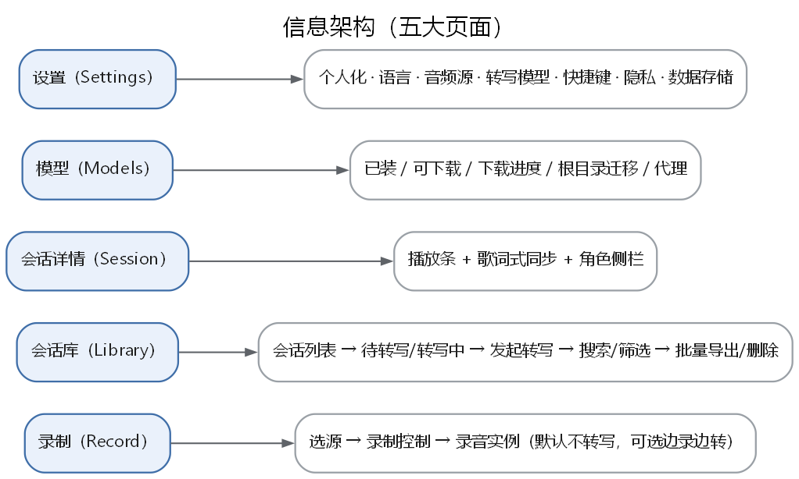
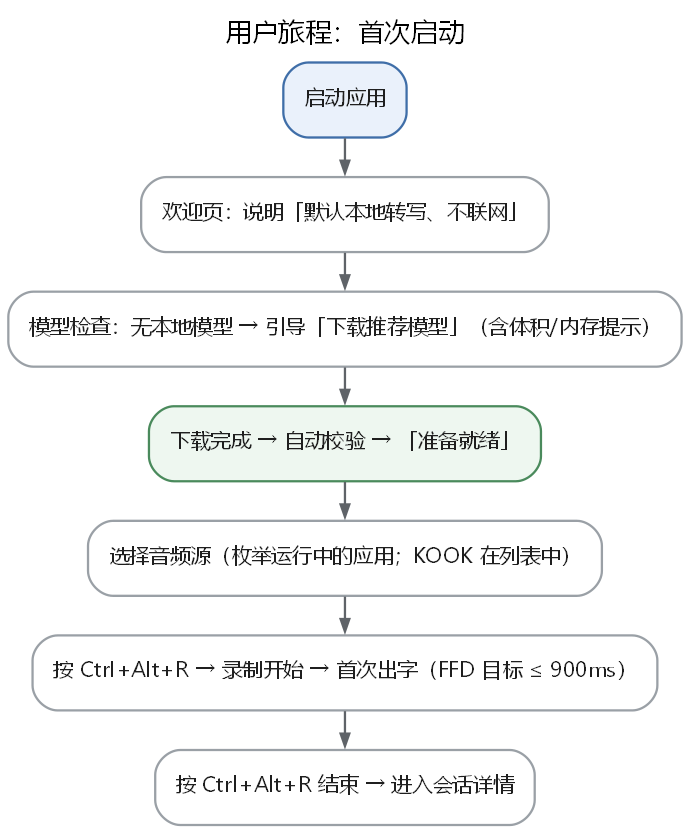
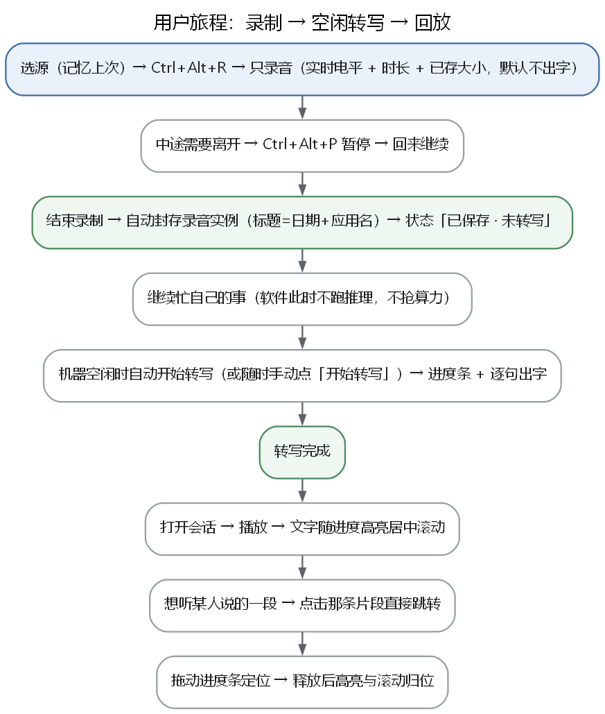
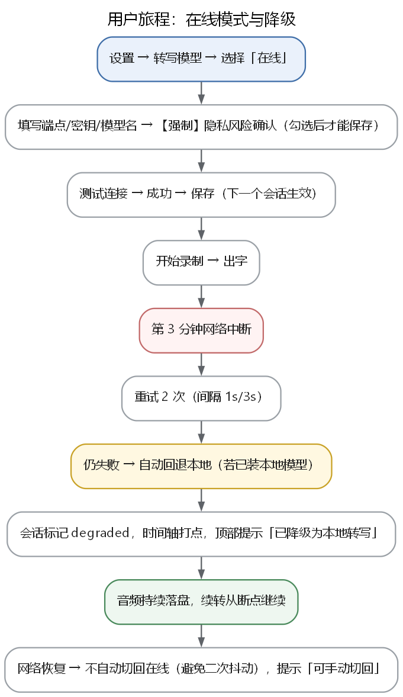
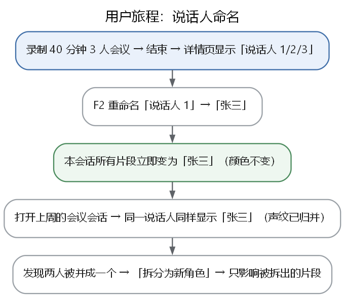
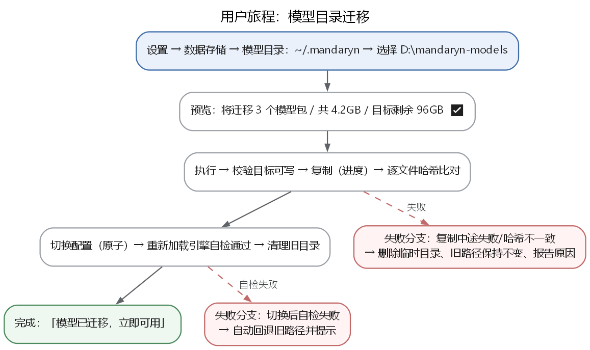
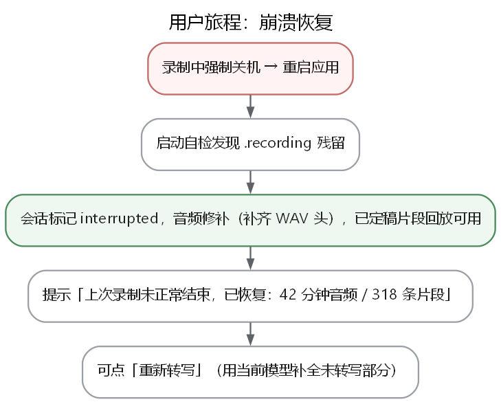

# Mandaryn 产品需求文档（PRD）

| 项 | 值 |
|----|----|
| 文档编号 | DOC-01 |
| 文档版本 | **v1.2.0** |
| 产品基线 | Mandaryn v0.1.0 |
| 状态 | 评审通过（Baseline） |
| 最后更新 | 2026-11-10 |
| 上游文档 | [DOC-INDEX.md](./DOC-INDEX.md)（术语与编号以此为准） |
| 下游文档 | [ARCHITECTURE.md](./ARCHITECTURE.md)、[UX-SPEC.md](./UX-SPEC.md) |

> 本文只声明**做什么、为什么、做到什么程度**。实现方式见 DOC-02，服务签名见 DOC-03，
> 表结构见 DOC-04，快捷键与配置项清单见 DOC-05，分发见 DOC-06。

---

## 1. 产品定位与范围

### 1.1 一句话

把「我正在听的某个应用里的中文语音」变成**可检索、可回放、分得清是谁说的**文字，且**默认不联网**。

### 1.2 目标用户

| 画像 | 场景 | 关键诉求 |
|------|------|----------|
| 会议/协作重度用户 | 用 KOOK、OOPZ、QQ、微信开语音会，事后回忆结论 | 录完事后再转写；回放能定位到「谁在第几分钟说了什么」 |
| 内容创作者 | 采集游戏/直播/访谈应用音频 | 分得清说话人；导出文本 |
| 合规敏感用户 | 涉及内部信息、不接受上云 | 全程本地；可离线分发模型 |

### 1.3 范围内（In Scope）

九大功能域 `FR-01` ~ `FR-09`，见 §3。

### 1.4 范围外（Out of Scope，v0.1.0 明确不做）

| 项 | 理由 |
|----|------|
| 实时翻译 / 双语字幕 | 与转写链路强耦合，先保转写质量；留待 v0.3 |
| 说话人**跨设备**身份同步 | 需要账号体系与云端声纹库，与隐私定位冲突 |
| 音频**编辑**（裁剪、降噪后处理） | 属于后期制作，不在「听清并记录」路径上 |
| 系统级虚拟声卡驱动安装 | 需签名驱动与管理员提权，改用系统原生捕获 API（见 FR-02） |
| 移动端 | 捕获目标（其他应用的音频输出）在移动端不可行 |
| 团队协作 / 共享会话 | 无账号体系 |

### 1.5 关键假设与风险

| 假设 | 若不成立的影响 | 缓解 |
|------|----------------|------|
| 主流目标应用（KOOK/OOPZ/QQ/微信）均为独立进程，音频走系统混音器 | 无法按应用分路 | 提供「设备回环」兜底（整机混音），见 FR-02-3 |
| 用户机器为 4 核 8GB 以上、SSD 可用空间 ≥ 10GB | 本地大模型无法流畅 | 模型分档（small/medium），按硬件推荐 |
| 中文为主要语言 | 模型选型偏移 | 在线模式覆盖多语种；本地按语种分档 |

---

## 2. 核心信息架构



*DOT 源码：[diagrams/PRD-01-ia.dot](./diagrams/PRD-01-ia.dot)*

---

## 3. 功能清单与优先级

优先级定义：**P0** = v0.1.0 必须交付，缺失则产品不成立；**P1** = v0.1.x 补齐，缺失可用但明显折损体验；**P2** = v0.2 及以后。

### FR-01 模型来源与切换（D1）

| 编号 | 功能 | 优先级 | 验收要点 |
|------|------|--------|----------|
| FR-01-1 | 支持 `local`（本地离线模型）与 `online`（在线模型）两种模型来源，用户可自行选择 | P0 | 设置页与录制页均可切换；当前来源在录制页常驻可见 |
| FR-01-2 | 明确切换**生效时机** | P0 | 会话进行中不允许切换（选择器禁用并说明原因）；切换在**下一个会话**生效，无需重启应用；引擎热切换有加载进度与失败回退 |
| FR-01-3 | 两种来源的适用场景引导 | P0 | UI 内联说明：本地=隐私优先、离线可用、中文强；在线=准确率/语种覆盖、需联网、有隐私成本 |
| FR-01-4 | 不可用时的降级策略与用户提示 | P0 | 在线不可用（网络/鉴权/限流/超时）→ 自动回退本地（若本地就绪），会话标记 `degraded` 并在时间轴打点 + 一条非阻塞提示；本地不可用时不自动回退在线（隐私默认），仅提示下载/切换 |
| FR-01-5 | 在线端点可配置（URL / 模型名 / 密钥 / 语种） | P0 | 支持 OpenAI 兼容的 `POST /v1/audio/transcriptions` 语义；密钥加密存储，界面只显示掩码 |
| FR-01-6 | 引擎健康检查 | P1 | 设置页「测试连接」返回延迟与错误分类；本地引擎显示模型包、加载耗时、内存占用 |

### FR-02 应用级音频捕获（D2）

| 编号 | 功能 | 优先级 | 验收要点 |
|------|------|--------|----------|
| FR-02-1 | 枚举**正在出声/正在运行**的应用，作为可选音频源 | P0 | 列表含应用名、进程可执行名、是否正出声、窗口标题（可选）；支持手动「刷新」 |
| FR-02-2 | 进程级音频捕获（只抓某个进程树） | P0 | 捕获该进程及其子进程的输出混音；静音该应用后仍能拿到其后续音频；不混入其他应用 |
| FR-02-3 | 设备级兜底源（整机混音 / 指定输出设备） | P0 | 当系统不支持进程级捕获时提供；UI 明确标注「会包含所有应用声音」 |
| FR-02-4 | 异常检测与恢复 | P0 | 目标应用未运行、应用退出、设备切换/插拔/默认设备变更，均有检测与恢复路径（详见 §4 UC-03 与 DOC-02 §4.1.4）；恢复失败给出可操作提示 |
| FR-02-5 | 记住上次选择的源 | P1 | 默认「若仍可用则自动选中并提示」 |
| FR-02-6 | 多源同时录制 | P2 | v0.1.0 单会话单源（多路并行成本与延迟不可控） |

### FR-03 录制与转写时机（D3）

> **核心约定：录制与转写解耦（默认延后转写）。** 录制阶段只做「采集 + 落盘」，产出**录音实例**（音频文件 + 元数据）；
> 转写是录制结束后的**独立任务** —— 由用户手动发起，或在用户认为机器空闲时执行。
> 只有开启「边录边转」开关（`FR-03-10`，**默认关**）才会在录制过程中实时出字。
> 转写进度是**独立于录制状态机的另一条轴**（`transcription_status`，见 DOC-02 §6.4），**不新增 `ST` 编号**。

| 编号 | 功能 | 优先级 | 验收要点 |
|------|------|--------|----------|
| FR-03-1 | 全局快捷键 / 手动按钮启动、暂停、结束录制 | P0 | 软件在后台也能启停；三种操作均有即时视觉反馈 |
| FR-03-2 | 录制状态机 | P0 | 状态定义与转换严格按 DOC-02 §6；非法转换被拒绝并记录 `ERR`，UI 不会卡在中间态 |
| FR-03-3 | 录音实例保存 | P0 | 录制结束即封存录音实例：音频文件（默认 WAV）落盘 + 元数据（源、起止时间、时长、采样格式、字节数）入库，**立即可回放**；音频缺失或损坏时标 `failed` 并给诊断 |
| FR-03-4 | 转写任务与触发时机 | P0 | 对已保存的录音实例跑模型转写并生成文字（`segments`）。两种触发：① 用户手动「开始转写」立即执行；② 「空闲自动转写」在整机预算有余量（`NFR-08` 的 `headroom > 0`）且无录制进行时执行。进度 / 当前句 / 剩余量可见，可取消、可重转；被抢占时让位并保留进度 |
| FR-03-5 | 网络中断处理 | P0 | 音频**永不因转写失败而丢失**；转写任务按「重试 → 降级 → 失败」处理并置 `failed`，恢复后可从断点续转或整段重跑（DOC-02 §4.2.4） |
| FR-03-6 | 引擎不可用处理 | P0 | 引擎未就绪 / 模型未下载**不阻止录制**（录制不依赖推理）；发起转写时若不可用，返回明确错误码与下一步动作（下载 / 换模型 / 换来源） |
| FR-03-7 | 无音频输入处理 | P0 | 电平长时间为 0 时显示「未检测到音频」引导；不静默失败、不产生空录音实例 |
| FR-03-8 | 崩溃/断电恢复 | P0 | 异常退出后重启，检测到未正常结束的会话 → 修补音频并置 `interrupted`；录音实例可回放、可稍后转写；已产出片段保留，可一键「重新转写」 |
| FR-03-9 | 录制中显示时长、电平、音频大小 | P1 | 实时更新，不阻塞主线程；开启边录边转时追加字符数 |
| FR-03-10 | 边录边转（可选开关，默认关） | P1 | 开启后在录制中实时出字（partial → 句末 finalized），partial 可被覆盖重写、finalized 不再变；`NFR-01` 的 `FFD-engine`/`FFD-e2e`/`SLD` **仅在此模式下适用** |
| FR-03-11 | 另存录音实例为文件 | P1 | 可把会话音频另存为单个音频文件（WAV/FLAC）带走；导出**不改动**数据库记录，源会话仍可回放 |

### FR-04 回放与歌词式同步（D4）

| 编号 | 功能 | 优先级 | 验收要点 |
|------|------|--------|----------|
| FR-04-1 | 已完成会话可通过播放条回放 | P0 | 支持播放/暂停、前后 5s、上/下一句、倍速 0.5/1/1.5/2、音量 |
| FR-04-2 | 文字随音频进度同步高亮 | P0 | 当前片段高亮，其余降透明度；高亮切换与音频位置的误差 ≤ 80ms |
| FR-04-3 | 自动居中滚动 | P0 | 当前片段保持在可读区中线附近；用户手动滚动时暂停自动滚动，并显示「回到当前句」 |
| FR-04-4 | 拖动进度条的同步行为 | P0 | 拖拽中：按指针位置即时预览高亮（不触发音频解码），自动滚动关闭；释放后：seek 到目标位置、恢复自动滚动、重算当前片段 |
| FR-04-5 | 点击任意片段跳到对应时刻 | P0 | 跳转后该片段成为当前片段 |
| FR-04-6 | 时间戳展示与片段级定位 | P1 | 片段左侧显示 `mm:ss`，悬停显示起止 |
| FR-04-7 | 说话人着色 | P1 | 每个角色一个稳定色；角色名与色一致贯穿列表与详情 |

### FR-05 离线模型下载与代理（D5）

| 编号 | 功能 | 优先级 | 验收要点 |
|------|------|--------|----------|
| FR-05-1 | 应用内浏览与下载离线模型 | P0 | 列表含名称、体积、语种、内存建议、许可证；显示已装/可更新 |
| FR-05-2 | 分片下载 + 断点续传 | P0 | 中断（关应用/断网）后继续下载不再从 0 开始；已完成分片不重复下载 |
| FR-05-3 | 进度展示 | P0 | 总进度百分比、已下载/总量、速度、剩余时间；支持暂停/继续/取消 |
| FR-05-4 | 完整性校验 | P0 | 逐文件哈希 + 整包哈希校验，不一致则丢弃并自动重下（最多 1 次），仍失败给出诊断 |
| FR-05-5 | 代理配置 | P0 | 类型：`none`/`http`/`https`/`socks5`；地址+端口；认证支持「用户名+密码」或「URL 内嵌凭据」；凭据加密存储；支持「仅下载走代理」与「仅在线转写走代理」分别开关；提供「测试代理」 |
| FR-05-6 | 下载失败重试与恢复 | P0 | 自动指数退避重试（最多 3 次）→ 切备用镜像 → 失败收敛为可诊断错误（HTTP 状态 / DNS / TLS / 代理），一键重试 |
| FR-05-7 | 自定义镜像源 | P1 | 可填镜像基址（企业内网离线分发） |

### FR-06 说话人分离与角色命名（D6）

| 编号 | 功能 | 优先级 | 验收要点 |
|------|------|--------|----------|
| FR-06-1 | 声纹区分不同说话人 | P0 | 会话内自动区分说话人并给每个片段标注说话人；重叠语音不强行拆分，标注「未识别」 |
| FR-06-2 | 默认角色命名 | P0 | 按首次出现顺序：`说话人 1`、`说话人 2`…；角色带稳定配色 |
| FR-06-3 | 角色重命名全局同步 | P0 | 修改角色名 → **所有会话**中属于该角色的片段立即显示新名（无需逐条更新，禁止出现新旧名并存） |
| FR-06-4 | 跨会话同一说话人识别 | P0 | 声纹相似度达阈值时归并为同一说话人（同一 `speaker`），使改名自然覆盖历史会话；未达阈值则新建说话人 |
| FR-06-5 | 手动纠正：合并 / 拆分 / 不是同一人 | P1 | 支持把「说话人 3」并入「说话人 1」，也支持把误并的拆开；操作可撤销 |
| FR-06-6 | 说话人数量约束 | P1 | 默认自动；可设 2–8 上限以提升聚类稳定性 |

### FR-07 模型目录与迁移（D7）

| 编号 | 功能 | 优先级 | 验收要点 |
|------|------|--------|----------|
| FR-07-1 | 默认模型目录 `~/.mandaryn` | P0 | 首次启动自动创建；`models/` 下按 `bundleId@version` 组织 |
| FR-07-2 | 自定义下载路径 | P0 | 设置页可选目录（原生「选择文件夹」对话框）；修改后新下载落到新路径 |
| FR-07-3 | 已下载模型迁移到新路径 | P0 | 校验 → 复制 → 切换 → 清理四步可见、可中断；迁移后模型立即可用（无需重新下载） |
| FR-07-4 | 迁移失败回滚 | P0 | 任一步失败都保持旧路径可用；切换后校验失败自动回退并提示；不产生「两处都不完整」的中间态 |
| FR-07-5 | 数据一致性保障 | P0 | 迁移期间禁止下载与引擎加载（全局互斥）；配置写入与目录切换原子化；启动时校验 `modelRoot` 有效性（缺失/不可写则回退默认路径并提示） |
| FR-07-6 | 磁盘占用可视化 | P1 | 显示各模型包占用与总占用，可单独删除 |
| FR-07-7 | 路径来源可见 + 失效回退 | P0 | 每个路径显示「当前生效值 + 来源（默认/我的设置/环境变量/命令行）」；被上层接管时同时显示「你的设置（未生效）」；高优先级路径不可用时回退到下一层并给出可见警告，不静默失败（方案见 DOC-06 §4） |
| FR-07-8 | 接管可暂存、可解除 | P1 | 受管状态下用户改目录写入暂存值并提示「待解除后生效」；提供「解除接管」的可复制命令与操作说明；解除并重启后自动应用暂存值 |

### FR-08 隐私边界（D8）

| 编号 | 功能 | 优先级 | 验收要点 |
|------|------|--------|----------|
| FR-08-1 | 本地模式的隐私承诺 | P0 | 本地模式下音频、转写文本、声纹**不离开本机**；除「模型下载」外无出站请求；无遥测 |
| FR-08-2 | 在线模式的风险提示 | P0 | 配置在线端点时**必须**显式提示风险（不可默认勾选通过），说明风险来源与缓解措施 |
| FR-08-3 | 在线会话的可识别性 | P0 | 使用在线的会话在列表与详情页有 `在线` 徽章；导出的文件内保留该标记 |
| FR-08-4 | 日志不落正文 | P0 | 日志仅记录元数据（时长、模型 ID、错误码），禁止写入音频内容或转写正文 |
| FR-08-5 | 凭据加密 | P0 | 在线密钥、代理密码使用对称加密后落库；界面只展示掩码 |
| FR-08-6 | 一键清除本地数据 | P1 | 可清空会话、音频、声纹库（保留配置或全清） |

### FR-09 快捷键体系与精简 UX（D9）

| 编号 | 功能 | 优先级 | 验收要点 |
|------|------|--------|----------|
| FR-09-1 | 完备的默认快捷键 | P0 | 全局（录制启停/暂停/显示窗口）+ 应用内（回放、导航、重命名）两档，清单见 DOC-05 §2 |
| FR-09-2 | 用户自定义快捷键 | P0 | 可录制新组合、可恢复默认、可禁用单个动作；冲突实时校验（系统占用 + 软件内重复） |
| FR-09-3 | 配置项精简 | P0 | 已移除/合并的配置项及其理由必须成文（DOC-05 §4），不得留下「无意义开关」 |
| FR-09-4 | UI/UX 要点 | P0 | 信息层级三层、核心路径 ≤ 2 次点击、状态反馈覆盖 4 类（空闲/录制/降级/错误），详见 DOC-05 §5 |

### 3.1 优先级汇总

| 优先级 | 条目数 | 交付版本 |
|--------|--------|----------|
| P0 | 47 | v0.1.0 |
| P1 | 13 | v0.1.x |
| P2 | 1 | v0.2+ |
| **合计** | **61** | — |

---

## 4. 用户流程（端到端）

> 每个 UC 都对应一组 FR；异常分支是**验收重点**，不是补充说明。

### UC-01 首次使用：从零到第一次出字



*DOT 源码：[diagrams/PRD-J01-onboarding.dot](./diagrams/PRD-J01-onboarding.dot)*
**异常**：下载失败 → 诊断 + 重试 / 配代理；无可用音频源 → 引导切到设备源。
**关联**：FR-01-1、FR-02-1、FR-03-1、FR-05-1、FR-07-1。

### UC-02 日常录制（本地模式）→ 保存 → 空闲转写 → 回放定位



*DOT 源码：[diagrams/PRD-J02-core-record.dot](./diagrams/PRD-J02-core-record.dot)*
**关联**：FR-03-1/3/4、FR-04-1~5。

### UC-03 

| 触发 | 系统行为 | 用户看到 |
|------|----------|----------|
| 录制前目标应用未启动 | 该源置灰，标注「未运行」；不阻止选择设备源 | 「KOOK 未运行，点此刷新 / 改用全部应用声音」 |
| 录制中目标应用退出 | 捕获 EOF → 重试 3 次（200ms/1s/3s，按可执行名重连）→ 失败则结束采集、会话转 `interrupted`、已录音频保留（可稍后转写） | 「KOOK 已退出，本次会话已保存（可回放、可重新转写）」 |
| 输出设备被切换 | 重新枚举设备 → 若当前源绑定的设备失效，自动迁移到新默认设备并继续录制 | 「输出设备已切换为 XXX，录制继续」 |
| 设备被拔出 | 同「切换」；若无可迁移设备 → 暂停采集但**不停会话**，保持计时并提示 | 「未检测到输出设备，已暂停采集，插入后自动恢复」 |
| 应用静音 / 该应用无音频 | 电平持续 0 → 提示「未检测到音频（该应用可能没有在播放声音）」 | 非阻塞提示，不产生空片段 |

**关联**：FR-02-4、FR-03-5/7、FR-03-8。

### UC-04 在线模式与降级



*DOT 源码：[diagrams/PRD-J03-online-fallback.dot](./diagrams/PRD-J03-online-fallback.dot)*
**关联**：FR-01-2/4/5、FR-03-5、FR-08-2/3。

### UC-05 说话人角色命名同步



*DOT 源码：[diagrams/PRD-J04-speaker-rename.dot](./diagrams/PRD-J04-speaker-rename.dot)*
**关联**：FR-06-1~6。

### UC-06 迁移模型目录



*DOT 源码：[diagrams/PRD-J05-model-migrate.dot](./diagrams/PRD-J05-model-migrate.dot)*
**关联**：FR-07-2~5。

### UC-07 崩溃恢复



*DOT 源码：[diagrams/PRD-J06-crash-recover.dot](./diagrams/PRD-J06-crash-recover.dot)*
**关联**：FR-03-8。

### UC-08 纯离线部署（隐私敏感环境）


*DOT 源码：[diagrams/PRD-J07-offline-local.dot](./diagrams/PRD-J07-offline-local.dot)*
**关联**：FR-01-1、FR-08-1、FR-05-7。

---

## 5. 非功能需求（NFR）

### NFR-01 性能

| 指标 | 目标值 | 测量条件 | 归属 |
|------|--------|----------|------|
| 首字延迟 `FFD-engine`（本地） | P50 ≤ 1000ms，P95 ≤ 1500ms | 16kHz 单声道、中文、medium 档本地模型、4 核 CPU；**计时起点 = 首个非静音帧（语音起始）**，终点 = 引擎返回首个非空增量 | FR-03-10 |
| 首字延迟 `FFD-e2e`（本地，仅观测） | **不设阈值**，随源音频前导静音自然变化 | 同上，但**起点 = 用户触发开始（含源音频前导静音）** | FR-03-10 |
| 首字延迟 `FFD`（在线） | P50 ≤ 1200ms，P95 ≤ 2000ms | 20ms RTT 网络、OpenAI 兼容流式端点 | FR-03-10 |
| 持续转写延迟 `SLD`（本地） | P95 ≤ 1500ms | 同上 | FR-03-10 |
| 持续转写延迟 `SLD`（在线） | P95 ≤ 2500ms | 同上 | FR-03-10 |
| 回放高亮同步误差 | ≤ 80ms | 1 小时会话、5000 条片段 | FR-04-2 |
| 拖动释放到高亮归位 | ≤ 50ms | 同上 | FR-04-4 |
| 滚动帧率 | 目标 60fps，下限 45fps | 自动居中滚动期间 | FR-04-3 |
| 冷启动到可交互 | ≤ 2.5s | SSD、无模型加载 | — |
| 引擎热切换（local→local） | ≤ 8s（含加载与自检） | medium 档模型、NVMe | FR-01-2 |
| 会话列表首屏 | ≤ 300ms（1000 会话） | 本地库 | — |
| 全文搜索 | ≤ 500ms（10 万片段） | 关键词检索 | FR-04-1 |
| 空闲 CPU | ≤ 2%（4 核基线） | 无录制、窗口可见 | — |
| 录制中 CPU | **不设固定上限，由 `NFR-08` 的整机预算动态约束**；`N=80%` 且空载时应 ≤ 60%（4 核基线，单路） | 本地转写 + 8 路捕获 | NFR-08 |
| 内存 | 冷启动 ≤ 250MB；本地模型就绪 ≤ 1.8GB | medium 档 | — |
| 内存增长 | 8 小时连续录制 RSS 增长 ≤ 5% | 无泄漏 | — |
| 音频落盘 | 16kHz/16bit 单声道；WAV ≈ 110MB/h，FLAC ≈ 55MB/h | 默认 WAV | — |

### NFR-02 兼容性

| 维度 | 要求 |
|------|------|
| Windows | 基线 Windows 10 2004+ / Windows 11；**进程级捕获**官方文档标注最低客户端 Windows 10 Build 20348（Server 2022）/ Windows 11，运行时探测能力，不支持则自动降级为设备回环（FR-02-3） |
| macOS | 基线 macOS 14.2+（Core Audio 进程音频采集能力）；14.2 以下仅设备回环；需用户授予「屏幕/系统音频录制」类权限 |
| Linux | PipeWire 0.3.60+；X11/Wayland 均可；无 PipeWire 时降级为 PulseAudio 监视源 |
| 架构 | amd64 必测；arm64（Apple Silicon / Windows on ARM）为 P1 |
| 推理运行时 | **CGO 为既定基线（已决策，见 DOC-00 §6 ADR-01）**：本地引擎依赖 CGO 与平台预编译库，构建机必须装 C 工具链；不提供纯 Go 等价路径。`nollm` 变体仅为可选产物（仅在线），非兜底 |
| 显示 | 100%–200% 缩放、暗色/亮色主题、窗口最小 960×640 |
| 语言 | 界面 `zh-CN`（默认）/ `en-US`；转写语种随模型 |

### NFR-03 隐私与安全

| 编号 | 要求 |
|------|------|
| NFR-03-1 | 本地模式下，音频与文本零出站；仅「模型下载」允许出站，且可完全禁用（离线导入） |
| NFR-03-2 | 在线模式下，出站内容与目标端点在**发起前**可见（域名 + 是否含音频/文本） |
| NFR-03-3 | 在线模式配置需显式风险确认，二次确认后才可保存（不可预设勾选） |
| NFR-03-4 | 在线密钥、代理密码加密落库（AES-GCM），不出现在日志、导出文件、崩溃转储 |
| NFR-03-5 | 日志禁止记录音频、转写正文、密钥；仅元数据 |
| NFR-03-6 | 会话音频与数据库文件仅存于用户数据目录，权限遵循系统默认（Windows 用户目录 ACL / POSIX 0700 目录） |
| NFR-03-7 | 无遥测、无崩溃上报到第三方；崩溃日志仅落本地 |
| NFR-03-8 | 不内置任何第三方分析 SDK；不做设备指纹 |

### NFR-04 可靠性

| 编号 | 要求 |
|------|------|
| NFR-04-1 | 录制中任何单点失败（网络/模型/设备）都不得导致**已采集音频**丢失 |
| NFR-04-2 | 异常退出后重启，未正常结束的会话可恢复为 `interrupted` 并可回放 |
| NFR-04-3 | 下载与迁移均可中断且可恢复，不留半成品目录 |
| NFR-04-4 | 状态机无「卡死」态：任一失败都有非终态出口或明确终态 |
| NFR-04-5 | 数据库升级使用 AutoMigrate + 一次性迁移钩子，升级不丢历史会话 |

### NFR-05 可维护性与可观测性

| 编号 | 要求 |
|------|------|
| NFR-05-1 | 遵循脚手架分层：业务在 `internal/services/<domain>/`，配置在 `internal/app/`，事件名集中在 `internal/events/`，模型注册在 `internal/storage/models.go` |
| NFR-05-2 | 出站 HTTP 统一走 `httpx`（代理感知），子进程统一走 `procx`，日志统一 `logx`，配置写入统一 `filex.WriteAtomic` |
| NFR-05-3 | 关键路径（FFD/SLD/降级/迁移）必须打点，可在「诊断」面板导出时间线 |
| NFR-05-4 | 前后端契约变更必须同步 DOC-03 与 bindings |
| NFR-05-5 | 单测覆盖：状态机、迁移回滚、时间轴二分、哈希校验；E2E 覆盖 UC-01/02/03 |

### NFR-06 可用性与可访问性

| 编号 | 要求 |
|------|------|
| NFR-06-1 | 全部核心操作可纯键盘完成；焦点可见 |
| NFR-06-2 | 人类可见字符串全部走 i18n（`t()`），无硬编码文案 |
| NFR-06-3 | 对比度符合 WCAG AA（正文 ≥ 4.5:1） |
| NFR-06-4 | 空状态、加载态、错误态三态齐备，错误信息含「下一步动作」 |

### NFR-07 分发与体积

| 编号 | 要求 |
|------|------|
| NFR-07-1 | 安装包不含模型权重（首次启动下载或离线导入） |
| NFR-07-2 | 主程序安装包 ≤ 120MB（Windows/macOS） |
| NFR-07-3 | 模型清单随版本发布，带签名/哈希，旧清单可被新版本识别 |

### NFR-08 整机性能预算与自适应限流（优先级 **P1**）

**指标含义**：用户为软件设定一个**整机性能预算上限** `N%`（配置项 `resourceCapPct`）。
软件可用的推理性能**不是一个固定值**，而是「预算减去其他应用的占用」：

```
otherPct  = 整机 CPU 占用率 − 本应用 CPU 占用率      （两者均按整机归一化）
headroom  = N − otherPct                            （本应用当前可用额度）
```

即：机器越忙，本软件让得越多。当 `otherPct ≥ N`（额度耗尽）时，**暂停本应用的推理任务**并持续监测；
待整机回落到上限以下，**自动恢复**，无须用户干预。

| 项 | 规格 |
|----|------|
| 资源口径 | **CPU**（整机归一化占用率），不含内存与 GPU（理由见下方「注」） |
| 用户可设上限 `N` | 默认 **80%**；范围 **10%–100%**；步进 **5%**；滑杆编辑（DOC-05 §3.8） |
| 测量方式 | 系统级 CPU 时间增量 ÷ 墙钟增量 ÷ 核数 × 100%；同时采集「全部进程」与「本应用」两条，相减得 `otherPct` |
| 采样窗口 | 每 **500ms** 采样，控制判据取 **5s 滑动平均**（10 点）；UI 实时读数同口径 |
| 暂停判据 | `otherPct ≥ N` 连续 **3s** → 暂停推理（`suspended`） |
| 恢复判据 | `otherPct ≤ N − 5` 连续 **3s** → 自动恢复（5 个百分点滞回带，防抖动） |
| **暂停范围** | **只暂停推理任务**（转写任务、声纹提取）；**音频采集与落盘不暂停，录制不中断**（录制本就不跑推理） |
| 降档优先于暂停 | `headroom` 收窄但 > 0 时先逐级降档（顺序见 DOC-02 §4.7），最低档仍不满足才暂停 |
| 暂停期间 | 音频继续落盘；转写任务让位，进度保留；恢复后按序续跑（追赶） |
| 验收方式 | ① 压测使 `otherPct ≥ N`：3s 内进入暂停，界面状态明确；② 解除压测：`otherPct ≤ N−5` 后 3s 内自动恢复；③ 全程会话音频连续（单次丢帧 ≤ 200ms，与刷盘周期一致）；④ 空载（`otherPct < 10%`）录制 30 分钟不出现降档与暂停 |
| 交付 | **P1**（v0.1.x）。v0.1.0 可先交付「固定 `N=80` + 只降档不暂停」的简化实现 |

**注 1：为什么不把内存与 GPU 纳入口径**
内存无法「优雅限流」——撞到天花板只会 OOM 并中断录制，与本条「录制不中断」的原则直接冲突；
内存改由模型档位（`ramHintMb`）与空闲卸载约束。GPU 无跨平台通用配额 API 且属可选加速，故不计入。

**注 2：`N` 是「整机预算」而非「本应用上限」**
这是本指标最易被误读之处：`N=80%` 不表示「本应用最多用 80%」，而是「整机总占用不超过 80%，本应用只用剩余额度」。
UI 文案必须显式写清，否则用户会以为调大数值＝本软件更激进（实际相反）。见 DOC-05 §5.9。

---

## 6. 数据与隐私边界（对应 FR-08）

### 6.1 本地模式

| 数据 | 位置 | 是否出站 |
|------|------|----------|
| 音频 | `<dataRoot>/sessions/<sessionId>/audio.wav` | ❌ |
| 转写文本 | SQLite `segments` | ❌ |
| 声纹向量 | SQLite `speakers.embedding`（加密） | ❌ |
| 模型包 | `<modelRoot>/models/<bundleId>@<version>/` | ❌（下载时除外） |
| 日志 | `<dataRoot>/logs/`（仅元数据） | ❌ |

**唯一出站点**：模型下载（可关）。出站域名在设置页可见。

### 6.2 在线模式

| 数据 | 出站 | 说明 |
|------|------|------|
| 音频片段 | ✅ | 按流式 chunk 发送（默认 5s 或端点要求的上限） |
| 转写文本 | ❌（默认不回流） | 端点返回文本，本机入库 |
| 声纹 | ❌ | 说话人分离始终在本地完成（见 DOC-02 §4.4） |
| 会话标题 | ❌ | 不自动发送用于生成标题 |

**风险来源**（必须在 UI 中原样告知）：

1. **端点运营方留存**：对方可存储、回放、用于模型训练。
2. **传输链路**：企业代理 / TLS 中间人可解密；不可关闭证书校验（本软件不允许关闭）。
3. **端点侧日志与第三方依赖**：对方可能转发给其上游服务商。
4. **音频敏感性**：语音含身份与内容，可能涉及第三方（其他参会人）未同意的数据。

**缓解措施**（写入 UI 与 DOC-02 §8）：

| 措施 | 说明 |
|------|------|
| 优先自建 / 内网端点 | 提示「自建或本机服务可消除第 1、3 项风险」 |
| 仅 HTTPS + 强制证书校验 | 不允许关闭；自签需显式信任 |
| 会话级开关 | 只对需要高准确率的会话开启在线，其余保持本地 |
| 端点域名可见 | 录制页常驻显示「→ api.xxx.com」 |
| 音频不落盘选项 | 内存直传，仅在本地保留转写文本（P1） |
| 代理只转发不含凭据 | 代理认证与端点认证分离，避免凭据叠加泄露 |

---

## 7. 验收标准（v0.1.0 发布门槛）

| # | 标准 | 判定 |
|---|------|------|
| 1 | 九大功能域 P0 全部可演示 | 逐条对照 §3 |
| 2 | UC-01/02/03/04/05/06/07 脚本化通过 | 手工或 E2E |
| 3 | NFR-01 的 FFD/SLD 达标（**开启边录边转时**） | 20 次采样，取 P50/P95 |
| 4 | 在线→本地降级可复现且留痕 | 拔网线复现 |
| 5 | 迁移失败可回滚（人为制造哈希不一致） | 注入故障 |
| 6 | 崩溃恢复可回放 | 强杀进程复现 |
| 7 | 本地模式无出站（抓包验证） | Wireshark/防火墙日志 |
| 8 | 日志无正文、密钥掩码 | 人工审计 |
| 9 | 角色改名全局生效（含历史会话） | 跨会话验证 |
| 10 | 快捷键冲突可检测、可恢复默认 | UI 验证 |
| 11 | `NFR-08` 预算限流：压测触发暂停 → 解除后自动恢复，录制全程不中断 | 压测脚本 + 音频连续性校验 |
| 12 | `NFR-08` 文案正确：`N` 表现为「整机预算」而非「本应用上限」 | UI 走查 |

---

## 8. 变更记录

| 日期 | 版本 | 变更 | 作者 |
|------|------|------|------|
| 2026-11-10 | v1.0.0 | 首版：9 大功能域 57 条需求（P0 46 / P1 10 / P2 1）、8 个 UC、8 类 NFR、验收门槛 | Kether |
| 2026-11-10 | v1.1.0 | 新增 `NFR-08` 整机性能预算与自适应限流（默认 80%，10–100%，步进 5%；`headroom = N − otherPct`；超限暂停推理、回落后自动恢复，录制不中断）；`NFR-01` 的「录制中 CPU ≤ 60%」改为受 `NFR-08` 约束，不再设固定上限 | Kether |
| 2026-11-10 | v1.2.0 | **CGO 转为既定基线**（ADR-01）：`NFR-02` 推理运行时不再表述为「可兜底」；新增 `FR-07-7`（路径来源可见 + 失效回退，P0）与 `FR-07-8`（受管路径可暂存、可解除，P1），对应 ADR-02。需求总数 57 → **59**（P0 47 / P1 11 / P2 1） | Kether |
| 2026-11-11 | v1.3.0 | **录制与转写解耦（默认延后转写）**：录制阶段只采集 + 落盘并封存**录音实例**（音频文件 + 元数据，可回放、可另存为文件）；转写改为录制结束后的独立任务，由用户手动发起，或整机空闲（`NFR-08` 预算余量）时自动执行。`FR-03-3` 由「实时流式转写」改为「录音实例保存」、`FR-03-4` 由「时延指标」改为「转写任务与触发时机」、`FR-03-6` 改为「引擎不可用处理」（录制不再依赖引擎）、`FR-03-9` 的字符数改为音频大小；新增 `FR-03-10` 边录边转（可选，默认关，P1）与 `FR-03-11` 另存录音实例为文件（P1）。`NFR-01` 的 `FFD`/`SLD` 改挂 `FR-03-10`（仅边录边转适用），`NFR-08` 暂停范围收敛为「转写任务与声纹提取」。需求总数 59 → **61**（P0 47 / P1 13 / P2 1） | Kether |
