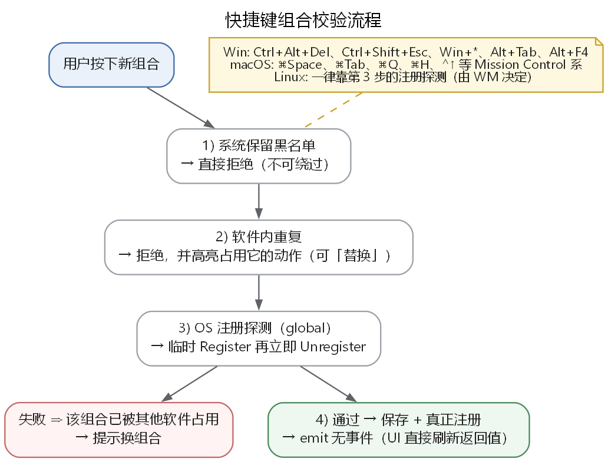

# Mandaryn 交互与快捷键规范（UX-SPEC）

| 项 | 值 |
|----|----|
| 文档编号 | DOC-05 |
| 文档版本 | **v1.2.0** |
| 产品基线 | Mandaryn v0.1.0 |
| 状态 | 评审通过（Baseline） |
| 最后更新 | 2026-11-10 |
| 上游文档 | [DOC-INDEX.md](./DOC-INDEX.md)、[PRD.md](./PRD.md) |
| 下游文档 | —（前端实现的直接依据；契约见 [API.md](./API.md)） |

> 本文覆盖 FR-09 全部条目：快捷键体系、可自定义项清单、精简原则、UI/UX 要点。
> `action` 命名与 DOC-03 `hotkeysvc` 一致；默认值与 DOC-04 `app_settings` 一致 —— **三处必须同步改**。

---

## 1. 设计原则

| # | 原则 | 具体含义 |
|---|------|----------|
| P1 | **默认值即最佳实践** | 首次安装不做任何配置即可完成 UC-01 全流程 |
| P2 | **一个设置只有一个入口** | 同类配置不散落两处（代理只在「模型与网络」页） |
| P3 | **可撤销优先于可配置** | 能用「撤销/恢复默认」解决的，就不做开关 |
| P4 | **状态永远可见** | 录制中、降级、错误在任何页面都能看到（§5.3） |
| P5 | **键盘优先** | 全部核心操作可纯键盘完成，快捷键可改 |
| P6 | **不暴露实现细节** | 采样率/线程/分片等参数不进入 UI（§4） |

---

## 2. 快捷键体系

### 2.1 两档作用域

| 作用域 | 含义 | 注册方式 | 适用 |
|--------|------|----------|------|
| `global` | 软件在后台/最小化也响应 | Wails `app.GlobalShortcut`（系统级） | 录制启停/暂停、唤起窗口 |
| `app` | 仅主窗口聚焦时响应 | 前端键盘事件 + 焦点作用域 | 回放、导航、编辑 |

> **设计取舍**：只有「必须隔空操作」的动作才占全局快捷键（3 个）。其余全部限定应用内，
> 避免与其他软件抢组合键（同类开源项目最常见的用户抱怨即「快捷键劫持」）。

### 2.2 默认绑定清单

| `action` | 界面名称 | Windows / Linux | macOS | 作用域 | 说明 |
|----------|----------|-----------------|-------|--------|------|
| `record.toggle` | 开始 / 停止录制 | `Ctrl+Alt+R` | `⌘⌥R` | `global` | 首按开始，再按停止；`finalizing` 期间忽略 |
| `record.pause` | 暂停 / 继续录制 | `Ctrl+Alt+P` | `⌘⌥P` | `global` | 仅 `recording`/`paused` 有效 |
| `window.show` | 显示 / 隐藏主窗口 | `Ctrl+Alt+M` | `⌘⌥M` | `global` | 从托盘面板也可触发 |
| `playback.play` | 播放 / 暂停 | `Space` | `Space` | `app` | 详情页；输入框聚焦时不拦截 |
| `playback.back` | 后退 5 秒 | `←` | `←` | `app` | 按住连发（200ms 后重复） |
| `playback.forward` | 前进 5 秒 | `→` | `→` | `app` | 同上 |
| `playback.prevSegment` | 上一句 | `↑` | `↑` | `app` | 跳到上一片段起点 |
| `playback.nextSegment` | 下一句 | `↓` | `↓` | `app` | 跳到下一片段起点 |
| `playback.recenter` | 回到当前句 | `Ctrl+J` | `⌘J` | `app` | 手动滚动后恢复自动居中 |
| `nav.record` | 录制页 | `Ctrl+1` | `⌘1` | `app` | |
| `nav.library` | 会话库 | `Ctrl+2` | `⌘2` | `app` | |
| `nav.models` | 模型 | `Ctrl+3` | `⌘3` | `app` | |
| `nav.settings` | 设置 | `Ctrl+,` | `⌘,` | `app` | |
| `search.focus` | 聚焦搜索 | `Ctrl+F` | `⌘F` | `app` | 会话库/详情页 |
| `role.rename` | 重命名当前角色 | `F2` | `F2` | `app` | 片段/角色被选中时 |
| `session.delete` | 删除选中会话 | `Delete` | `⌦` | `app` | 二次确认（§5.4） |
| `model.switchSource` | 切换模型来源 | `Ctrl+Shift+L` | `⌘⇧L` | `app` | 录制中拒绝并提示（FR-01-2） |

**共 17 个动作**（3 全局 + 14 应用内）。

### 2.3 冲突处理



*DOT 源码：[diagrams/UX-01-hotkey-validate.dot](./diagrams/UX-01-hotkey-validate.dot)*

| 情况 | 处理 |
|------|------|
| 全局注册在**启动时**失败（组合被别的程序抢了） | 该动作 `registerErr` 置原因，**自动降级为 `app` 作用域**并在设置页标红；录制按钮仍可用（点击） |
| 用户把 `global` 改成与系统冲突的组合 | 保存被拒（`ERR_HOTKEY_CONFLICT`），保留原绑定 |
| 两个动作想用同一组合 | 拒绝第二个，提示「已被『开始录制』使用」，提供「替换」按钮（替换则前一个自动禁用） |
| 重置 | 每项右侧「恢复默认」；页底「全部恢复默认」 |
| 禁用 | 每项可「禁用」（存 `null`，见 DOC-04 TBL-01.1） |

> **冲突检测必须在保存前完成**（`API-8.2` 返回 `ConflictReport`），不能「先存后失败」——
> 否则用户会处于「以为改好了」的假状态。

### 2.4 自定义方式（交互）

1. 设置 → 快捷键 → 点击某行右侧的组合键胶囊 → 进入「录制中」形态；
2. 按下目标组合 → 实时显示规范化预览（如 `Ctrl+Alt+Shift+K`）；
3. 冲突则即时红字提示并禁用「保存」；
4. `Esc` 取消本次录制；`Backspace` 清空（等于禁用）；
5. 保存后立刻生效（不需重启）。

---

## 3. 可自定义项完整清单

> **共 25 项**（含快捷键整体作为 1 项）。默认值与 DOC-04 `app_settings` 严格一致。
> 「生效」列：`即时` = 保存后立刻生效；`下次会话` = 下一个录制会话生效；`重启` = 需重启应用。

### 3.1 转写模型与引擎（5 项）

| # | 项 | 默认值 | 取值 | 生效 | 说明 |
|---|----|--------|------|------|------|
| 1 | 模型来源 `model_source` | `local` | `local` / `online` | 下次会话 | 录制中禁用（FR-01-2） |
| 2 | 在线端点 `online_endpoint` | 空 | HTTPS URL | 即时 | 保存前必须完成隐私确认（FR-08-2） |
| 3 | 在线模型名 `online_model` | 空 | 文本 | 即时 | |
| 4 | 在线语种 `online_language` | `auto` | `auto`/`zh`/`en`/其它 | 即时 | 合并了旧的「自动语言检测」开关 |
| 5 | 降级策略 `fallback_to_local` / `auto_switch_back` | 开 / 关 | bool ×2 | 即时 | 默认不自动切回在线（ARCH §4.2.4） |

### 3.2 音频与录制（5 项）

| # | 项 | 默认值 | 取值 | 生效 | 说明 |
|---|----|--------|------|------|------|
| 6 | 默认音频源 `default_source_id` | 空（首次引导选） | 源 ID | 下次启动 | 源不可用时提示重选 |
| 7 | 保存格式 `save_format` | `wav` | `wav` / `flac` | 下次会话 | FLAC 省一半空间（NFR-01） |
| 8 | 灵敏度 `sensitivity` | `standard` | `standard` / `noisy` | 下次会话 | 替代旧的 3 个 VAD 参数（§4） |
| 9 | 说话人上限 `max_speakers` | `auto`(0) | auto / 2–8 | 下次会话 | FR-06-6 |
| 10 | 会话自动命名 `auto_name` | 开 | bool | 即时 | 模板：`日期 时间 · 来源应用` |

### 3.3 说话人角色（2 项）

| # | 项 | 默认值 | 取值 | 生效 | 说明 |
|---|----|--------|------|------|------|
| 11 | 默认命名前缀 | `说话人` | 文本（≤20） | 下次会话 | 生成「说话人 1/2/3」 |
| 12 | 角色配色 | 主题令牌序列 | 选色 | 即时 | 只允许令牌，不填十六进制 |

### 3.4 模型存储与网络（3 项）

| # | 项 | 默认值 | 取值 | 生效 | 说明 |
|---|----|--------|------|------|------|
| 13 | 模型根目录 `model_root` | `~/.mandaryn` | 目录 | **重启**（改即触发迁移向导，FR-07） | 受"环境变量/命令行"接管时改写入暂存并标注「未生效」（§5.10） |
| 14 | 代理配置 `proxy_*` | `none` | type/host/port/凭据/两条开关 | 即时 | 合并为单一入口（§4） |
| 15 | 镜像基址 | 官方 | URL | 即时 | 内网离线分发（FR-05-7） |

### 3.5 界面与系统（4 项）

| # | 项 | 默认值 | 取值 | 生效 | 说明 |
|---|----|--------|------|------|------|
| 16 | 主题 `theme_choice` | `system` | `system`/`light`/`dark`/`obsidian`/custom | 即时 | 既有能力 |
| 17 | 语言 `locale_choice` | `auto` | `auto`/`zh-CN`/`en-US` | 即时 | 跨窗口同步（既有 `appsettings:changed`） |
| 18 | 托盘左键行为 | 显示面板 | 面板 / 主窗口 | 即时 | 仅 1 项，不做更多分支 |
| 19 | 提示音 | 开 | bool | 即时 | Windows 桌面：应用分路开始、录制结束或失败时播放短提示音（失败为低音）；设备回环不播放开始音，避免录入自身提示 |

### 3.6 数据与隐私（3 项）

| # | 项 | 默认值 | 取值 | 生效 | 说明 |
|---|----|--------|------|------|------|
| 20 | 数据目录 `dataRoot` | 平台默认 | 目录 | 重启 | 既有 `storagesvc`；受管时改写入暂存并标注「未生效」（§5.10） |
| 21 | 音频不落盘 `no_audio_persist` | 关 | bool | 下次会话 | 仅在线模式可用（P1，FR-08） |
| 22 | 调试模式（`log_level`：开 = `debug`） | 关 | bool | 即时，无需重启 | 位于「隐私边界」页；开启后额外写调试日志 `<dataRoot>/logs/debug.log`。按需求**展示**存储位置、格式、保留策略（10 MB × 5、7 天）与当前占用，并内置查看器与清空；`MANDARYN_LOG_LEVEL` 接管时禁用开关并说明 |

### 3.7 快捷键（1 项，含 17 个动作）

| # | 项 | 默认值 | 取值 | 生效 |
|---|----|--------|------|------|
| 23 | 快捷键绑定 | §2.2 全表 | 任意组合 / 禁用 | 即时 |
| 24 | 布局与导航形态（既有） | `classic` | 9 种预设 | 即时 |

### 3.8 性能（1 项）

| # | 项 | 默认值 | 取值 | 生效 |
|---|----|--------|------|------|
| 25 | 整机性能预算 `resource_cap_pct` | **80%** | 10%–100%，步进 5%（滑杆） | 即时（调度器内部订阅，不等下次会话） |

> 该项用滑杆而非输入框：数值连续、有明确边界、调错的代价可感知（§5.9 实时反馈）。
> 语义是「**整机**总占用不超过 N%，本软件只吃剩余额度」——**不是**「本软件最多用 N%」，文案必须写清（DOC-01 `NFR-08` 注 2）。

---

### 3.9 实现核对（Windows，2026-11-19）

「本轮实测」含设置 E2E 或对应运行端单测；「已有」表示代码已有入口，本轮未逐项重测。精简模式只收起诊断细节，不覆盖保存值。

| # | 配置 | 实现与验收 |
|---|---|---|
| 1 | 模型来源 | 已有录制页入口；录制中禁用，空闲时即切换引擎，不等下一会话才加载。 |
| 2 | 在线端点 | 本轮实测：HTTPS 端点变更须确认；保存不联网、不切换来源。未连接真实在线服务。 |
| 3 | 在线模型名 | 本轮实测：可配置并保存，后续在线转写取新配置。 |
| 4 | 在线语种 | 本轮实测：可配置并保存，后续在线转写取新配置。 |
| 5 | 降级策略 | 本轮实测：两项策略可保存；保存不会把已降级的路由切回在线。 |
| 6 | 默认音源 | 本轮实测：录制与快捷键共用；兼容旧偏好，清空不复活旧值，不可用时提示重选。 |
| 7 | 保存格式 | 本轮实测：选择 WAV 或 FLAC，下次会话生效。Windows server／Edge 已验证 FLAC 写入、正常封存、强杀重启恢复和回放；WAV 保持兼容。 |
| 8 | 灵敏度 | 本轮实测：标准沿用原语音门限；嘈杂提高门限。配置随新会话固定；边录边转、延后转写及断点续跑对同一音频使用同样的段号和边界。 |
| 9 | 说话人上限 | 本轮实测：可配置并持久化，下一次说话人分析读取。 |
| 10 | 会话自动命名 | 本轮实测：新会话读取开关；显式标题与旧会话保持不变。 |
| 11 | 默认命名前缀 | 本轮实测：偏好可保存，自动生成的新角色使用该值；旧角色不改名。 |
| 12 | 角色配色 | 本轮实测：选主题令牌，改色立即保存并在重启后恢复。 |
| 13 | 模型根目录 | 已有迁移入口；非受管时迁移完成即切换，受管时暂存。需要统一规范的生效时点。 |
| 14 | 代理配置 | 已有设置入口，包含两条链路选项；企业环境变量可接管。 |
| 15 | 镜像基址 | 本轮实测：模型页可保存镜像，刷新后从该源取清单和文件；部署变量接管时只读，解除后恢复个人设置。 |
| 16 | 主题 | 已有个性化入口。 |
| 17 | 语言 | 已有语言入口。 |
| 18 | 托盘左键行为 | Windows 原生测试已验证左键回调打开面板或恢复最小化的主窗口，设置重启后保留。 |
| 19 | 提示音 | Windows 原生测试已验证录制完成音播放成功，关闭后没有播放调用；开始音和失败音由 Go 单测覆盖。设备回环不播放开始音，避免录入提示音。 |
| 20 | 数据目录 | 保存后重启迁移整根；CLI／环境变量接管期间只暂存。Windows server／Edge 与原生 WebView2 已验证解除接管后切换、目标冲突时保留旧根，以及两种情形下原录音可回放。 |
| 21 | 音频不落盘 | 默认关闭，仅对下次在线会话生效；分句音频从内存上传，定稿文字入库。停止、端点失败、取消与退出均未生成音频文件；会话库可查看和导出文字，无法回放或重转。 |
| 22 | 调试模式 | 已有隐私页入口；精简模式收起该区，不关闭已启用的日志。 |
| 23 | 快捷键 | 已有编辑入口；另有一个默认未绑定的精简模式动作，仍按一项配置计。 |
| 24 | 布局与导航 | 已有布局预设入口。 |
| 25 | 整机性能预算 | 本轮 E2E 确认精简和标准模式都保留滑杆。 |

---

## 4. 精简原则：被移除 / 合并的配置项

> 依据 FR-09-3：**每一项移除都必须给出「为什么用户不需要它」**，以及「需要时怎么办」。

### 4.1 移除（7 项）

| 被移除项 | 移除理由 | 需要时怎么办 |
|----------|----------|--------------|
| 采样率 / 声道 / 位深 | 内部唯一格式 16kHz/16bit/mono（ARCH §4.3）；错误配置只会降低识别率，用户无收益 | 不提供。设备格式由系统决定并自动重采样 |
| VAD 阈值 / 静音时长 / 最短语音 | 4 个耦合参数，调错即「吞字」或「碎句」；普通用户无法建立直觉 | 合并为「灵敏度：标准/嘈杂」（#8），内部预设参数曲线 |
| 分片大小 / 并发连接数 / 超时 | 属于分发实现细节，与用户目标无关 | 内部默认 4×8MB（ARCH §4.6.2），失败自动退避 |
| 最大片段长度 | 强制 20s 上限保证 SLD 可控（ARCH §4.3） | 不提供；超长自动切分 |
| 「录制时自动切换模型」 | 隐式行为不可预期，会造成「为什么这次不准」 | 移除。改为显式选择 + 会话徽章标注实际引擎 |
| 「匿名使用统计」 | 与 NFR-03-7（无遥测）冲突，不应存在 | 根本不存在该开关 |
| 日志文件路径 / 滚动大小 / 保留天数 | 诊断信息，用户不需要也不应管理 | 固定：`<dataRoot>/logs/`，单文件 10MB × 5 |

### 4.2 合并（5 组）

| 原配置（分散） | 合并为 | 理由 |
|----------------|--------|------|
| 代理类型 / 地址 / 端口 / 用户名 / 密码 / 是否启用（6 项散落） | **代理** 一处（#14，含 2 条「仅下载 / 仅在线」开关） | 一个概念一个入口（P2）；凭据只出现在一个表单里更安全 |
| 自动语言检测开关 + 在线语种 | `online_language`（#4，`auto` 即自动） | 两个开关表达同一件事 |
| 「是否注册全局快捷键」+ 每动作绑定 | 每动作的 `scope`（§2.1） | 全局开关无法表达「只有两个动作要全局」 |
| 导出格式（设置项） | 导出对话框内的格式选择 | 导出是动作，不是偏好；一次一个格式 |
| 「更新检查频率」+ 「启动检查」 | 固定策略：启动检查一次 + 手动「检查更新」 | 频率选项对用户无意义 |

### 4.3 刻意保留（容易被误删，但有用）

| 项 | 为何保留 |
|----|----------|
| 保存格式 WAV/FLAC | 空间与保真的真实权衡（110MB/h vs 55MB/h），用户会关心 |
| 灵敏度 标准/嘈杂 | 唯一需要人判断的音频参数，二选一已经最小 |
| 降级策略 2 个 bool | 直接影响「隐私是否被违背」（自动切回在线=可能偷偷上传） |
| 日志级别 | 报障时唯一自助手段 |
| 9 种布局预设 | 既有能力，零学习成本，且属于个人化而非转写参数 |
| 整机性能预算滑杆（#25） | 低端机、共享机器、电池模式下的真实诉求：用户知道自己机器在忙什么，且这是唯一能「让软件别抢资源」的旋钮；固定值无法覆盖「同一台机器在开会 vs 在编译」两种场景 |

> **净效果**：配置项从同类项目的常见 45–60 项收敛到 **25 项**，其中与「转写质量」直接相关的只有 5 项。

---

## 5. UI/UX 设计要点

### 5.1 信息层级（三层）

| 层级 | 内容 | 载体 |
|------|------|------|
| L1 全局状态 | 是否在录制、是否降级、是否有错误 | 顶部状态条（`StatusPill`）+ 托盘图标 + 窗口标题 |
| L2 当前任务 | 源选择与录制控制 / 录音实例 / 转写进度 / 会话内容 | 主内容区 |
| L3 配置 | 模型、快捷键、隐私、存储 | 设置页（`Ctrl+,`） |

**规则**：L3 的任何改变**不能**隐藏 L1 的状态 —— 设置在录制中打开时，状态条仍常驻显示并保持可停止。

### 5.2 核心操作路径

| 目标 | 路径 | 点击数 |
|------|------|--------|
| 开始录制（已配置过） | 主窗口点「开始」或 `Ctrl+Alt+R` | 1（或 0） |
| 停止并确认已保存 | `Ctrl+Alt+R` 停止 → 自动跳到该会话详情（未转写时提示「开始转写」） | 1 |
| 对已存录音发起转写 | 会话库 → 行内「转写」（或详情页「开始转写」） | 1 |
| 让它在空闲时自己转 | 默认行为：不点任何按钮，机器空闲时自动排队执行 | 0 |
| 回放定位某人某句 | 会话库 → 会话 → 点片段 | 3 |
| 改名说话人 | 详情页选中片段 → `F2` → 输入 → 回车 | 2 |
| 换模型 | 模型页点「使用」 | 2 |
| 迁移模型目录 | 设置 → 模型与网络 → 更改目录 → 确认向导 | 3 |

### 5.3 状态反馈矩阵

| 状态 | L1 状态条 | 托盘 | 页面内 | 通知 |
|------|-----------|------|--------|------|
| `idle` | 灰点「就绪」 | 常态图标 | 开始按钮可用 | — |
| `preparing` | 转圈「正在准备…（引擎 42%）」 | — | 按钮禁用 + 原因 | — |
| `recording` | 红点 + 计时 + 实时电平条 | 图标变录制态 \| 停止/暂停可用；累计已存字节（边录边转时追加字符数） | — |
| `running`（转写中） | 蓝标「转写中 38%」 | 图标进度环 | 进度条 + 「取消」；已转句子逐句出现 | 完成时一次 toast（可关） |
| `queued`（转写排队） | 灰蓝标「转写排队中」 | 常态图标 | 行内「取消」 | — |
| `failed`（转写失败） | 红标 + 错误码短文案 | 图标感叹 | 错误卡片 + 「重新转写」 | toast |
| `paused` | 黄点「已暂停」 | 图标暂停态 | 继续/停止 | 设备失效时附原因 |
| `finalizing` | 转圈「正在保存录音…」 \| — \| 列表只读 \| 完成时一次 toast「已保存，可稍后转写」 |
| `degraded`（ST-07） | 橙标「已降级：本地」+ 图标 | 图标加感叹 | 时间轴打点 + 顶部内联提示 | 一次 toast（可关） |
| 无音频输入 | 灰标「未检测到音频」 | — | 内联引导（检查应用是否在播放） | 8s 后一次 toast |
| 错误 | 红标 + 错误码短文案 | 图标感叹 | 错误卡片 + 「下一步动作」按钮 | toast |

**统一规则**：任何错误提示必须包含三要素 —— **发生了什么 / 影响范围（音频是否保住）/ 下一步动作**。

### 5.4 关键界面线框

**录制页（L2）**

默认只录音、不出字（延迟转写）；右侧区域显示已存大小与「录完再转」说明。

```
┌──────────────────────────────────────────────────────────────┐
│ ● 录音中 00:42:17   ▁▃▅▂▇▅  ·  已存 78.6 MB      [边录边转 ⏻]  │  ← L1 状态条
├──────────────────────────┬───────────────────────────────────┤
│ 音频源                    │ 本次录音                          │
│ ▸ KOOK（含 2 子进程）  ●  │ 已采集 42:17 · WAV 16kHz 单声道  │
│   OOPZ                    │ 预计文件 4.6 MB / 分钟              │
│   QQ                      │                                   │
│ ▸ 全部应用声音（会包含…） │ 录制结束后可在「会话库」发起转写；  │
│                          │ 机器空闲时会自动开始。              │
│ [ 开始 ]  [暂停]          │                                   │
└──────────────────────────┴───────────────────────────────────┘
```

> 「边录边转」开关默认关（`FR-03-10`）：开启后右侧变为实时转写流（partial 灰色斜体 → 定稿转正）。
> 该开关固定在录制区右上角，录制中不可切换。

**会话库（L2）：待转写与转写中**

```
┌──────────────────────────────────────────────────────────────┐
│ 会话库    [搜索…]            [全部状态 ▾]  [待转写 3]         │
├──────────────────────────────────────────────────────────────┤
│ ● 2026-11-10 14:03 · KOOK    42:17   已保存 · 未转写   [转写]  │
│ ◐ 2026-11-10 11:20 · OOPZ    18:02   转写中 38%       [取消]  │
│ ○ 2026-11-09 20:11 · QQ      55:40   转写排队中        [取消]  │
│ ✓ 2026-11-09 09:30 · KOOK  1:12:05   已转写 1 240 句          │
└──────────────────────────────────────────────────────────────┘
```

**会话详情（歌词式回放）**

```
┌──────────────────────────────────────────────────────────────┐
│ ← 返回   2026-11-10 14:03 · KOOK        [在线]  [导出]  [···] │
├──────────────────────────────────────────────┬───────────────┤
│ 说话人1  14:03  那我们先把这一版冻结…        │ 角色           │
│ 说话人2  14:03  冻结是吧？                    │ 说话人1 ✎ 张三 │
│ ██ 说话人1  14:04  对，下周再看数据          │ 说话人2 ✎ 李四 │
│ 说话人2  14:04  那我去准备报表                │ 说话人3   未识别│
├──────────────────────────────────────────────┴───────────────┤
│ ▶ ──────●──────────────────────  14:04 / 42:17   1× 🔊       │
└──────────────────────────────────────────────────────────────┘
```

### 5.5 高亮与滚动的视觉规范（对应 FR-04）

| 元素 | 规范 |
|------|------|
| 当前片段 | 背景 `--fd-accent` 12% 透明度 + 文本 100% 不透明 + 左侧 2px 强调条 |
| 其它片段 | 文本 55% 不透明（暗色 60%） |
| 说话人色 | 仅用于角色名与左侧条，**不染正文**（避免可读性下降） |
| 自动居中 | 当前片段中心与可读区中线偏差 ≤ 15% 视口高度 |
| 手动滚动 | 立即停自动滚动 + 底部浮出「回到当前句（Ctrl+J）」胶囊，2s 无操作淡出 |
| 拖拽中 | 高亮跟随指针（60fps），滚动关闭；进度条显示目标时间气泡 |
| 释放后 | 300ms 内完成高亮归位 + 自动滚动恢复（不闪烁） |
| 间隙 | 落在两句之间时保持上一句为当前（不出现「无高亮」抖动） |

### 5.6 视觉与组件约束（沿用脚手架铁律）

| 项 | 要求 |
|----|------|
| 颜色 | 一律 `var(--fd-*)`；JS 侧用 `MANDARYN_CSS_VARS.*`/`useMandarynPalette()`；禁止硬编码十六进制（主题预设文件除外） |
| 圆角 | 按钮 4–6px（`radius="sm"`），容器 8px（`radius="md"`）；不用圆形按钮 |
| 图标 | 只用 `@tabler/icons-react`，`size={20} stroke={1.75}`；禁止 emoji / 内联 SVG |
| 组件 | 只用 `@mantine/core`；表格 `mantine-datatable`；图表 `@mantine/charts` |
| 对话框 | 一律 `NativeDialogs`（原生），禁止 `alert/confirm/prompt`、`<input type="file">` |
| i18n | 所有人类可见字符串走 `t()`，含 `aria-label`、placeholder、toast、错误文案 |
| 持久化 | 禁止 `localStorage`/`sessionStorage`，全部走 Preferences/AppSettings |

### 5.7 可访问性与键盘

| 项 | 要求 |
|----|------|
| 焦点 | 可见焦点环（`--fd-accent`，2px）；`Tab` 顺序 = 视觉顺序 |
| 可达 | 录制启停、源选择、回放、改名、删除均可纯键盘完成 |
| 对比度 | 正文 ≥ 4.5:1，次级文本 ≥ 3:1（NFR-06-3） |
| 动效 | 尊重 `prefers-reduced-motion`：关闭自动正中滚动动画，改为瞬时定位 |
| 输入冲突 | 文本框聚焦时，`Space`/`←`/`→`/`F2` 等一律不拦截 |

### 5.8 三态设计（空 / 加载 / 错误）

| 界面 | 空状态 | 加载态 | 错误态 |
|------|--------|--------|--------|
| 录制页-源列表 | 「未检测到正在运行的应用」+ 刷新 + 改用设备源 | 骨架 3 行 | 「无法枚举音频源」+ 授权按钮（macOS） |
| 会话库 | 「还没有会话，按 Ctrl+Alt+R 开始第一次录制」 | 骨架 5 行 | 「无法读取会话库」+ 查看诊断 |
| 会话详情 | —（必有内容） | 骨架 + 波形占位 | 音频丢失 → 「音频文件缺失，文本仍可查看」 |
| 模型页 | 「尚未安装模型」+ 推荐下载 | 进度条 | 「清单获取失败」+ 离线导入 + 代理设置 |
| 说话人面板 | 「未识别到多个说话人」 | — | — |

### 5.9 性能预算控件（设置 → 性能）

**位置**：设置页新增「性能」子页（`SettingsPage/performance/`，遵循子目录隔离规范：独立 View / ViewModel / Style / lang）。
**为什么单独成页**：它约束的是**整机行为**而非转写质量，放进「转写模型」页会让用户误以为它是模型参数。

```
┌─ 性能 ──────────────────────────────────────────────────────┐
│ 整机性能预算                                          [ 80% ]│
│ 限制本软件可占用的整机性能份额。其他应用越忙，本软件让得越多。│
│ 10% ├──────────●─────────────────┤ 100%        （步进 5%）    │
│                                                              │
│ 当前状态：正常           可用额度 46%                          │
│ 整机 34% = 其他应用 31% + 本软件 3%                            │
│ ▁▂▁▃▂▁▂▁▁▂▁▁▂▁▁▂▁▁▁▂▁▁▁▂▁▁▁▁▁  （最近 30s）                  │
└──────────────────────────────────────────────────────────────┘
```

| 元素 | 规范 |
|------|------|
| 标签 | 「整机性能预算」（`settings.performance.cap.label`） |
| 说明文案 | 必须包含「其他应用越忙，本软件让得越多」，并显式声明「**不是**本软件的上限」（§`NFR-08` 注 2） |
| 控件 | Mantine `Slider`：`min=10 max=100 step=5`，`marks=[10,50,80,100]`，右侧同步数字读数 |
| 值格式 | `aria-valuetext="80%"`；键盘 `←/→` 按 5 步进、`Home/End` 到边界 |
| 实时反馈 | 三行读数：**当前状态**（正常 / 降档 L1–L3 / 已暂停）/ **可用额度**（`headroom`）/ **三分量**（整机 = 其他应用 + 本软件） |
| 迷你趋势 | 最近 30s 的 1s 采样条形图（throttle 到 1Hz 渲染，不随 `EV-15` 每秒重排） |
| 状态色 | 正常 = 中性；降档 = 警示；已暂停 = 强调色 + 一行解释「其他应用占用已超过预算，转写已暂停（录音继续）」 |
| 数据来源 | `EV-15 perf:usage`（1Hz）；进入本页时先调 `GetPerfUsage` 拿首帧，避免空白 |

**与其他 24 项的一致性**：同一套表单布局、同一套 `--fd-*` 配色、同一保存时机（即时生效，无「保存」按钮）、同一条 i18n 规范、同样提供「恢复默认」。
差异仅在于它额外展示**运行时只读反馈**（读数区不可编辑），这在既有设置项里没有先例，需在实现时明确「只读区与控件区视觉分层」，避免用户误以为读数可点。

**与录制页的联动**：录制中若进入降档/暂停，L1 状态条同时显示（§5.3），用户不必回到设置页才知道发生了什么。

### 5.10 路径来源展示与受管路径（FR-07-7 / FR-07-8）

**位置**：「数据存储」子页（`SettingsPage/database/`）与「转写模型」页的存储区共用同一组件 `PathField`，避免两处行为分叉。

**核心矛盾**：路径可能被环境变量或命令行接管。用户改了目录却没生效，若界面只显示一个灰掉的输入框，会被判定为「软件坏了」。因此路径必须**四态可见**（DOC-02 §4.8 的 `ResolvedPath`）：

| 状态 | 判定 | 界面表现 |
|------|------|----------|
| 默认 | `source=default` | 显示默认路径 + 「使用默认位置」；可编辑 |
| 我的设置 | `source=user` | 显示当前值 + 来源标签「我的设置」；可编辑 |
| 受环境变量接管 | `source=env` | 生效值**只读**；上方黄条：`已由环境变量 MANDARYN_MODEL_ROOT 接管`；下方一行灰字：`你的设置：D:\models（未生效）`；输入框可编辑但改动写入**暂存** |
| 受命令行接管 | `source=cli` | 同 `env`，标签改为「命令行参数」（优先级最高，不提示「删掉变量即可」而是提示「去掉启动参数」） |

**受管状态下的写入语义**（`API-9.12`）

- 用户改目录 → 后端写 `model_root_pending`，返回 `pendingValue`；界面立即显示 `待解除后生效：D:\models2`，**不弹错误**（PRD `FR-07-7` 要求不静默失败，也不该假装成功）。
- 提供「解除接管」区块：一句可复制的命令（后端生成 `overrideHint`，按平台区分 `set` / `export`）+ 「复制」按钮 + 一句「解除后重启本软件，暂存设置会自动应用」。
- 若 `fallbackFrom` 非空（高优先级路径不可用而降级）：显示警示条 `原路径 D:\models 不可用（不存在或无写入权限），已回退`，并给出「打开当前生效目录」入口。

**通用约束**

- `dataRoot` 变更一律提示「需重启生效」；`modelRoot` 也在重启后统一生效（与自检一致），避免「一半即时一半重启」的认知负担。
- 「打开目录」走 `API-9.14 RevealPath`（平台原生），禁止 `file://` 链接。
- 所有权重文案走 `t()`：`settings.paths.source.env` / `.cli` / `.pending` / `.fallback` / `.reveal` / `.copyHint`。
- 只读态控件必须是 `TextInput readOnly` 而非 `disabled`：`disabled` 会丢焦点与文本选择能力，用户无法复制自己的路径。

---

## 6. 与其它文档的一致性检查表（发布前必过）

| 检查项 | 对照 |
|--------|------|
| 17 个 `action` 与 DOC-03 `hotkeysvc` 的 `Binding.Action` 完全一致 | §2.2 ↔ API-8.1 |
| 25 项默认值与 DOC-04 `app_settings` 列默认值一致 | §3 ↔ TBL-02 |
| 性能预算滑杆的取值范围/步进/默认值与 `NFR-08` 一致（80%，10–100，步进 5） | §3.8 ↔ DOC-01 `NFR-08` ↔ TBL-02 |
| 预算文案明确「整机预算」而非「本应用上限」 | §5.9 ↔ `NFR-08` 注 2 |
| 「录制中不可切换模型」在 UI 与后端都拒绝 | §2.2 ↔ API-5.2 ↔ FR-01-2 |
| 状态文案与 DOC-02 §6 的 9 个状态一一对应 | §5.3 ↔ ST-01..ST-09 |
| 高亮/滚动指标与 NFR-01 数值一致（≤80ms / 45fps） | §5.5 ↔ NFR-01 |
| 路径四态（默认/我的设置/环境变量/命令行）与 `ResolvedPath.source` 取值完全一致，界面不自行推断优先级 | §5.10 ↔ API-9.11 ↔ DOC-02 §4.8 |
| 受管时改目录不报错、写暂存并提示解除方式（不静默失败、不假装成功） | §5.10 ↔ `FR-07-7` / `FR-07-8` ↔ API-9.12 |
| 移除项不残留在任何界面 | §4 ↔ 前端 review |

---

## 7. 变更记录

| 日期 | 版本 | 变更 | 作者 |
|------|------|------|------|
| 2026-11-10 | v1.0.0 | 首版：17 个快捷键（含冲突处理四步）、24 项可自定义项、7 项移除 + 5 组合并及理由、三层信息架构、状态反馈矩阵、关键界面线框、高亮滚动视觉规范、三态设计、一致性检查表 | Kether |
| 2026-11-10 | v1.1.0 | 新增 §3.8「性能」组与第 25 项「整机性能预算」滑杆（默认 80%，10–100，步进 5）及保留理由；新增 §5.9 性能子页设计（标签、说明文案、三分量实时反馈、30s 趋势、降档/暂停状态色）；可自定义项由 24 项增至 **25 项**；§6 检查表补 2 行 | Kether |
| 2026-11-10 | v1.2.0 | 新增 §5.10 路径来源展示与受管路径（四态可见：默认 / 我的设置 / 环境变量接管 / 命令行接管；受管时写入暂存、提供可复制的解除提示、失效回退警示），对应 `FR-07-7`、`FR-07-8` 与 `ADR-02`；明确 `dataRoot`/`modelRoot` 统一重启生效、只读态用 `readOnly` 而非 `disabled` | Kether |
| 2026-11-11 | v1.2.0 | **录制与转写解耦（默认延后转写）**：§5.4 录制页线框右侧由「实时转写流」改为「本次录音（已采集/预计体积/录完再转说明）」，新增「边录边转」开关说明（默认关、录制中不可切换）；新增会话库线框（待转写 / 转写中 / 排队 / 已转写四态与行内操作）；§5.2 核心操作路径新增「对已存录音发起转写」与「空闲时自动转」；§5.3 状态反馈矩阵补 `running`/`queued`/`failed` 三行，`finalizing` 文案改为「正在保存录音…」 | Kether |
